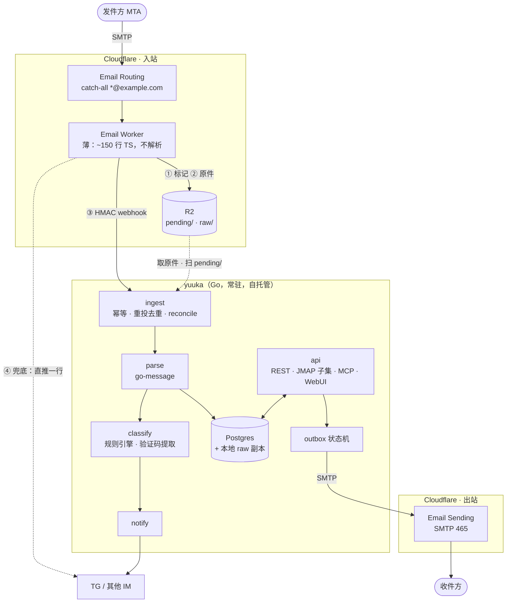
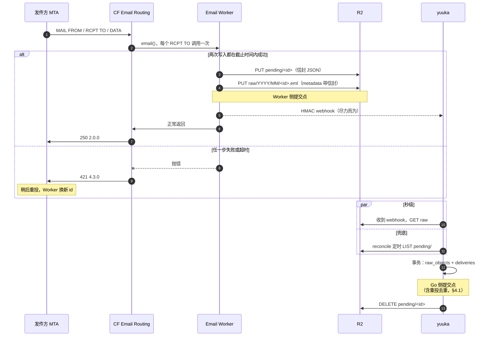

# 总体架构与设计原则

> yuuka 设计文档的一部分。节号沿用整份设计的全局编号，索引见 [docs/README.md](README.md)。

## 2. 总体架构



**Worker 为什么必须薄**：它是唯一不能用 Go 写的部分，所以把它压到"落盘 + 通知"
两件事，不放任何业务语义。MIME 解析只在 Go 侧有一份实现，WebUI、JMAP、
本地客户端看到的语义必然一致。

**为什么不用 Cloudflare Queues 当主通道**：R2 + `pending/` 标记已经是一个
可靠队列，且 R2 本身就是所需的归档层，少一个组件。webhook 只负责把延迟从
"下次 reconcile"降到"秒级"，丢了不影响正确性。以后量大再换 Queues 不动上层。

**不假设部署形态**：公网主机、反向代理之后、内网加隧道都应该能跑。
yuuka 对网络只有两个要求：ingest 端点能被 Worker 访问到，WebUI 能被运维者的浏览器访问到。
怎么做到（端口映射、反向代理、隧道）是部署的事；认证不靠它们，每个端点由 yuuka 自己认证（§13.7）。

### 2.1 收信提交协议

信封（`MAIL FROM` / `RCPT TO`）不在 `.eml` 里，而 catch-all 判前缀靠的正是 `RCPT TO`。
所以 Worker 落盘的不只是原件，还有信封。顺序是唯一的，不留备选：

1. **写 `pending/<id>`**：JSON，含 `id`、`envelope_from`、`envelope_to`、`received_at`、
   `raw_key`。写失败就抛错
2. **PUT `raw/YYYY/MM/<id>.eml`**：同一份信封再写进 R2 对象的 custom metadata，
   让原件自描述——即使标记丢了，只凭 raw 也能恢复投递事实。写失败就抛错
3. 发 HMAC webhook（尽力而为，失败不抛错）
4. 正常返回 = 向 Cloudflare 确认收下

**Worker 侧的提交点是第 2 步成功。** 之前任何一步失败都抛错，交给 Cloudflare 让发件方重投。
Worker 必须给自己设截止时间：R2 写入超过 60 秒就放弃并抛错。

**Go 侧的提交点**是一个事务：写 `raw_objects` + `deliveries`（信封从标记或 metadata 读）。
事务提交后才删除 `pending/<id>`。reconcile 按标记的状态处理：

| 标记 | raw | 处理 |
|---|---|---|
| 有 | 有 | 正常 ingest（幂等），提交后删标记 |
| 有 | 无，标记 < 15 分钟 | Worker 可能还在写，跳过 |
| 有 | 无，标记 ≥ 15 分钟 | Worker 在第 2 步失败并已抛错，这封由发件方重投、会换新 id。记一条 `orphan_marker` 事件后删标记；短时间内频繁出现就告警 |
| 无 | 有，库里没有 | 不应出现（标记只在入库后删）。每周一次全量扫 `raw/` 与 `raw_objects` 对账兜底，信封从 metadata 恢复 |

Email Worker 每次调用只有**一个** `RCPT TO`：同一封信发给同域两个前缀，
Worker 会被调用两次、产生两份 raw，由 §4.1 的折叠合并成一条 message、两条 delivery。

完整时序（Worker 侧失败走 421 重投，Go 侧由 webhook 或 reconcile 两条路之一触发）：



#### 2.1.1 实测：Worker 的结局如何变成 SMTP 应答

2026-10 在一个测试域上实测：直连 Cloudflare MX 投递，记录 DATA 结束时的应答。

| Worker 的结局 | 发件方收到 | 含义 |
|---|---|---|
| 正常返回 | `250 2.0.0 Ok` | 收下 |
| 同步抛错 / `await` 之后抛错 | `421 4.3.0 Upstream error` | **临时失败，发件方会重投** |
| `setReject(reason)` | `555 5.7.1 <reason>` | 永久失败，发件方退信 |
| 一直不返回 | 约 311 秒后 Worker 被取消，Cloudflare **再调用一次**；第二次也被取消后（约 622 秒）回 `421 4.3.0` | 已超过 RFC 5321 建议的 10 分钟 DATA 超时，多数发件方在此之前已自行超时、按临时失败重投 |

由此定下的规则：

- **失败就抛错，不需要 `forward()` 兜底**：抛错得到的是 421，发件方按标准会重投
- **永远不用 `setReject()`**：它让发件方退信，等于把信丢了。任何失败都应该是临时失败
- **截止时间是必需的**：不设的话，挂住的 R2 写入会让连接悬空十分钟，
  而且 Worker 可能在发件方放弃之后才写完，造成一份没人知道的重复。超时就抛错，换一个明确的 421
- **同一次投递可能跑两次 Worker**：被取消后 Cloudflare 会自行重试一次，第一次可能已经写了一半。
  Worker 的写入因此必须能承受重复——每次调用用新 id，重复由 Go 侧的重投去重收拾（§4.1）
- **一笔事务多个收件人时**，Worker 按 `RCPT TO` 各调用一次、并行执行，
  **任一调用抛错，整笔事务回 421**，发件方会对所有收件人重投——已经成功的那几路会收到第二份。
  所以重投去重不是边角情况，而是常规路径（§4.1）
- **新建的路由规则约 30–60 秒后才生效**，此前对该地址回 `550 5.1.1`（永久失败）。
  catch-all 规则建好后不再涉及；但给新域接入时，要先建规则、确认生效，再把 MX 指过来
- `wrangler email routing rules update … catch-all` 只接受 forward / drop；
  catch-all 指向 Worker 要在 wrangler 配置里声明 `addresses = ["*@<zone>"]`（Wrangler ≥ 4.113，只支持顶级域），
  或在 dashboard 设置

### 2.2 Worker ↔ Go 契约（v1）

这一节是 Worker 和 Go 之间唯一的约定，按单向门处理（AGENTS.md）：任何改动两侧在同一个提交里改，
并更新 `testdata/contract/v1/` 下的共享测试向量——两侧的测试读同一份向量，格式漂移会直接让测试失败。
`v` 字段让将来的格式可以和旧格式并存，而不是原地修改。

#### 标识与时间

- `id`：Worker 为**每次调用**生成的 ULID（26 位 Crockford base32，大写）。
  发件方重投、Cloudflare 的二次调用都会得到新 id（§2.1.1），所以 id 标识的是「一次 Worker 调用」，不是一封信
- 时间一律 UTC、RFC 3339、毫秒精度、以 `Z` 结尾，如 `2026-10-31T01:41:38.123Z`

#### 存储：两个 bucket

| bucket | key | 内容 | Worker 的权限 | Go 的权限 |
|---|---|---|---|---|
| raw | `raw/YYYY/MM/<id>.eml` | 原始 MIME 字节，写一次永不改 | 写（只在不存在时写） | **只读** |
| pending | `pending/<id>` | 投递标记 | 写 | 读、列、删 |

`YYYY/MM` 取 `received_at` 的 UTC 年月。分成两个 bucket，是因为 R2 令牌的权限粒度到 bucket 为止：
分开后 Go 侧凭据对原件只有读权限，「原件不可变」由权限保证，而不是靠 Go 代码自觉。
key 仍保留 `raw/`、`pending/` 前缀，文档、日志里的引用不用改，将来合回一个 bucket 也不必迁移 key。

#### 投递标记

UTF-8 编码的 JSON 对象：

| 字段 | 类型 | 说明 |
|---|---|---|
| `v` | 整数 | 固定为 `1` |
| `id` | 字符串 | 见上 |
| `received_at` | 字符串 | Worker 收到这次调用的时间 |
| `envelope_from` | 字符串 | `MAIL FROM`。值为空或 `<>` 时记空字符串；但 Cloudflare 不会给出这两种（见下方实测），退信不能靠它识别 |
| `envelope_to` | 字符串 | 这次调用对应的那一个 `RCPT TO` |
| `raw_key` | 字符串 | 原件在 raw bucket 里的 key |
| `raw_size` | 整数 | 实际写入的原件字节数（不取 `message.rawSize` 的声明值） |

- `v` 不认识就拒绝，不猜；认识的版本里出现未知字段则忽略——加字段不算破坏性变更，改字段含义才算
- 地址原样保存，不做大小写或 IDN 归一；可能含非 ASCII（SMTPUTF8）

#### 原件自带的 metadata

raw 对象带一个 custom metadata：`yuuka-marker` = 投递标记 JSON 的 **base64url（无填充）**。
整体编码一次，是因为 Go 侧经 S3 API 读 metadata：R2 会把非 ASCII 的值按 RFC 2047 编码后再交出来，
非 ASCII 的 key 则直接丢掉。编成纯 ASCII 后两条读取路径拿到的字节完全一样；
而且标记和 metadata 共用同一份 schema，不用为 metadata 另定一套字段规则。
单个对象的 metadata 上限是 8 KiB，标记最长不过几百字节。
标记丢了（§2.1 的对账表最后一行），只凭 raw 对象就能恢复全部投递事实。

#### webhook

```
POST <ingest-url>
Content-Type: application/json
Yuuka-Timestamp: <unix 秒>
Yuuka-Signature: v1=<HMAC-SHA256，小写十六进制>

<投递标记 JSON，与 pending/<id> 的内容逐字节相同>
```

- **签名输入**：`"v1:" + timestamp + ":" + body`，body 取原始字节，不重新序列化
- **密钥**：部署时生成的随机串（至少 32 字节），取其 UTF-8 字节作 HMAC key。
  Go 侧同时接受多把密钥，轮换时新旧并存一段时间
- **Go 侧校验顺序**：timestamp 与本地时钟相差不超过 300 秒 → 逐把密钥计算并做常数时间比较 →
  解析标记 → 按标记读 raw、入库
- **不维护 nonce**：窗口内重放一个合法请求，结果只是再触发一次幂等入库，没有副作用；
  为它引入一张 nonce 表不值得
- **应答**：`204` = 已入库或此前已入库；`4xx` = 请求本身有问题（签名、格式），Worker 只记日志；
  `5xx` 或超时 = 暂时失败，交给 reconcile。Worker 对任何应答都**不重试、不抛错**——
  webhook 只负责把延迟降到秒级，正确性由 reconcile 保证（§2）

#### Worker 的步骤

1. 生成 `id`，记 `received_at`；`message.from` 为空或为 `<>` 时 `envelope_from` 记空字符串
2. 把 `message.raw` 整个读进内存。R2 的 `put()` 要求流的长度已知，而入站上限是 25 MiB、
   Worker 内存是 128 MB，缓冲比 `FixedLengthStream` 简单，也不用信任 `rawSize` 的声明值
3. 写 `pending/<id>`
4. 写 raw 对象，带 `yuuka-marker`，并以 `onlyIf` 要求「key 不存在才写」；条件不满足时 `put()` 返回 `null`，
   视同失败。id 唯一，这道条件只防程序错误，不是常规路径
5. 第 3、4 步共享一个 **60 秒**截止时间（`Promise.race` 计时器——R2 的 `put()` 不能取消）；
   任一步失败或超时就抛错（§2.1.1 的 421 路径）。超时的写入之后可能仍然完成，
   留下一对完整的标记和原件：reconcile 会把它入库，发件方重投的那一份由重投去重合并（§4.1），不丢也不重复
6. 用 `ctx.waitUntil` 发 webhook，5 秒超时，结果只记日志。Cloudflare 要等 `waitUntil` 结束才回 SMTP `250`（见下方实测），
   所以这 5 秒直接加在发件方的等待上；Go 侧因此不把入库绑在请求上，Worker 放弃等待也不打断进行中的入库
7. 正常返回

Worker 运行在 Workers Paid 上（Email Sending 本来就要求它，§7）：入站处理计入 Workers 的 CPU 限额，
免费档每次 10 ms 的 CPU 不够缓冲一封大信。

**M0 实测结论**（2026-10，真实 bucket 与真实投递；文档都没写）：

| 问题 | 结论 | 影响 |
|---|---|---|
| 经 binding 的 `onlyIf`（`If-None-Match: *`）条件写是否原子 | 是。5 轮、每轮 8 个并发写同一 key，每轮恰好 1 个成功，其余 7 个返回 `null`，无报错 | 第 4 步的「不存在才写」可以依赖 |
| `MAIL FROM:<>` 时 `message.from` 是什么 | `postmaster@<HELO 域>`：Cloudflare 按 SPF 对 null sender 的约定（RFC 7208）替换了它 | Worker 拿不到 null sender，和真的 `postmaster@` 发件人无从区分。退信识别只能看内容（`multipart/report`，§10.4.2）。第 1 步的归一化无害，留给会给出空值的其他来源 |
| SMTP `250` 是否等 `waitUntil` 结束 | 等。webhook 目标睡 6 秒时，`250` 在约 6 秒后才到，Worker 日志里 webhook 在 5 秒超时 | webhook 的超时就是加给发件方的最大延迟，保持在几秒以内；Go 侧把入库从请求上下文中脱开（第 6 步） |

端到端也按设计跑通：单收件人、一笔事务两个收件人（两条投递、同一 `content_hash`）、
发件方重投（两份原件、一条投递、第二份 `duplicate_of` 第一份），webhook 不可达时全部由 reconcile 在一分钟内入库。

日志只记 `id`、`raw_size` 和步骤结果，**不记地址、主题或正文**：Worker 的日志在 Cloudflare 一侧，不归运维者管。


---

---

## 3. 八条设计原则

1. **原始 MIME 是邮件内容的唯一事实来源，不可变**
   `raw/YYYY/MM/<ulid>.eml` 写一次永不改。从内容派生的一切（解析结果、线程、附件索引、
   提取值）都能用 `reparse` 一条命令整库重放，解析器出 bug 不等于丢信息。
   但**人和系统做出的决定不是派生物**：标注、改判、前缀登记、规则、授权、
   投递事实与远端卸载状态。它们和派生数据分开存放、`reparse` 不碰、按正经数据库备份（§4.2）。

2. **`(域, 前缀)` 是维度，不是邮箱**
   不存在"创建邮箱"这个动作。每个 catch-all 域的 `*@<zone>` 全部接住，
   未见过的组合自动进 `prefixes(zone, prefix)` 表。全局单库 →
   跨域跨前缀搜索、统计、去重天然可做。

3. **前缀注册表 + 泄漏检测**（现成项目全都没有，但这是 catch-all 的真正价值）
   每个前缀登记"我把它给了谁"。当 `github@` 收到非 GitHub 发件域的信，
   或某前缀的发件域集合突然变化 → 标记"可能泄漏/被转卖"。
   这里要分清两个问题。**地址是否泄漏**不需要认证：任何意料之外的发件方都说明地址被别人知道了。
   **「自称是 X 的信到底是不是 X」**看的是收件人看到的信头 `From`，能证明它的只有
   可信接收方给出的 **DMARC** 结果（SPF 或 DKIM 通过且与 From 域对齐，§10.1.1）。
   所以 `observed_domains` 只记 DMARC 通过的 From 组织域，这样泄漏才能归因到具体一方；
   未验证的信照样计入泄漏信号，但不归因到任何域；自称是 `expected_domains` 却没过 DMARC 的，标为仿冒。
   SPF 单独证明不了 From：它验证的是信封 `MAIL FROM` 域或 HELO，转发还会让它失败。
   `ix64/spf` 的二次判定因此只是辅助信号——可信接收方没给 SPF 结果时补一个、给 agent 视图多一条证据，
   不参与 From 身份判断，也不覆盖可信接收方的结论。它的输入只从可信那一行 `Received` 里取，
   不齐时结果是 `none`；它依赖查询当时的 DNS，所以只在 ingest 时算一次、作为事实保存（§4.2）。
   前缀分两态：**claimed**（我认领过、给出去过）和 **discovered**（只是有人往这投过）。
   泄漏检测、TG 推送、聚合视图默认只看 claimed；discovered 主要是垃圾信字典攻击的产物，
   静默登记即可，认领是一个显式动作（§4.3、`prefixes.state`；M1 由 `yuuka prefix claim` 完成）。

4. **双区分流（machine / human）**
   `class` 字段 + 规则引擎，信号：`List-Unsubscribe`、`Auto-Submitted`、
   `Precedence: bulk`、`noreply` 类发件人、无 `In-Reply-To` 且命中验证码模式、
   前缀命名约定（`svc-*` / `gh-*`）。
   - 通知区：按前缀/服务聚合，自动提取验证码、magic link、过期时间，
     只读、可批量清理、推送到 TG；UI 重点是"一眼看到码"而不是读信。
   - 会话区：完整 MUA 语义——线程、引用、草稿、附件、多身份签名、可回复。
   分流错了可以一键改判并生成规则，规则是用户数据不是代码。

5. **不丢信**
   未知前缀照收；解析失败进 `quarantine` 并保留 raw；ingest 幂等
   （折叠键 `content_hash` + 同路径 raw sha256 去重，见 §4.1；Email Worker 可能重投）;
   Worker 侧只要 raw 写成功就算收下，自建服务离线数天也只是延迟入库。
   提交顺序、信封存放和 reconcile 规则见 §2.1，只有那一套，不留备选。
   「Worker 抛错 → Cloudflare 让发件方重投」是这条原则的基石。官方文档没有写，
   已实测确认：抛错得到 `421 4.3.0`，发件方会重投；`setReject()` 得到 `555`，发件方退信（§2.1.1）

6. **出口是状态机，不是 fire-and-forget**
   `outbox(held → queued → sending → sent | partial | unknown | failed(n) → dead)`，
   结果按收件人逐个记录（`outbox_recipients`），bounce/suppression 回写到收件人这一层。
   完整的状态转换见 §4.5。
   **只在确定对方没收下时重试**：连接、认证、`RCPT` 阶段失败或 4xx 可以退避重试；
   正文（`DATA`）已经发出但没等到最终回复，就是 `unknown`——不自动重试，
   先用出口的状态查询或退信事件对账，对不上再交给人决定。盲目重试的代价是对方收到两封。
   「确定」要有落库的证据：每次尝试在越过提交点之前先写 `committed_at`，
   进程崩溃后凡是写过它的尝试都进 `unknown`，不能凭库里的 `sending` 重排（§4.5）。
   部分收件人被拒是 `partial`：只对 4xx 的那几个收件人重试，已收下的不再发。身份层支持任意 `From` 前缀（Cloudflare Email
   Sending 是域级 onboard，所以 `任意@example.com` 都能发），签名/显示名按前缀配置。

7. **入口是多实例的 driver，不是一个管道**
   `ingest driver` 是接口，而且**从第一天起就有多个实例并存**：Cloudflare
   Email Worker（各 catch-all 域）、IMAP 拉取（Gmail / 工作邮箱）、
   将来可能的自建 MX。出口同理：SMTP 口是通用货币，`smtpTransport` 一个实现
   就覆盖 CF / Resend / SES / Gmail / 工作邮箱（§10）。上层不动。
   这条保证系统不被 Cloudflare 的 beta 功能和配额锁死。

8. **Agent 是一等公民，权限按身份分档**
   Agent 和人共用同一套领域 API、同一套鉴权、同一套审计，不开后门；
   能力分级由 API 层强制（见 §8），读随便读，标注可撤销，
   **外发按身份授权**：以自己的专属身份可以经自动审核或在限额内直接发出，
   以人的身份只能产生草稿（§8.9）。规则引擎没有发信身份，只做标注层动作（§8.5）。
   邮件正文永远按不可信输入对待。

---

---

## 5. Go 侧选型

| 用途 | 选择 | 备注 |
|---|---|---|
| MIME 解析 | `github.com/emersion/go-message` (+ `mail`) | 编码/多部分/inline 处理成熟；`enmime` 作为宽容兜底备选 |
| 发信 | `go-message` 组装 + `net/smtp` over TLS 465 | **MIME 自己组装，transport 只投递字节**；一个 smtp driver 覆盖 CF/Resend/SES/Gmail/工作邮箱，差别只是配置（§10.2）。不引第三方 SDK |
| **拉取**外部邮箱 | `go-imap/v2` client + IDLE，PLAIN 或 OAuth2(XOAUTH2) | M365 已关基础认证，必须 OAuth。Gmail 个人账户开两步验证后**仍可用 app password**，而 OAuth 同意屏在 Testing 模式下 refresh token 7 天过期、转正式又要应用审核——个人项目 Gmail 默认走 app password，OAuth 留给 M365。Gmail 以后可升级到 Gmail API（`history.list` 增量 + Pub/Sub push），增量比 IMAP 可靠 |
| 以后要真 IMAP（服务端） | `github.com/emersion/go-imap/v2` 的 server 侧 | **因为后端常驻，IMAP 永远是可加的一层，不依赖 CF 的私测功能** |
| JMAP | 自己实现子集 | 见下 |
| HTTP | `net/http` + `chi`/标准库 | 不需要重框架 |
| DB | `pgx` + 手写 SQL（或 sqlc） | 邮件查询形状怪，ORM 吃亏 |
| 前端 | 任选，产物 `embed` 进二进制 | 单文件部署 |
| SPF | `ix64/spf` | 同作者的既有库，直接复用 |
| WebAuthn（passkey 登录，§13.7） | `github.com/go-webauthn/webauthn` | duo-labs/webauthn 的延续，Go 里事实上的标准实现。自己写要带上 CBOR、COSE 密钥、authenticator data、各种 attestation 格式和 origin / RP ID 校验，上千行且全是安全关键代码。只用它的校验部分：仪式状态、存储、会话都在 yuuka 自己手里，换库不动表结构（§13.3） |
| CSRF | 标准库 `http.CrossOriginProtection` | Go 1.25 起自带，不需要 token 型 CSRF 库 |
| 旧字符集解码 | `golang.org/x/text` | 通知里的主题常是 GB2312/GBK 等旧编码，标准库的 `mime.WordDecoder` 只认 UTF-8 和 ISO-8859-1；pgx 本来就间接依赖它 |
| R2（S3 API） | `aws-sdk-go-v2/service/s3` | Cloudflare 自己的 Go 示例用它，依赖全在 aws/smithy 内。**`RequestChecksumCalculation` 与 `ResponseChecksumValidation` 都设为 `WhenRequired`**：SDK 自 2025 年起默认附带的校验和 R2 不完全支持。R2 的 LIST 与 PUT/DELETE 强一致，reconcile 可以直接依赖列表结果 |

**关于 JMAP 要诚实说一句**：JMAP 客户端生态非常薄（Fastmail 自家客户端、
ltt.rs 等，Thunderbird / aerc / iOS Mail 都不支持）。所以"JMAP 就行"实际等于
"我自己写客户端或用 PWA"。建议的落法：
- 内部 API 自己定（REST，贴着 UI 需求走，不受 JMAP 束缚）
- 对外暴露 **JMAP 子集**：`Core/echo`、`Mailbox/get`、`Email/query`、`Email/get`、
  `Email/set`、`EmailSubmission/set`、`Email/queryChanges`（增量同步）
- 真的想用 Thunderbird/iOS Mail 的那天，加 `go-imap` 网关，一两周的活，
  后端模型已经就绪

---
