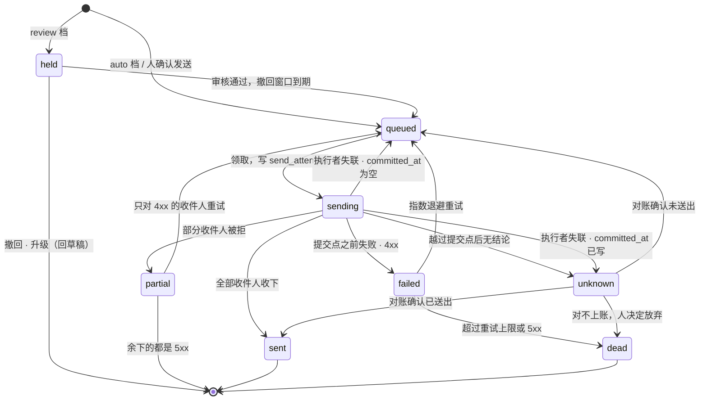

# 数据模型

> yuuka 设计文档的一部分。节号沿用整份设计的全局编号，索引见 [docs/README.md](README.md)。

## 4. 数据模型（Postgres）

一封信在模型里拆成**内容**和**投递**两层——因为同一封信可能同时落到
`a@example.com`、`b@另一个域` 和 Gmail（CC 或多地址投递），内容只该存一份。

已经建好的表，列、约束和索引以迁移为准：[`internal/store/migrations/`](../internal/store/migrations/)。
这里只说每张表做什么、属于 §4.2 的哪一类：

| 表 | 类别（§4.2） | 做什么 | 迁移 |
|---|---|---|---|
| `raw_objects` | 投递事实 | 原件存储里的每个对象一行，带 `sha256` 和 `content_hash`（§4.1）；发件方重投的那份照样落盘，用 `duplicate_of` 指向第一份，不再生成 delivery | [0001](../internal/store/migrations/0001_ingest.sql) |
| `deliveries` | 投递事实；只有 `message_id`、`auth` 两列是派生 | 每次投递一行：信封、`(zone, prefix)`、这一路自己的原件（Received / ARC / DKIM 每一路都不同）和认证结果。投递是 ingest 记下的事实，不是从 MIME 派生的：信封、远端定位、卸载状态都不在原件里。`source_key` 是幂等键（§10.1） | [0001](../internal/store/migrations/0001_ingest.sql) |
| `messages` | 派生（id 除外，id 跨 reparse 稳定） | 内容，按 `content_hash` 折叠；隔离状态 `parse_error` 也在这一层（§4.2） | [0002](../internal/store/migrations/0002_content.sql) |
| `threads` | 派生 | 消息图的连通分量（§4.1）。reparse 整体重建，旧 id 能沿用就沿用，但不像 message id 那样承诺稳定 | [0002](../internal/store/migrations/0002_content.sql) |
| `message_state` | 决定 | 人对一封信的标注、改判（`class_override`）、钉住（§9.6 卸载跳过）；本地标注层，远端永不覆盖（§9.2） | [0002](../internal/store/migrations/0002_content.sql) |
| `message_aliases` | 决定 | 折叠算法换版本后被合并掉的旧 id 指向存活的 id，`yuuka://` 锚点和外键引用因此不失效 | [0002](../internal/store/migrations/0002_content.sql) |
| `prefixes` | 决定；`first_seen` / `last_seen` 是观测值 | `(zone, prefix)` 注册表：我把它给了谁、实际谁在发、claimed / discovered 两态（§3.3、§4.3） | [0002](../internal/store/migrations/0002_content.sql)、[0004](../internal/store/migrations/0004_prefix_claim.sql) |
| `changes` | 日志 | 全局变更日志：§8.6 的 `since_state`、JMAP `queryChanges`、前端 SSE 共用。M1 建表就开始写 | [0002](../internal/store/migrations/0002_content.sql) |
| `principals` `credentials` `passkeys` `enrollment_tokens` `recovery_codes` | 配置与授权 | 主体、凭据、WebUI 登录（§13.2、§13.3、§13.7） | [0003](../internal/store/migrations/0003_identity.sql) |
| `identity_grants` `account_access` | 配置与授权 | 谁能以哪个身份发信、发到哪一步（§13.5）；谁能读哪个账户（§13.8）。M1 只建表 | [0003](../internal/store/migrations/0003_identity.sql) |
| `actions` | 决定 | 审计日志（§8.8） | [0003](../internal/store/migrations/0003_identity.sql) |

`deliveries.auth` 的结构由 [`internal/authres`](../internal/authres/authres.go) 的 `Auth` 定义，只来自可信接收方（§10.1.1）。
迁移里与本节设计不同的地方都以 `M0:` / `M1:` 注明，主要是两类：

- 还没有 `accounts` 表。`deliveries` 暂用 `account_key`（进程配置的账户名）代替 `account_id → accounts`，
  幂等约束暂为 `(account_key, source_key)`；`identity_grants.identity_id`、`account_access.account_id`
  暂不带外键。建 `accounts` / `identities` 的迁移按注释里写好的步骤收口
- 有几列已建、暂不写：`messages.spam_score`（§4.3 的降级现算）、`messages.body_html_key`、
  `deliveries.spf_recheck`（二次 SPF 判定还没接）、`prefixes.observed_domains`（随泄漏检测，M3）

**数据库角色**：部署时 yuuka 用两个非超级用户角色连库（建法见 [`deploy/postgres-roles.sh`](../deploy/postgres-roles.sh)，
接线见 [`cmd/yuuka/db.go`](../cmd/yuuka/db.go)）：owner 拥有库和 schema、只用来在启动时跑迁移；
app 只有表上的增删改查和序列的 `USAGE`（经 `ALTER DEFAULT PRIVILEGES`，以后迁移建的表自动覆盖），
没有任何 DDL。运行时的一切查询都以 app 身份执行，所以一条被请求影响的 SQL 最多改行，
改不了表结构、删不了表、也碰不到别的库。`pg_trgm` 是 trusted 扩展，库的 owner 就能装，不需要超级用户。
放弃的东西：`serve` 启动时要迁移，所以进程环境里仍有 owner 的连接串，拿到进程环境的人照样拿到 owner；
真正隔开要把迁移挪到单独的一次性步骤，那需要一个迁移子命令，目前不值得为它新增 CLI 面。
另一个小缺口：`schema_migrations` 也是 owner 建的表，app 能改它的行，后果是迁移重放失败、
`serve` 拒绝启动，不会丢数据。不设 owner 连接串时一个角色兼做两件事，开发和测试都这样跑；
测试夹具则按部署的形状给每个测试建 schema（[`storetest`](../internal/store/storetest/storetest.go)），
所以整个测试集都在 app 角色下跑过一遍。

尚未实现的表和列（设计）：

```sql
-- 账户 / 身份 / 传输（多账户整合的地基，见 §9）
accounts(id, kind, label, auth_ref, sync_policy, writeback_policy, offload_policy, active)
  -- kind: cf_catchall | imap | gmail_api | smtp_only
  -- sync_policy: full(存原件) | metadata(只索引,正文按需) | notify(只通知)
  -- offload_policy: off | after(...)，归档卸载（§9.6），仅 sync_policy=full 可开
identities(id, address|pattern, zone, display_name, signature, transport_id, is_default,
           owner_id → principals)   -- 身份归属：决定 agent 外发档位的硬上限（§8.9）
transports(id, kind, config_ref)   -- cf_smtp | gmail_smtp | m365 | ...
zones(zone pk, account_id, catchall bool, sending_onboarded bool)

-- deliveries 上还没加的列：账户外键，以及拉取与卸载的事实（§9.6、§10.1）
deliveries(
  account_id → accounts,             -- 取代 account_key；幂等约束改为 unique(account_id, source_key)
  delivered_to text[],
  remote_labels text[], remote_flags bitmask,
  remote_state smallint,             -- present | offloaded（远端已按 §9.6 删除，本地是唯一副本）
  offloaded_at timestamptz
)
  -- message_id 可空的另一个原因：notify 策略只留幂等桩，不建 message（§4.4、§10.1）

attachments(id ulid pk, message_id, filename, mime, size, sha256, content_id, disposition, blob_key)
extractions(message_id, kind(otp|link|expiry|amount), value, confidence)  -- 通知区用
rules(id, priority, match jsonb, actions jsonb, enabled, proposal_id)     -- 分流/标签/推送；actions 封顶在标注层（§8.5）
drafts(id ulid pk, principal_id → principals, identity_id → identities, thread_id, in_reply_to,
       to_addrs, subject, body_md, attachments jsonb, proposal_id,
       cites jsonb,                  -- [{uri, quote}] 引用了哪些入站内容（§8.1 锚点），§8.9 外泄检查的输入
       hold_reason text,             -- 提交后为什么停在草稿：档位 / 限额 / 审核升级
       updated_at)
  -- 提交时按 identity_grants.send_policy 决定去向：留在这里等人，或生成 outbox 记录（§8.9）
outbox(id ulid pk, state, next_retry_at,
       -- state: held → queued → sending → sent | partial | unknown | failed(n) → dead
       --   held 只出现在 review 档；unknown 是「越过提交点后没拿到结论」，不自动重试（§3 原则 6、§4.5）
       --   failed(n) 的 n 是 send_attempts 的条数，不另存计数
       identity_id → identities,     -- 路由由 identity 决定（§9.3），调用方选不了 transport
       submitted_by → principals,    -- 谁起的这封信 / 哪个服务从 submission 口投进来（§13.6）
       approved_by → principals,     -- 哪个人按了发送；按策略放行时是 system
       review jsonb, hold_until,     -- §8.9 每项检查的结论；撤回窗口截止时间
       draft_id → drafts, from_addr, raw_key,   -- raw_key 是我们提交的字节，不含平台加的头（§10.4.1）
       verp_tag text,                -- Return-Path 本地部分嵌的 id，DSN 回流靠它对账；出口不允许时为空（§10.4.2）
       error)

-- 每一次发送尝试：谁在执行、走到了哪一步。崩溃恢复只看这张表（§4.5）
send_attempts(id ulid pk, outbox_id → outbox,
              recipients text[],      -- 这次投给谁；partial 之后的重试只含 4xx 的那几个
              transport text,         -- 实际走的出口（传输链里的哪一个，§9.3）
              owner text, lease_until timestamptz,  -- 执行归属：哪个执行者、租约到何时，执行期间续租
              started_at timestamptz,
              committed_at timestamptz,  -- 越过不可回头点之前写下并提交；为空 = 可证明对方没收到正文
              finished_at timestamptz,
              outcome smallint,       -- accepted | partial | rejected | failed | unknown | abandoned
              provider_id text,       -- 出口给的投递 id，unknown 对账用
              message_id text,        -- 出口实际用的 Message-ID；平台生成时每次尝试都可能不同，线程匹配认全部（§10.4.1）
              error)

-- 逐收件人的结果：部分收件人被拒、退信、投诉都落在这一层
outbox_recipients(outbox_id → outbox, addr, kind(to|cc|bcc),
                  state,              -- pending | accepted | rejected | deferred | unknown | bounced | complained
                  last_attempt_id → send_attempts,
                  smtp_code, detail, updated_at,
                  primary key(outbox_id, addr))
notifications(id, message_id, channel, state, sent_at)
```

全文检索：Postgres 原生 FTS 对中文很弱。先用 `pg_trgm` 够个人用量，
中文体验不行再上 PGroonga 或外置 bleve 索引（这是可替换的一层，不影响模型）。
M1 做的是子串匹配：一个 trigram GIN 表达式索引（迁移 0002 的 `messages_search`），
查询按空白切词、每个词都要命中（[`internal/store/search.go`](../internal/store/search.go)）。
子串匹配不需要分词，中文天然可用；少于三个字符的词用不上 trigram 索引，退化为顺序扫描，
结果仍然正确，个人量级可以接受。`body_text` 有长度上限：它只服务检索和摘要，原件才是正文的来源。

### 4.1 折叠键：内容哈希，不是 Message-ID

catch-all 意味着**任何人都能往任意前缀投递**，所以 Message-ID 不能做折叠键：
攻击者投一封 Message-ID 与已有邮件相同的信，就会被折叠进旧 message，新内容在索引层消失
（raw 还在，但 UI 看不到）；另外大量垃圾信没有 Message-ID 或反复重用同一个。因此：

- 折叠键是 `content_hash`：对去掉传输头（每一跳、每次投递都会加或改写的字段，
  v1 的剔除列表见 [`internal/contenthash`](../internal/contenthash/contenthash.go)）后的原件字节取 SHA-256。
  它只保证一个方向：**内容不同，哈希必然不同**，所以不会误合并。
  反方向只是「通常相同」：转发和邮件列表会改 Subject 或追加页脚，中继可能把 8bit 重编码成
  quoted-printable，这些都会让同一封信算出不同的哈希。**哈希不同就不合并**——
  代价是同一封信显示两次（它们仍按 Message-ID 进同一条线程），比误合并吞掉内容便宜得多。
  不改成对解码后内容取哈希：那会让折叠键依赖解析器版本，解析器一升级折叠结果就变
- **Message-ID 不进折叠键**。`Message-ID` 头不在剥离之列，`content_hash` 相同就意味着
  Message-ID 相同，再加一列是冗余；缺失时也不必合成一个。Message-ID 只用于线程
- **`content_hash` 是原件的字节属性**，和 `sha256` 并列存在 `raw_objects` 上，ingest 时算一次。
  算法只按 RFC 5322 的字段边界（含折行）切分头部、按字段名剔除，不解析 MIME，不依赖解析器版本。
  所以 M0 没有解析也能用它去重，reparse 也不会改变折叠结果。
  算法定为 v1，用 golden 测试锁住；将来要改剔除列表就是 v2，只对新入库的原件生效，旧行不重算——
  最坏的结果是同一封信显示两次
- **raw 的 sha256 不唯一**：原件存储里的每个对象都有自己的一行，哪怕另一次 Worker 调用存下了
  一模一样的字节。同一个对象被 webhook 和 reconcile 各处理一次，撞的是 `id`；
  是不是一次新的投递，由下面 `deliveries.source_key` 的唯一约束决定。
  若 sha256 唯一，两个收件人恰好拿到字节相同的原件时，第二个收件人的投递会被静默丢掉。
  sha256 也认不出发件方重投：Cloudflare 每次接收都加一行带新事务 id 和时间戳的
  `Received`，重投的原件 sha256 必然不同（§2.1.1 实测）。跨路径折叠同理也不能靠它
- **重投去重由唯一约束保证，不是先查后插**。push 来源（Cloudflare Worker 等）的
  `deliveries.source_key` 由 `content_hash` 和 `envelope_to` 拼成（`store.PushSourceKey`），同一账户内唯一（§10.1）。
  重投的第二份在插入 delivery 时撞键：原件照样落盘（不可变、可审计），
  `raw_objects.duplicate_of` 指向第一份，不生成新的 delivery——和第一份的写入在同一个事务里，
  webhook 与 reconcile 并发处理同一封信的两份也不会各建一条。
  多收件人事务里一路失败就会让其余各路重投（§2.1.1），所以这是常规路径。
  代价是同一封信被有意投递两次到同一地址时也会被合并，可以接受。
  pull 来源不这样做：远端的两份是两个对象（比如同一封信在两个文件夹里），
  各自要有自己的定位才能回写和卸载，所以各是一条 delivery，只在 `messages` 层折叠
- §1 沿用的 `subject + sender` 兜底线程匹配**只对 `class=human` 启用**：
  机器邮件里同一发件人的所有「Your verification code」会被它归成一条巨型线程。
  M1 只在新信是 human、自己没有 `In-Reply-To` / `References` 时才找，而且限一个时间窗口，
  具体规则见 [`internal/store/threads.go`](../internal/store/threads.go)。
  「sender」目前只是发件人本人：入库的只有收信，线程参与者只有发件人。
  M2 发出的信进 `messages` 后，要把它放宽成「线程的通信对方」，§10.4.1 断开的第一封才接得上
- 线程是消息图的连通分量：Message-ID / In-Reply-To / References 互相指到的、Message-ID 相同的
  （内容没折叠的同一封信），加上面的兜底边。ingest 逐封并入（一封信连通两条线程时合并成较早的那条），
  reparse 整体重算，两者规则相同，所以内容不变时 reparse 不移动任何线程

### 4.2 重建边界：reparse 重建什么、不碰什么

§3 原则 1 说的「可重建」只覆盖从邮件内容派生的东西。边界按表划清；
唯一的混合表是 `deliveries`，它的派生列只有 `message_id` 和 `auth` 两列，reparse 只写这两列
（拆成单独一张表会让最常用的「信 → 投递」查询多一次 join，不值得）：

| | 表 | reparse |
|---|---|---|
| **派生** | `messages`（除 id 外的列）、`threads`、`attachments`、`extractions`、`deliveries.message_id`、`deliveries.auth` | 从 `deliveries.raw_id → raw_objects` 和账户配置重算 |
| **投递事实** | `raw_objects`（含 `content_hash`、`duplicate_of`）；`deliveries` 的其余列（`source_key`、信封、远端定位、`remote_state`、`offloaded_at`、`spf_recheck`） | 不碰。它们来自 ingest 当时的 `InboundRef` 和当时的外部状态 |
| **决定** | `message_state`、`message_aliases`、`prefixes`（label / note / expected_domains / state）、`rules`、`proposals`、`actions`、`drafts`、`outbox`、`notifications` | 不碰 |
| **配置与授权** | `principals` / `credentials` / `identity_grants` / `account_access`（§13）、`accounts` / `identities` / `transports` / `zones` | 不碰 |

后三类**无法从原件重建**，备份要按正经数据库来（§7）。CF 来源的投递事实能从 R2 对象的
metadata 恢复（§2.1），但外部账户的远端定位和卸载状态只在库里，同样要靠备份。

判断一列是派生还是事实，标准是**同样的输入、任何时候重算都得到同样的结果**。
只读原件和本地配置的计算是派生；查了外部状态的不是——二次 SPF 查的是当时的 DNS，
过半年重算回答的是另一个问题，所以 `spf_recheck` 是事实。`content_hash` 虽然可以从原件重算，
但它是 ingest 当时做重投去重决定的依据，算法版本冻结在行上，和 `sha256` 一样归入事实。

`reparse` 的几条规则：

- **message id 跨 reparse 稳定**。重算按现有 id 原地更新。折叠键不随解析器变化（§4.1），
  所以 reparse 本身不会合并或拆分 message；只有换算法版本后显式对旧原件重算 `content_hash` 才会，
  那时保留较早的 id，被合并的写进 `message_aliases`。
  否则 `message_state`、`proposals.cites`、`actions` 和人手里的 `yuuka://` 链接全部失效
- 段落锚点 `#part/2/para/7` 依赖解析器的分段方式，可能随 `parser_version` 漂移。
  所以 `cites` 同时存锚点和一小段原文摘录，锚点对不上时按摘录重新定位
- 生效的分类是 `coalesce(message_state.class_override, messages.class)`：
  人的改判永远压过重算结果，规则重跑也不会把它改回去
- `yuuka reparse [--since T]` 先补跑没有 message 的投递（M0 入库的、或解析步骤失败的），
  再按 id 原地重写 `received_at ≥ T` 的消息和它们每条投递的 `auth`，最后全库重建线程——
  改了 Message-ID 或 References 的信可能挪到任何一条线程里，只重建局部会留下错的连通分量。
  它不写 `message_state`、`message_aliases`、前缀的认领与标注；`prefixes` 只会补上缺的行、放宽观测区间。
  隔离状态（`parse_error`）是派生的：换了更好的解析器，reparse 会把它清掉。
  所以它放在 `messages` 上，而不是 `raw_objects.ingest_state`——`raw_objects` 是 reparse 不碰的事实

### 4.3 垃圾判定要有来源

一个 catch-all 域每天会收到成百上千随机前缀的字典攻击。没有垃圾判定，
§3.5「未知前缀照收并自动登记」会让 `prefixes` 被淹没、TG 每封都响、泄漏检测的基线全是噪声。
Cloudflare Email Routing 基本不做内容过滤，`spam_score` 字段必须有人填：

- M1 最低实现：`dmarc=fail`、或 `prefixes.state=discovered`（§3.3）→ 直接降级，
  不推送、不进聚合视图、不参与泄漏基线，只静默入库。
  降级按投递判断，一封信只要有一条投递不降级（前缀已认领、可信接收方没报 `dmarc=fail`）就不降级。
  它**不存储**，查询时由 `deliveries.auth` 和 `prefixes.state` 现算：认领一个前缀立刻生效，
  不必 reparse；`spam_score` 因此在 M1 恒为空。未验证（取不到可信认证头）不算 `dmarc=fail`，不降级。
  推送只在 ingest 当场判断：这条投递不降级、且同一封信没有更早的不降级投递时推一次；
  解析步骤失败、或由补跑（backlog）处理的投递一律不推——前者判断不了降级，后者已经不是新信
- 认领与取消认领（M1 只有 CLI：`yuuka prefix claim` / `unclaim`，§11）只改 `prefixes.state`，
  记一条 `actions`、一条 `changes`（kind `prefix`），并和 ingest 的内容步骤持同一把锁，
  所以一次投递看到的要么是认领前、要么是认领后的状态。地址的大小写按 ingest 的规则折叠。
  因为降级现算，已有的信立刻不再降级；推送只对认领之后到达的信生效，不补推旧信——
  补推会让一次认领在 TG 上炸出一串历史邮件。
  地址往往在给出去时就认领，那时还没收到过信：这样的前缀照样建行，`first_seen` / `last_seen` 为空，
  第一封信到达时由 ingest 填上（`least` / `greatest` 跳过 NULL），而不是把认领时刻冒充成观测值。
  对还没收到过信的前缀取消认领会删掉这一行：一个从未被投递、也没人认领的前缀不描述任何事实
- Cloudflare 入站会加 `X-CF-SpamH-Score: <n>`（§10.1.1 实测）。刻度没有文档，
  先原样记进 `deliveries.auth`、作为一个信号，积累样本后再决定阈值
- 需要更强判定时旁路 rspamd（标准协议，ingest 多一步调用），不影响模型

### 4.4 只有头部的信

`sync_policy=metadata` 的账户只落头部（§9.2、§10.1）。这带来三个存储层的问题：

**建消息**：`raw_objects.completeness = header_only`，照常建 `messages` 行，
但 `content_hash` 为空、`body_text` 为空、`has_attach` 按 `Content-Type` 推断。
`content_hash` 为空的行**不参与跨账户折叠**：只凭头部无法证明两份是同一内容，
而 §4.1 的方向是宁可重复、不可误合并。它们仍按 Message-ID / References 进同一条线程，
UI 上就是线程里并列的两条，其中一条标「正文未同步」。

**按需取正文**：`FetchBody` 的结果是流，只存在于这一次响应里：

- 不写 RawStore、不写 `messages.body_text`、不进全文索引
- HTTP 响应带 `Cache-Control: no-store`；前端不写入 IndexedDB（§12.4）
- `actions` 记下「谁、在什么时候、取了哪条投递的正文」，`result` 只记大小和 sha256，**不记内容**
- agent 取正文要有该账户的 `account_access`，并按 §9.4 计为一次外部请求

**补全**：账户从 `metadata` 改成 `full` 时，后台任务按投递重新拉取完整原件，
写一份新的 `raw_objects`（`completeness=full`），把 `deliveries.raw_id` 指过去，
再对这条投递跑 reparse——新原件 ingest 时算出了 `content_hash`，这条投递可以正常折叠。
旧的 header_only 原件保留（原件不可变），只是不再被引用。

`notify` 策略的账户不走这里：它不建 `messages`，只有 `deliveries` 的幂等桩和 `notifications`。

### 4.5 outbox 状态机

`outbox.state` 的全部转换（规则见 §3 原则 6，`held` 的来历见 §8.9）。
退信和投诉不改变这里的状态，它们落在 `outbox_recipients` 上，逐个收件人记录：



#### 提交点、执行归属与崩溃恢复

「只在确定对方没收下时重试」要靠落库的证据，而不是靠进程还活着。`sending` 本身不是证据：
进程可能在对方回 `250` 之后、写下结果之前退出，库里只剩 `sending`。
直接重排会让对方收到两封，不处理又会永远卡住。所以每次发送都先在 `send_attempts` 里记一笔：

1. **领取**：`queued → sending` 和插入一条 `send_attempts`（`owner`、`lease_until`）在同一个事务里。
   执行期间定期续租
2. **提交点**：transport 在越过不可回头点之前回调 `commit`（§10.2），
   调用方在回调里写 `committed_at` 并**提交事务**，回调返回后 transport 才继续。
   不可回头点由出口定义：SMTP 是发出正文结束符 `<CRLF>.<CRLF>`（在此之前断开，服务器会丢弃这封）；
   API 出口是发出请求。回调失败（比如库连不上）时 transport 放弃、什么都不发出
3. **结果**：写 `finished_at`、`outcome` 和逐收件人结果，同时推进 `outbox.state`

恢复任务在启动时和之后定期运行，处理租约已过期、`finished_at` 仍为空的尝试：

- `committed_at` 为空：可以证明对方没收到正文。尝试记为 `abandoned`，收件人保持 `pending`，
  outbox 回 `queued` 按正常退避重试
- `committed_at` 已写：**不能证明没送出，一律进 `unknown`**，这次尝试的收件人也记为 `unknown`。
  不自动重排，和运行中 `Send()` 返回 `Unknown` 走同一条对账路径

这条规则只依赖「写 `committed_at` 先于越过提交点」这一个顺序，所以它也覆盖执行者没死、
只是卡住超过租约的情况。卡住的执行者之后带着结论回来时，结果只写进它自己那条尝试（按尝试 id 定位），
作为对账证据把 `unknown` 推到 `sent` / `partial` / `failed`；它不能再领取别的尝试。
误判的方向只有一个：在 `commit` 之后、真正发出之前崩溃，会把一封没发出的信记成 `unknown`——
多问人一次，不会多发一封。

`unknown` 的对账按出口能力取证：有 `provider_id` 且 `StatusQuery=true` 就查状态；
有 VERP 的出口等 DSN（§10.4.2）；能自定 Message-ID 的出口可以按自己的 id 在出口日志里找。
崩溃造成的 `unknown` 往往连 `provider_id` 都没拿到，这时交给人：UI 标「可能已发出」，
人选择「确认已送出」「接受可能重复，重发」或「放弃」，选择记入 `actions`。

---

---

### 9.1 内容 / 投递两层模型（§4 已改）

同一封信同时落到 `x@example.com` 和 Gmail（CC、多地址、转发链）是常态。所以：

- `messages` 存**内容**，按 `content_hash` 跨账户折叠成一条（§4.1）
- `deliveries` 存**每次投递**：哪个账户、哪个域、哪个前缀、IMAP UID、
  那边的 folder/label、那边的已读状态，以及**这一路自己的原件和认证结果**
  （`raw_id` / `auth`——两条投递的 Received、ARC、DKIM 验签各不相同，不能只留一份）

好处：
- 收件箱里一封信就是一封信，不是三条重复
- 但"它是通过哪个前缀/账户来的"完整保留 → 前缀泄漏检测（§3.3）照样成立
- 幂等键是 `(account_id, source_key)`（§10.1），重复拉取、重投都不产生重复投递

跨账户线程归并：按 `Message-ID / In-Reply-To / References` 构图，
**线程不属于任何账户**。一条线程里前半在 Gmail、后半在自有域的情况能正确拼起来。
