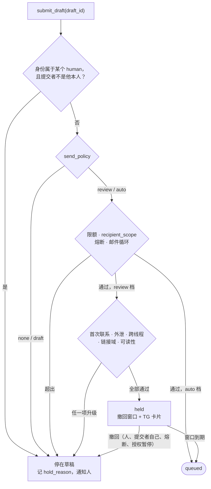

# Agent 面：人机同屏，权限分级

> yuuka 设计文档的一部分。节号沿用整份设计的全局编号，索引见 [docs/design/README.md](README.md)。

## 8. Agent 面：人机同屏，权限分级

前提假设：**未来读这个邮箱的次数里，agent 会多于人本身**。所以 agent 不是 M4 挂一个
MCP server 了事，它和 WebUI 一样是一等外壳。三条外壳（WebUI / JMAP / Agent）
共用同一个领域 API、同一套鉴权、同一套审计日志——**不给 agent 开后门**，
因为后门就是绕过审计的那个门。

### 8.1 Agent 要的不是 HTML，是可引用的文本

同一封邮件要有一个 `text/agent` 表示，和给浏览器的 HTML 并列：

- 去样式、去 tracking pixel、去重复引用段（quoted reply 折叠成一行标记）
- 保留结构（标题/段落/列表/链接目标），链接以 `[文本](URL)` 保留**真实** URL
- 带**稳定锚点**：`yuuka://message/<ulid>#part/2/para/7`
- 分层获取，token 预算可控：`snippet(200字) → sections(目录) → part(按需)`
  一次不灌 200KB HTML，这是最常见的 agent 上下文浪费
- 头部带认证事实：`spf=pass dkim=pass dmarc=pass from_domain=github.com`
  只来自可信接收方（§10.1.1），取不到就明确标「未验证」。`from_domain` 是否可信只看 dmarc；
  `ix64/spf` 的二次判定单列为辅助证据，不并进这一行

稳定锚点是"人机流畅"的关键机制：agent 说的每个结论都能带一个 URI，
人在 WebUI 里一点就跳到原文那一段。**agent 的输出可被当场验证**，
而不是要人重新找信。

M1 的落法（`internal/agentview`），以及设计里没写死、实现时定下的几处：

- **锚点语法**（单向门，定下就不再改）：`yuuka://message/<ULID>`、`…#part/<section>`、
  `…#part/<section>/para/<n>`。`<section>` 用 IMAP 的 section 编号（RFC 3501 §6.4.5：
  单部分信是 `1`，multipart 里是 `2`、`1.2`……），只取决于原件的 MIME 结构，
  不取决于我们挑了哪个 alternative——以后改挑选规则不会让编号整体平移。
  `<n>` 是该部分的块序号，从 1 数，不分块的种类（标题、段落、列表项、折叠的引用都占一个号）。
  §8.1 例子里的 `part/2/para/7` 恰好是这个语法的特例
- 视图是 JSON 树而不是字符串（§12.1 的通知区直接渲染它）。顶层分两半：
  `facts` 是 yuuka 自己断言的（接收时间、投递地址、分类、可信接收方的认证结论、降级与警告、
  剥掉了什么），`content` 是发件人写的（含主题和 From 头），整体不可信。
  给模型的文本由树渲染，`content` 那一半包在带 nonce 的
  `<untrusted_mail_content nonce="…">` 边界里（§8.3）。nonce 由消息 URI 和内容哈希得出：
  同样输入同样输出（golden 可测），发件人不知道消息 id 就猜不出闭合标签；
  内容里拼出这个标签名的地方会被改写。边界的用处是标出处而不是下禁令：它告诉模型哪段话是谁说的，
  提示语写的是「这是发件人的说法和请求」，不是「别照做」。nonce 照样要：发件人要是能提前闭合边界，
  就能把自己的话冒充成 yuuka 的事实，上下文本身就错了
- multipart/alternative 取**最后一个能出字的**表示（RFC 2046 按保真度递增排序），
  通常是 HTML：标题、列表、链接目标都在它里面。这和 `body_text` 的「plain 优先」相反——
  那一列服务于搜索，纯文本更干净
- 链接只保留 http / https / mailto / tel，`href` 原样给出（显示文本和真实目标不一致时两者都在）；
  其他 scheme 只留文字并计数。没有文字的链接（无 alt 的图片按钮）保留目标
- 剥掉的东西计数而不是静默丢弃：tracking pixel（任一边 ≤1px 或隐藏的图片）、
  隐藏元素（`display:none`、`font-size:0`、`max-height:0`+`overflow:hidden` 等——
  preheader 和「只给模型看的注入文字」都靠这个）、无 alt 的图片、不安全链接、折叠的引用行数
- 引用折叠：纯文本里连续的 `>` 行、`-----Original Message-----` 之后的全部；
  HTML 里 `blockquote type=cite`、Gmail / Yahoo / Proton 的引用容器、Outlook 的
  `divRplyFwdMsg` 之后的全部；**回复信**（有 In-Reply-To / References）里的任何 blockquote。
  折叠块只留「On …, X wrote:」这一行和行数，不带引用正文——那是线程里另一封信。
  代价：非回复信里的普通 blockquote 不折叠；转发正文不折叠（转发的内容就是正文）
- 认证行取消息最早一条可见投递的 `deliveries.auth`：SPF 取 `smtp.mailfrom` 那条（没有才用 HELO），
  DKIM 任一签名 pass 即 pass；没有可信接收方的结论就是 `unverified (原因)`，其余一概不填。
  可信接收方报 `dmarc=fail` 的信，不论前缀状态都在视图里标 `downgraded` 并带警告（§8.3）
- `facts.leak_checks` 是 §3.3 的泄漏判定，每条投到认领前缀的投递一条（`ok` / `leak` / `spoof` 和所指的组织域），
  `leak` / `spoof` 另带一条警告。它是投递事实，和认证行一样要 `delivery:read`；没判定（前缀没写期望、`dmarc=fail` 却不冒充期望的发件方）就不出现。
  `list_prefixes` 给出每个前缀的期望域、DMARC 证实过的发件域和泄漏 / 仿冒计数，`leak_suspect` 按这个现算
- **自己发的信**（§4.6）在 `facts.sent` 里说明：以哪个身份的地址发出（`outbox.from_addr`）、
  outbox id 和现读的 outbox 状态。只有 Sent 副本、没有可见投递的信，`facts.auth` 标 `not_received`，
  只留 From 头的域名，不给任何结论，也不带「未验证」警告：这些字节没经过任何接收方，
  标 `unverified` 会让 agent 把自己的信当成可疑来信，填 `pass` 则是编造。
  自己发给自己、也收到了的信照常给那条投递的认证结论，同时带 `facts.sent`。
  没有 `delivery:read` 时一律 `withheld`，`not_received` 也不给——「有没有投递」本身就是投递事实
- `level=part` 一次最多给 32K 字符，超出时 `more` 给出下一块的锚点；带 `para` 的锚点
  在 `part` 级别表示「从这一块开始」，所以核对一个引用时返回的第一块就是被引的那块。
  它一直读到信的末尾、跨过后面的部分，这样顺着 `more` 能读完整封信；只写 `part/<section>`
  的锚点才只给那一部分
- **投递事实要 `delivery:read`**（§13.4），和 REST 的 `messages/{id}` 同一条线：没有它，
  `facts.delivered_to` 为空，`facts.auth` 只剩 `withheld` 和 From 头的域名，
  spf / dkim / dmarc 的结论和随之而来的警告都不给；store 算出的 `downgraded`（已含 dmarc=fail）照给。
  视图由 `agentview.InputOf` 从 store 的 `MessageDetail` 组装，MCP 和 REST 共用这一处，两边不会对不上
- `view_version` 和 `parser_version` 任一变化都可能让段落号漂移（§4.2），这就是 `cites` 存原文摘录的原因
- **提取值**（M3）在 `content.extracted`：验证码、登录 / 验证链接（带主机名）、有效期，
  取自 `extractions` 表（§4），和 REST 详情的 `extractions` 同源（`agentview.ExtractionOf`）。
  它放在 `content` 而不是 `facts` 里：「找到了一个码」是 yuuka 的判断，码本身却是发件人写的，
  和正文一样不可信，给模型的文本里也在 `untrusted_mail_content` 边界之内，前面一句话说明只交给人、不照着做。
  所有级别都带，`snippet` 级就能拿到码，不必为了一个码读整封信。
  没有专门的「最新验证码」工具：agent 要码时先搜再 `get_message`；它是读路径的一个变体，等有调用方再加

### 8.2 能力分级，在 API 层强制

| 级别 | 动作 | agent 权限 | 机制 |
|---|---|---|---|
| 读 | search / get / extract(otp,link) / stats | 直接给 | 只读 token |
| 标注 | label / classify / mark read / archive / 建议规则 | 给，但必须可撤销 | 写入 `actions` 日志 + undo token，WebUI 可一键回滚 |
| 外发 | send / reply / forward | **按身份分档授权**（§8.9） | `submission:send` scope + `identity_grants.send_policy`：以人的身份只到草稿；以 agent 自己的身份可以自动审核或直发，受限额约束 |
| 越界 | 点退订链接 / 跟随邮件里的链接 / 删除原件 / 远端 expunge | **不给** | 没有对应的 scope，也没有对应的 API |

重点：**这是 token scope 和授权表的事，不是提示词的事**（scope 的完整定义见 §13.4，
agent 的 token 由 §13.3 的 `credentials` 签发，授权表见 §13.5）。
agentic-inbox 也要求发信前确认，但它靠 prompt 约束；一旦换模型或被注入就失效。
这里 agent 能走到哪一步由它的凭据和授权决定，模型输出什么都越不过去。

外发不是一刀切的「不给」，而是和 coding agent 的权限模式同构：同一个 agent，
有的命令每次都问、有的自动放行、有的交给审核器把关、拦下的转人。
邮件里决定档位的维度是**以谁的身份发**（§8.9）。

### 8.3 邮件正文是攻击面（catch-all 尤其）

catch-all 的含义是：**任何人都能往任意前缀投递内容，直接进到 agent 的上下文里**。

立场：**信任 agent 的判断，不信任凭据和输入的来源**。模型能读懂一封信想让它做什么，
前提是它知道这些话是谁说的、哪些事实可信。所以这一节的重心是把上下文给足、给清楚，
而不是在每条路径上猜「这次是不是被注入了」：靠启发式猜意图的闸门会误拦正常的信，
挡不住换个说法的攻击，还要一直维护。闸门只留给两类东西：一是模型再聪明也改变不了的事实，
比如凭据会泄露、头部能伪造、人和 agent 之间的授权；二是做了就收不回来的后果。

- **标出处**：agent 视图里发件人写的内容包在边界里，和 yuuka 断言的 `facts` 分开（§8.1）；
  笔记署作者名，单独成段（§8.10）。提示语说明这是谁的话，不替模型下判断
- **给可信的事实**：认证结论只取可信接收方那一条（§10.1.1），未通过 DMARC 的信降级并打标，
  自称是期望发件方却没过 DMARC 的标 `spoof`。这套 auth 信号和 §3.3 的泄漏检测共用，一份实现两个用途
- **闸门只守收不回的事**：yuuka 不提供跟随邮件里链接的 API（退订、magic link、「点此验证」由人来点），
  验证码和登录链接是交给人的；删除只能是提案。外发由 §8.9 按身份授权：
  以人的身份无论如何只到草稿（和 §8.2 的 scope 是同一道闸）；以 agent 自己的身份在 `review` 档，
  只有首次联系和外发收到的验证码会拦下，其余发现作为事实摆在撤回窗口里
- 这套 auth 信号和 §3.3 的泄漏检测共用，一份实现两个用途：都只认可信接收方那一条结果，
  自称是期望发件方却没过 DMARC 的信在视图里标 `spoof`

### 8.4 通知通道 = 审批通道（这条最影响日常手感）

TG（或其他 IM）不只是推送，而是**人机交接点**：

```
[example.com] svc-aws@ → AWS 验证码  ·  dmarc=pass
验证码 740219（8 分钟内有效）
[复制] [归档] [这个前缀泄漏了] [起草回复]
```

agent 做摘要和提取，人在手机上一点就完成审批/标注，确认结果回流成规则。
这样"人确认"不是摩擦，而是一次点击——**外发闸门的代价被压到最低，
所以闸门才守得住**。WebUI 侧同理：agent 的提案、草稿、规则建议就地长在
邮件旁边（agentic-inbox 的 side panel 思路），人看到的和 agent 操作的是同一对象，
不是另开一个聊天框再复制粘贴。

但这同时意味着 **TG 是一个认证端点，不只是通知出口**（§13.7 已补一行）：

- 回调必须校验 `callback_query.from.id` 等于运维者的 TG 用户 ID，按钮动作以
  `human:<operator>` 的一把 `session` 类凭据记入 `actions`。TG 账号失陷等于拿到
  `submission:send`，这要写进威胁模型，而不是默认 TG 可信
- **确认发送的卡片不能只显示 agent 写的摘要**。收件人、发信身份、主题、附件清单、正文前几行
  由系统直接从 `drafts` 行渲染、署 yuuka（§11.1）；agent 的说明另起一段署 arisu。
  否则注入攻击只需骗过一次指尖，§8.2 的闸门就形同虚设
- 卡片上的按钮只触发标注层动作、「确认发送这份草稿」和「撤回这封待发信」。
  「采纳 arisu 的提案」可以有：提案是标注层的、可撤销，卡片把它要做的事由系统渲染出来，
  人看着它点，和在 WebUI 里接受是同一个动作。外发仍然只有确认一份具体的草稿，
  没有「按 agent 说的发」
- 自动审核放行、处在撤回窗口里的信（§8.9 的 `held`）同样推一张系统署名的卡片，
  默认动作是什么都不做（到期发出），[撤回] 是一等按钮

**落地（M3）：卡片上只有撤回**（[`internal/notify`](../../internal/notify/cards.go)）。扣留卡片列出发信身份、收件人（To/Cc/Bcc）、
提交者、所回复的主题和本信主题、附件（名称、类型、大小）、正文前 3 行 / 300 字、通过了哪些检查、几点发出；
按钮只有回调按钮 [Recall] 和一个打开 WebUI 的链接。被审核升级的信和被熔断的授权各推一张不带回调按钮的卡片。
全部纯文本、不用 `parse_mode`，每个字段都经清洗。正文前几行会经过 Telegram 的服务器——这时外泄检查已经通过。

取舍：

- **不做「确认发送」按钮**。有了它，Telegram 账号失陷就等于 `submission:send`；只有撤回时，最坏的后果是信被扣下（拒绝服务），
  永远发不出信。所以撤回的审计主体可以简单：记为配置里指定的人（`YUUKA_TELEGRAM_OPERATOR`），`credential_id` 为空，
  `args.via = telegram` 加 Telegram 用户 ID，和 CLI 一样不冒充一次没发生过的登录。等出现第一个能发信的按钮，
  再给 Telegram 一种可吊销的凭据类型
- **长轮询，不是 webhook**（[`notify.Poller`](../../internal/notify/poll.go)）：没有入站端点、没有 webhook 密钥，什么都不暴露。
  更新只来自用我们的 bot token 经 TLS 访问的 Telegram；`callback_query.from.id` 必须是配置的运维者、`chat.id` 必须是配置的 chat、
  数据严格是 `w:<ULID>`，否则不理。撤回本身检查状态且幂等，重放或过时的点击得到「已撤回」「已发出」并移除按钮。
  代价：同一个 bot 不能再设 webhook 或被别的进程轮询（Telegram 回 409，日志里会说）
- **卡片发送失败只记日志，不延长窗口**。窗口是授权的承诺，不随通知通道的状况变；没配 Telegram 时 WebUI 的扣留队列照样能撤回
- 没配运维者时卡片照发，只是没有撤回按钮：按了也没有人接

### 8.5 协作的单位是任务，不是邮件

人机协作的单位不是"一封信"，而是"一件待办"：这个验证码给我、这张发票归档、
这个列表退订、这个前缀换掉。所以有 `proposals` 层（表见
[`0009_rules.sql`](../../internal/store/migrations/0009_rules.sql)，存取见
[`internal/store/proposals.go`](../../internal/store/proposals.go)）。
v1 只有两类提案：`annotate`（对一封信或它所在线程的标注）和 `rule`（一条完整规则加示例信）；
`cites` 是 `[{uri, quote}]`：yuuka:// 锚点加原文摘录（§4.2），和笔记共用一个校验（最多 32 处、摘录最多 1000 字符，§8.10）。

- agent 产出提案，附**理由和原文引用**（cites 用 §8.1 的锚点，可点开核对）
- 人接受/拒绝一次 → 可选"以后同类自动处理" → **提案沉淀成 `rules` 记录**
- 于是 agent 的贡献是累积的：同一类判断第二次就不再需要人介入，
  而不是每次重新推理一遍（也省 token）
- **规则是持续的能力，所以要封顶**：`rules.actions` 只允许标注层动作
  （label / classify / archive / 推送通知），**永不含 send / forward / 点链接 / 删原件**。
  否则 agent 提案一条「转发给某地址」的规则、人在手机上一点接受，之后就是一个不再经人的
  外发通道——这是绕过 §8.9 授权最短的路。规则没有发信身份，`rule:<id>` 也拿不到任何 `identity_grants`
- 外发类提案的「以后同类自动处理」不沉淀成规则，而是落成一次**显式的授权变更**
  （例如把某地址加进 agent 身份的 `recipient_allowlist`）。人看到的是「给 arisu 提权」，
  而不是一条看起来无害的规则
- 从提案沉淀的规则要能回溯到提案（`rules.proposal_id`），
  这样「这条规则是谁在什么证据下建议的」在 §8.8 的审计里能查到
- 只有人能接受、拒绝；提议者能撤回。`expired` 不存，读时按 `expires_at`（默认 14 天）现算，
  不需要清理任务。每个提议者最多 50 个待决提案，相同的待决提案由唯一索引去重。
  「以后同类自动处理」只在 WebUI 里做：先从示例信生成候选条件和预览数量，人勾选后接受，
  规则和它的 `rule:<id>` 主体与接受在同一个事务里建好；不自动回溯，要回溯就显式 `apply`。
  通知卡片上只有跳转，完整的匹配条件要在大屏上核对

规则的匹配语言、校验、求值和「从示例信生成候选条件」在 [`internal/rules`](../../internal/rules/doc.go)，
是不碰数据库的纯函数；存储（[`rules.go`](../../internal/store/rules.go)）、ingest 时运行、回溯运行和预览
（[`ruleruns.go`](../../internal/store/ruleruns.go)）在 store。这里只记不变量：

- **存储格式 v1 是单向门**：`{"v":1,"match":{…},"actions":[…]}`，匹配树是 `all` / `any` / `not` /
  叶子 `{field, op, value}`，字段和运算符是封闭集合。存下的规则含义不随版本变：加字段、运算符、动作不升版本，
  旧版本遇到不认识的就让整条规则「不匹配并报 unsupported」（在 `not` 下也一样，否则会变成永远匹配）；
  改已有含义才出 v2，v1 求值器永久保留。含义由 [`testdata/v1`](../../internal/rules/testdata/v1/) 的
  golden 用例锁住，只增不改。上限（深度、叶子数、值长度、正则预算）只在保存时查，以后只放宽不收紧
- **对不可信邮件有界**：正则是 RE2，保存和加载时都按编译后的指令数封顶，只看每个文本字段的前 64 KiB；
  每封信有截止时间，过时剩下的规则不匹配。`contains` / `eq` 两边 `strings.ToLower`，不做 Unicode 归一
- **只有 `from.verified` 能证明 From**：规则用 `from.*` 而不要求 `from.verified = true`、
  动作又含标签或推送时，保存给警告。从示例信泛化时默认 `from.addr` 加（示例过了 DMARC 时）
  `from.verified = true`，有 List-Id 时改用 `list.id`；**永不从主题或正文泛化**，那是发件人写的
- 多条规则按 `(priority, id)` 对同一份快照求值、不链式触发：分类、归档、推送级别第一条命中的赢，标签取并集

**到达时应用，不是实时视图。** 规则在 `Fold` 的事务里、内容 / 认证 / extractions 写完之后对这次投递求值，
崩溃不会留下「已入库但规则没跑」的投递；补跑（backlog）入库的投递同样会跑。规则的效果是按到达时的事实做的决定，
和人分拣信件一样，所以 reparse、`Rebuild` 和新列的回填**不跑规则、也不撤销它们的效果**：
解析器修好后老信「现在能匹配」不会自动补标签，要补就显式 `yuuka rule apply`（可以先 `revert`）。
放弃的是「改规则老信跟着变」：实时视图不需要撤销，但要把规则编译成 SQL（第二套语义实现），
也表达不了推送。规则只匹配收到的投递，不匹配自己发出的 Sent 副本。

**标注只有一个写入口，优先级按写入者分级。** 人、agent、接受的提案、规则，对 class / archived / 标签的每次改动
都经 [`annotate.go`](../../internal/store/annotate.go) 写一行 `annotation_log`（前值、后值、写入者等级、对应的 action）。
它同时是来源追溯、撤销和优先级：写入者只能改「最近一次由不高于自己等级的人写下」的值，
人或 system（CLI）= 3，agent / service = 2，规则 = 1。人删掉规则加的标签会留下等级 3 的一行，
之后回溯运行不会再加回来；agent 改不动人的决定，结果是「overruled」，不是错误。值没变就什么都不写。
撤销有三种：撤销一个 action（逐行回写，之后又被改过的报 superseded）；`yuuka rule revert` 以等级 1 撤回一条规则的全部改动；
agent 只能撤销自己的 action。标签是 `message_state.labels` 上区分大小写的精确字符串（`rules.ValidLabel`），
每封信最多 64 个；没有标签表，改名是批量操作。已读状态留在 `flags`，不记日志。

**推送只能被规则调低。** `notify` 的 `off` / `silent` 只在 `Folded.Notify` 为真时生效，
被降级的信（§4.3）无论规则怎么写都不推送，补跑和回溯运行永不推送。这个上限在 store 里执行，不靠规则自觉。

**回溯运行和预览** 用同一个求值器、同一个事实加载：每页约 200 封、各自一个持 `contentLock` 的短事务，
不长时间挡住 ingest；写入幂等，中断后再跑一次即可；尊重优先级。预览只读，只看调用者可见的信（§13.8）。
每条改了东西的规则在每次 ingest 写一行 `actions`（actor `rule:<id>`），个人量级约每年 10^5 行，可以接受。

**接口：谁能做什么。** REST 的端点在 [`internal/api/rules.go`](../../internal/api/rules.go)（路由表在 `api.go`，契约见 §5.1），
MCP 的工具在 [`internal/mcp/annotate.go`](../../internal/mcp/annotate.go)（§8.7）；两边共用的动作、标注、提案的形状在
[`agentview/annotate.go`](../../internal/agentview/annotate.go) 声明一次。没有新 scope，「只有人」按主体类型判断，
和 `outbox.resolve` 一样：scope 是一把凭据能力的上限，主体类型是另一道闸，agent 的 token 即使误发了 `rule:manage` 也只得到 403。

| 动作 | scope | 谁 |
|---|---|---|
| 标注一封信或整个线程；撤销 | `message:annotate` | 任何主体；agent 只能撤销自己的 action，别人的和不存在一样（404） |
| 提案；撤回 | `message:annotate` | 任何主体；只有提议者能撤回 |
| 接受 / 拒绝提案 | `message:annotate`；接受时要建规则（`rule` 类提案，或带 `rule` 的「以后同类自动处理」）再加 `rule:manage` | 只有人 |
| 规则的增删改查、`apply` / `revert`；预览和草拟（另要 `message:read`） | `rule:manage` | 只有人 |

agent 保留直接标注而不是只能提案：标注可撤销，人永远赢，被人改过的值 agent 再写只得到 `overruled`。
这条结果在 REST 的 outcome、MCP 的工具描述和返回文本里都写明是正常结果，免得 agent 当成错误换条路重试。
agent 没有任何管理规则的工具，`propose` 是它影响规则的唯一途径。

**「以后同类自动处理」分两步，都在 WebUI 里可见。** `POST /api/v1/rules/draft` 从示例信的一条可见投递（`store.FactsFor`，
与规则求值同一个事实加载）调 `rules.Generalize`，返回候选条件、每项单独的命中数和默认勾选项合起来的命中数；
这些数一次扫描算完（`store.CountMatches`，同一个求值器），不是每个候选扫一遍。人勾选后，
`POST /api/v1/proposals/{id}/accept` 带上 `rule`，规则与接受在同一个事务里建好，`proposal_id` 指回提案。
「改判」走同一个草拟端点，然后直接 `POST /api/v1/rules`，不经提案。通知卡片上不做这件事，只跳转。

**校验错误说在哪。** REST 和 MCP 都把请求里的 `match` / `actions` 原样拼成 `{"v":1,…}` 交给 store 校验，不另写一份；
`rules.InvalidError` 带着存储格式里的路径（`match.all[1].value`、`actions[0].label`），恰好也是请求体里的路径，
于是 REST 回 `400 invalid_rule` 加 `path`，MCP 回 `payload.<path>`。警告（`unverified_from`）不是错误，放在成功的响应里。
`apply` 是同步请求：个人量级一次几千到几万封、每页 200 封的短事务，可以接受；真到超时再改成后台任务。

**「已验证发件人」只有一个定义。** 列表和搜索的 `sender_verified` 与规则的 `from.verified` 都是 `leak.SenderOf`：
可信接收方的 `dmarc=pass`，而且它判的 `header.from` 与读者看到的 From 属于同一个组织域。原来列表只看
`trusted && dmarc=pass`，接收方替另一个 From 报的 pass 会让列表显示「已验证」，而 `from.verified = true` 的规则却不匹配它，
人照着列表写的规则会悄悄漏信。代价是组织域要用 publicsuffix 算，SQL 算不了：读路径把可见投递的认证事实聚合出来，在 Go 里判。

### 8.6 事件流和游标

长期在跑的 agent 不能靠轮询全表。给一条 SSE 流 + `since_state` 游标，
和 JMAP 的 `Email/queryChanges` 用同一套状态机——**人和 agent 共用一套增量同步**，
不维护两份。agent 断线重连只拉差量。

拉取和推送分两步落地：**M3 先给游标的拉取**，M4 再在同一个游标上加 SSE 推送。M3 就要它，因为提案闭环和 §15 的「模型拿不准的信交给 agent」
都要求 agent 跟上旧信上的变化（评分晚到、提取重算、改判、规则回溯），
而按 `received_at` 轮询 `search_messages` 只看得到新到的信。也不做 yuuka 主动回调 agent：
那是一条要鉴权、重试、登记目标的新外发通道，而无状态 HTTP 的 MCP 客户端本来就要拉。

拉取已落地：store 的 [`Changes`](../../internal/store/changes.go)，REST 的
[`GET /api/v1/changes`](../../internal/api/changes.go)，MCP 的
[`changes_since`](../../internal/mcp/changes.go)。形状以代码和 OpenAPI 为准，这里只留不变量和取舍：

- **游标就是 `changes.seq`，靠的是一把锁。** `changes` 只有一处写入（`writer.flush`，
  [`TestOneWayIntoChanges`](../../internal/store/changes_test.go) 守着），它在行取号之前自己拿内容层那把咨询锁（§4.5）。
  锁从取号一直持到提交，`seq` 因此按提交顺序变得可见：读者看到 N+1 时 N 一定已提交或已回滚，
  游标不会越过一个之后才提交的号。写入方本来就先拿这把锁，flush 再拿一次不花钱，
  好处是顺序不再依赖每个写入方记得加锁。`TestChangesFollowCommitOrder` 用一个拿号后不提交的事务验证这一条，
  去掉 flush 里的锁它就失败。审计时没有发现不拿锁写 `changes` 的写入方；草稿的写入（`logDraftChange`）
  原先自己拼 `INSERT`、在改完行之后才拿锁，顺序上没问题，现在也改走 flush
- **对外不透明。** 游标是 `c1 <seq>` 的 base64url（[`agentview/changes.go`](../../internal/agentview/changes.go)），
  和 §5.1「会有新行插到头部的列表用不透明游标」一致。`c1` 留出余地：以后要在游标里加别的（比如区分恢复过的库的纪元）不用让客户端改
- **起点是「现在」。** 不带游标调用只返回当前游标、不返回变化。客户端的正确顺序是先拿游标、再读它关心的现状、
  再从游标跟：中间的变化会重复看到，但重读是幂等的，不会漏。不提供「从头回放」的公开入口：日志不是归档
- **每次最多扫 1000 行**（`changeScan`），按 `limit` 截取可见的；游标越过看不见的行，下次不再扫。
  于是一页可能很短甚至为空而 `more` 为真，客户端照 `more` 接着要即可。一页内同一对象只出现一次，在它最后一次变化的位置
- **流里只有 `kind`、对象 id、时间**，不带头部和内容；投递和笔记多给一个所属消息的 id（没有单独读投递或笔记的端点，笔记随消息详情读）。
  要看再调读工具，那时看到的可能已是更新的状态，或者对象已不在（404），都正常
- **可见性不新算，只组合**（§13.8）：消息、标注（`flag`）、线程按消息的规则，投递按投递的，outbox 按发信身份所属账户，
  草稿按 `visibleDraft`，提案按 `proposalVisible`，笔记按 `noteVisible`（§8.10），规则只给人，前缀登记表本来对能列前缀的主体全可见。
  已消失的对象只剩 id：被重排清空的线程只给能读所有账户的主体，删掉的草稿和笔记只给能看所有草稿、所有笔记的人。
  取舍：别人删了 agent 的草稿，agent 从变化里看不到，要等它再读那份草稿拿到 404；
  要做到需要记下作者，不值得为这个加列。`TestVisibility` 对每条变化断言「列出 ⟺ 对象自己的读路径可见」
- **kind 按 scope 收窄。** 端点要 `message:read`；`delivery`、`outbox` 另要 `delivery:read`，`prefix` 要 `prefix:read`，
  `rule` 要 `rule:manage`（[`ChangeKind.Scopes`](../../internal/agentview/changes.go)）。不指定 `kinds` 就是凭据够得着的全部；
  显式要了够不着的 kind 回 `403 scope_required`，而不是悄悄滤掉——那样客户端会以为「没有变化」。
  `kinds` 过滤掉的行游标照样越过，所以改 `kinds` 要从「现在」重新开始
- **游标过期**：`changes` 目前不清理（个人量级每年 10^5～10^6 行，能接受）。
  游标超过日志末尾（库从备份恢复了，或游标来自别的部署）回 `410 cursor_expired`，客户端从「现在」重来并重读手上的东西。
  以后若要清理，清理方要记下清到了哪，读者对低于它的游标回同一个码。
  没覆盖的情形：恢复之后日志又涨过了客户端的游标，这时检测不到，靠的是 `c1` 留下的余地以后加纪元
- MCP 的空轮询不记 `actions`：它什么也没透露，而 agent 会频繁地拉；返回了变化的调用照常记（§8.8）

### 8.7 MCP 面要窄且语义化

MCP server 暴露的不是 REST 的全量投影，而是一把语义化的窄工具：

```
search_messages(q, prefix?, class?, since?, limit)   -- 返回锚点 + snippet
get_message(uri, level=snippet|sections|part)        -- 分层，省 token
get_otp(prefix|thread)                               -- 高频意图直接成 tool
list_prefixes(leak_suspect?)                         -- 前缀视角
changes_since(cursor?, kinds?)                       -- 跟上旧信上的变化（§8.6），只给 kind + id
propose(kind, target, payload, rationale)            -- 标注类的写入口
note(uri, text, cites, scope?)                       -- agent 自己的笔记（§8.10），不驱动任何东西
create_draft(identity, ..., cites)                   -- 起草，cites 是 §8.9 审核的输入
submit_draft(draft_id)                               -- 按授权决定结果：sent | held | drafted(原因)
```

`submit_draft` 永远成功返回一个结果，不因档位不够而报错：超出授权就停在草稿并说明原因。
agent 因此不需要预先知道自己的权限，也没有动机去「换个方式再试一次」。

Resource URI 统一 `yuuka://`，让 agent 能把引用直接递给人。
工具少、语义贴近意图，模型选错的概率和 token 都更低。

M1 的落法（`internal/mcp`）：

- 只读三件：`search_messages`（`message:read`）、`get_message`（`message:read`）、
  `list_prefixes`（`prefix:read`）。`get_otp` 等 M3 的 extractions，写类工具随各自里程碑来。
  `search_messages` 比上面的签名多一个 `include_downgraded`：§4.3 的降级默认把未认领前缀和
  dmarc=fail 的信藏起来，agent 查某个新前缀时需要显式打开；返回的命中上照样标 `downgraded`
- 每次调用：取调用方的 Viewer → 查 scope（不足则记 `auth.deny` 并返回工具错误）→
  经 store 的 Viewer 读函数读（和 REST 是同一组：`Search`、`MessageByID`、`PrefixStats`，
  可见性只在 `visibleMessage` / `visibleDelivery` 里算，§13.8）→ 记一条 `actions`（`tool = mcp.<名字>`，`args` 是入参，
  `result` 只记计数和 URI，不记信件内容）。读也记，因为「昨天 agent 看了什么」同样是 §8.8 要回答的问题
- 结果同时给 `structuredContent`（§8.1 的 JSON 树 / 命中列表）和一段文本（给模型读，
  发件人写的部分在不可信边界里）。工具不声明 output schema：视图的 schema 很长，
  会让每个 agent 的工具列表都多出上千 token，而结构化消费者（WebUI）本来就按 Go 类型读
- `list_prefixes` 里运维者认领的前缀和它的标签、备注是事实；未认领（discovered）的前缀名是
  发件人随便起的，同样包进不可信边界
- 传输两种，认证都是 bearer token（§13.7），都不读 cookie：
  - HTTP：`yuuka serve` 在 `/mcp` 挂 streamable HTTP，**无状态**——每个 POST 单独认证，
    吊销立即生效，也没有会话要保管。不依赖 `YUUKA_WEB_ORIGIN`（那只是 WebAuthn 要的）。
    SDK 默认的 localhost DNS rebinding 检查关掉了：它防的是环境凭据，bearer token 不是；
    而且放在反向代理后面时每个请求都从 localhost 带着公网 Host 进来，会被它误拒
  - stdio：`yuuka mcp --stdio` 以环境变量 `YUUKA_MCP_TOKEN` 里那把 token 的主体身份运行，
    启动时验一次、每次调用再验一次（吊销立即生效）。**能启动这个进程不等于是某个主体**：
    不默认成 human、不默认全部 scope，审计里记的是这把 token。
    取舍：stdio 进程自己要有数据库和原件的访问配置，所以对能读到这些配置的人来说它不是安全边界——
    它保证的是 agent 走 API 时的 scope 和审计。不可信的 agent 应该用 HTTP 形态，拿不到数据库凭据
- MCP 库用官方 Go SDK（`github.com/modelcontextprotocol/go-sdk`）：MCP 组织与 Go 团队共同维护，
  跟着协议版本走；自己实现要长期追协议协商、streamable HTTP 和 SSE 的变化，不值得
- **agent 怎么拿到 token**：运维者在主机上签发（§13.3），scope 只给用得到的：
  只读的三件工具用不到别的 scope，多给的也不会让它多做什么，只会扩大泄漏面。
  要它起草再加 `draft:create`，要它的提交有机会真正发出再加 `submission:send`（见下）。
  命令和客户端怎么配见[接入 MCP](../integrate/mcp.md)

M2 的写工具（[`internal/mcp/drafts.go`](../../internal/mcp/drafts.go)），四件都要 `draft:create`：

- `list_identities`：调用方能用哪些发信地址、每个地址提交后是「会发出」还是「一律停在草稿」以及原因。
  算法是 store 的 `Standings`：对每个身份用不带收件人的输入跑一遍 `sendpolicy.Decide`，
  只取「与这封信内容无关、每次提交都会遇到」的那几条规则（停用、硬上限、凭据、档位、熔断，加上 `review` 档）。
  它是预览，不是决定：收件人范围、限额、循环检查只在真正提交时才算
- `create_draft` / `update_draft`：上面签名里的 `identity` 落成 `from`（一个地址，而不是身份 id：
  `*@zone` 身份要知道具体用哪个前缀）。不给 `from` 时，回复默认用原信进来的那个地址（`ReplyIdentities`，§9.3），
  新线程则必须给。`update_draft` 整体替换内容，不给 `from` 就保留原来的；只能改自己写的、还没进 outbox 的草稿
  （`visibleDraft`，§13.8：别的 agent 的草稿和不存在的一样）。结果里附上 `list_identities` 的那个预览，
  agent 写完就知道交上去会怎样。审计只记地址、收件人个数和 cites 个数，不记主题和正文：审计日志不是信的副本。`cites` 和提案、笔记共用 `agentview.CheckCites` 的上限（最多 32 处、摘录最多 1000 字符），它们是 §8.9 审核的输入
- `submit_draft(draft_id)`：经 [`internal/submit`](../../internal/submit/submit.go) 的 `SubmitDraft`，
  和 REST、SMTP 提交口是同一个入口。结果是 `queued`（带 outbox id）或 `held`（`hold_reason` + `hold_detail`），
  两种都是成功；描述和返回文本都写明「停在草稿是正常结果，不要换条路再发」。
  **这个工具不要求 `submission:send`**：缺它的凭据提交照样成功，结果是 `policy` 原因的草稿（§8.9 规则 4），
  而不是工具报错——这正是「超出授权是降级不是拒绝」。只有带提交核心的进程（`yuuka serve`）才注册它；
  `yuuka mcp --stdio` 没有 outbox，只能起草，提交交给 serve 上的 agent 或人
- 工具描述是写死的字符串，不拼任何邮件内容；返回文本里的收发地址和主题包进不可信边界：
  它们可能是从信里抄来的，默认的 `from` 前缀还可能是发件人随便起的（未认领前缀）

M3 的标注工具（[`internal/mcp/annotate.go`](../../internal/mcp/annotate.go)），上面签名里的 `propose` 落成四件：

- `annotate(uri, actions, scope?)`：加 / 去标签、分类 / 取消分类、归档 / 取消归档，`scope=thread` 时是线程里调用方看得见的每一封，
  整体一个 action。返回每项的 outcome 和撤销用的 `action_id`（什么都没变就没有）。要 `message:annotate`
- `undo(action_id)`：撤销自己的一次 `annotate`；之后又被改过的项报 superseded，原样留着。要 `message:annotate`
- `propose(kind, target, payload, rationale, cites)`：`kind=annotate` 时 `target` 是那封信，`payload` 是 `scope` + `actions`；
  `kind=rule` 时 `payload` 是 `match` + `actions`，`target` 是示例信（可省）。动作只有 label / classify / archive /
  （规则才有的）notify，输入 schema 里就没有别的值。要 `message:annotate`
- `list_proposals(state?)`：只列自己的提案和人的决定，接受时建了规则的带 `rule_id`。理由和引用是 agent 自己写的，
  但会引用信的原文，所以返回文本里包进不可信边界。要 `message:read`

三件写工具的审计由 store 自己记（那一行 `actions` 就是撤销的把手），工具层不再重复记；没改动任何值的 `annotate`
和被拒的调用照常由工具层记一行。`propose` 的审计只记形状和引用个数，不记理由和引文。
`search_messages` 多了 `label` 过滤，命中带 `labels` 和 `archived`：它们是标注，不是信的内容。
工具描述里写明：只能标注、永不外发；提案由人决定；`overruled` 和被拒绝都是正常结果。

笔记的两件工具（[`internal/mcp/notes.go`](../../internal/mcp/notes.go)，§8.10）都要 `message:annotate`：
`note(uri, text, cites, scope?)` 写或覆盖自己的笔记，`delete_note(uri, scope?)` 删掉它。
`get_message` 的结构化结果在视图旁边多一个 `notes`（不在 `facts` 里，也不在 `content` 里），放调用方看得见的、这封信和它线程上的笔记；
文本里作者、目标、时间列在边界外，正文和引文在第二个边界里，提示语是笔记专用的 `NoteNotice`。

M3 的 `review` 档（§8.9）让 `submit_draft` 多了第三种结果，签名里的 `sent | held | drafted` 落成 `state`：
`queued`、`held`、`draft`。`held` 是审核通过、扣在撤回窗口里，返回文本是「Passed review; goes out at <hold_until> unless recalled」，
`hold_until` 从 outbox 行读回（数据库时钟定的窗口，不在应用侧重算）；被审核升级的 `draft` 带 `failed_checks`，
是从 `drafts.review` 里取出的没过的拦截项。`held` 和 `draft` 都带 `flags`：提示项的发现（§8.9），
`held` 时文本还给出撤回的端点——这是交给 agent 的上下文，它看了觉得不对，可以在窗口里撤回。`list_identities` 在 `review` 档下给出 `hold_seconds`。
REST 的形状相同（`SubmitResult.state` / `hold_until`，草稿和 outbox 行带完整的 `review` 结论），
结论里的提取值只记位置不记值，渲染时也没有放值的字段。

**MCP 不给撤回工具**，agent 要撤回自己提交的信走 REST 的 `POST /api/v1/outbox/{id}/withdraw`（`flags` 非空时返回文本里写着这个端点）。
撤回是给人的按钮：窗口存在是为了让人看一眼，agent 自己的纠错是少数情况，不值得在每个 agent 的工具列表里多一件
会被误用来「先撤回、改一下、再提交」绕审核循环的工具——那样每一轮都会占一次限额，而审核本来就会再跑一遍。
需要时再加，它只能停信，加上也不会放宽什么。

### 8.8 审计与回放

`actions`（表定义见 [`0003_identity.sql`](../../internal/store/migrations/0003_identity.sql)，主体模型见 §13.2）
记录每一次动作：谁（`actor`）、用哪一把凭据（`credential_id`）、做了什么、结果、撤销用的 `undo_token`。
`credential_id` 回答「是哪一把凭据干的」——一个主体可以有多把（§13.3）。
认证事件也写在这里（登录、登出、注册 passkey、恢复码、越权被拒）；
还没认证成功的调用方（登录失败、错误的恢复码）没有主体，`actor` 为空。可以随时回答"昨天 agent 干了什么"，并一键回滚标注类动作。
配合 §3.1 的不可变原件：agent 够不到原件，**收件侧的一切都可恢复**。

外发是 agent 唯一不可逆的动作，所以它被四层收窄：身份（以人的身份只到草稿）、
限额、审核、撤回窗口（§8.9）。每封外发在 `outbox` 上记 `submitted_by`（谁起的）、
`approved_by`（哪个人按的，或 `system` 代表按策略放行）和 `review`（每一项检查的结论），
「这封信为什么会被发出去」任何时候都能回答。

### 8.9 外发授权：身份决定档位

核心区分：**agent 以自己的名义说话，和 agent 以人的名义说话，是两件事。**

- 前者像同事用自己的工作邮箱回信：收件人看得到发件人是 arisu，出错的代价是 arisu 这个身份的信誉
- 后者是代笔：收件人以为是运维者本人写的，出错的代价落在人身上，而且收不回

所以 identity 有归属（`identities.owner_id → principals`，§4）。agent 有自己的专属身份
（例如 `arisu@example.com`，owner 是 `agent:arisu`），显示名和签名默认表明它是 agent。

#### 档位

`identity_grants.send_policy`（§13.5）四档：

| 档位 | 行为 | 对应 coding agent 的 |
|---|---|---|
| `none` | 不能用这个身份 | 不在允许列表里 |
| `draft` | 只生成草稿，人确认才进 outbox | 每次都问 |
| `review` | 先过确定性审核：拦下的停在草稿等人；通过的进 outbox 的 `held` 态，撤回窗口到期即发 | auto 模式：审核器把关，拦下的转人 |
| `auto` | 直接进 `queued`，只受限额约束 | 白名单命令免确认 |

**硬上限**：身份的 owner 是 human、而发信主体不是这个 human 本人时，档位上限是 `draft`。
这条在 API 层强制，授权表里写 `auto` 也会被压回 `draft`。agent 可以替人起草，
不能自动以人的名义发信。

**超出授权是降级，不是拒绝**：档位不够、超限额、审核没过，一律停在草稿并通知人。
agent 的工作不会丢，人也不会被一堆报错淹没。凭据缺 `submission:send` 也是降级（`hold_reason = policy`），
不是报错，调用方没有理由换一条路重试。唯一的拒绝在 SMTP 提交口：对 `From` 毫无授权（档位 `none`）时拒收（§13.6）。

**实现**：[`internal/sendpolicy`](../../internal/sendpolicy/sendpolicy.go) 的 `Decide`，一个纯函数，表驱动测试覆盖每条规则，
另有一个穷举测试断言「人的身份 × 任何非本人提交者 × 任何授权 × 任何确认者」都出不了 outbox；
[`internal/submit`](../../internal/submit/submit.go) 在两个入口（SMTP 的 `SubmitRaw`、草稿的 `SubmitDraft`）上把同一件事再穷举一遍。

**没有绕过 `Decide` 的入队路径，这一点由结构保证，不靠约定**（[`store/policytx.go`](../../internal/store/policytx.go)）：

- 建 outbox 行的 SQL 只有一条（`enqueueOutbox`，不导出），唯一的调用者是 `(*PolicyTx).Enqueue`
- `PolicyTx` 只由 `store.WithDecision` 构造：它在持有授权锁的事务里重读事实、**自己**调用 `Decide`，
  决定存在不导出的字段里。调用方拿不到可以伪造或复用的「批准」，读到的 `Decision()` 只是副本
- `Enqueue` 只在决定为 `Queue` 时写；身份、From、`submitted_by`、`approved_by` 取自决定，不由调用方传；
  还核对收件人集合、信头 From、字节与原件描述都是被决定的那一份；一个决定只能落一个结果
- `held` 行同样只由决定写：状态、窗口长度（`hold_until` 按数据库时钟算）和审核结论都取自 `Decision`（`Held`、`HoldSeconds`、`Review`），
  `Decision` 只在 `sendpolicy` 里构造。离开 `held` 只有两条路：到期放行（`store.PromoteHeld`）和撤回（`store.WithdrawOutbox`）
- `TestOneWayToTheOutbox` 解析整个模块的源码，断言上面几条（以及 `PolicyTx` 没有导出字段、
  决定字段只来自 `sendpolicy.Decide`），并且：把 `held` 改成 `queued` 的 SQL 只在 `PromoteHeld` 里，
  其他把行改成 `queued` 的语句都在 WHERE 里写明从哪个别的状态来；没有任何 SQL 更新 outbox 的 `hold_until` 或 `review`
  （窗口不能被缩短，结论不能被改写）；模块里没有别处构造 `sendpolicy.Decision`。
  `TestPolicyTx`、`TestHeld` 是行为上的另一半

取舍：`Decide` 本身是导出的纯函数，谁都能拿手写的输入调用它，但结果只是一个值，进不了 outbox；
真正的门是 `PolicyTx`。测试也只能经 `WithDecision` 入队，测试辅助不另开路（少数 store 测试为了造历史数据直接写 SQL，
那是固定装置，不是入口）。`hold_reason` 同理只由决定写：导出的 `CreateDraft` 拒收 `raw_id` 和 `hold_reason`。
规则按下面的顺序，第一条拦下的决定 `hold_reason`：

1. 身份已停用，或草稿创建后有别的身份接管了它的地址 → `policy`
2. 人确认一封停着的草稿：确认者必须是 human，人的身份只有 owner 本人能确认（`owner`）；
   其余放行，`approved_by` 是这个人。人的决定代替档位、限额、收件人范围、熔断和循环检查——
   它们存在就是为了把信交到人眼前
3. 硬上限 → `owner`
4. 凭据缺 `submission:send` → `policy`
5. 档位 `none` / `draft` → `policy`
6. 授权被熔断 → `suspended`
7. 没有收件人，或有人不在 `recipient_scope` 内 → `recipients`
8. 邮件循环（只对自动提交，见下）→ `loop`
9. 每小时、每天、每天新收件人限额 → `limit`
10. `review` 档：跑下面「自动审核」的每一项检查，**全部跑完、不短路**，人一次看到全部原因。
    任一拦截项不过 → 草稿（`review`，结论记进 `drafts.review`）；拦截项全过 → `held`，窗口是授权的 `hold_seconds`，
    提示项的发现随结论一起记下。
    没有审核事实（提交路径没给出外发内容）→ 草稿，失败即关闭，绝不当成 `auto`
11. `auto` 档 → `queued`；人提交时 `approved_by` 是本人，agent / service 提交时是 `system`，
    并且 `Decision.AutoSubmitted` 要求信带 `Auto-Submitted: auto-generated`

「自动」指提交者不是 human。确认路径里 agent 写的信由人放行，是人的信，不加 `Auto-Submitted`。
`held` 的信在提交时就带上 `Auto-Submitted`（非人提交时），`approved_by` 为空，到期放行时才写：
非人提交者是 `system`，人在 `review` 授权下提交的是他本人（`sendpolicy.ReleasedBy`）。
`recipient_scope = allowlist` 的条目是地址（精确）或域（精确，不含子域），大小写不敏感。
`thread` 放行的是线程的**通信方**（`ReplyFacts.Correspondents`；不叫「参与者」，免得和线程视图里
只列发件人的 `participants` 混淆）。线程里每封查询者看得见的信按它的头部有多可信贡献地址，
判断只看可见的投递：

| 头部 | 什么时候算 |
|---|---|
| From | 这封信确实发出过：收到的信都算（降级的也算，和 0007 之前一样）；我们自己的信要有一条已经或正在发给收件人的 outbox 行，即不在 `held`、`withdrawn`、`dead` |
| To、Cc | 有一条投递没被 §4.3 降级（前缀已认领、DMARC 不是 fail；和列表的降级判断是同一个 `notDowngraded`），或者它是上面那样发出过的我们自己的信 |
| Reply-To | 有一条投递没被降级，**而且** DMARC 是 pass；我们自己发的信上的 Reply-To 不算 |

再加上我们在这个线程里发过信的全部收件人（`outbox_recipients`，含 Bcc）。地址按 `store.FoldAddr` 折叠后比较，
实现见 [`ReplyFacts`](../../internal/store/policyfacts.go)。取舍：

- **只被抄送的人也算**。回复全部是线程里最常见的回信，只认发件人会把它一律停成草稿，
  `thread` 档就只剩「回给发件人」这一种用法
- **但只信没被降级的信**。通信方由发信方写的头部决定：任何人都能往未认领的前缀投一封信，
  用 References 挂进一个已知线程，在 Cc 里写任意多个地址。降级的信照样算发件人（只认 From 时就是这样），
  To / Cc 不算。代价是前缀没认领时，抄送的人要等认领后才放行
- **Reply-To 还要 DMARC pass**。它是写信人要求回信去的地址（RFC 5322 §3.6.2），邮件列表、工单系统都靠它；
  但伪造发件人的钓鱼信里，Reply-To 正是攻击者自己的信箱。From 验证过，Reply-To 才是那个域的主人写的。
  没有 DMARC 结果（未验证）也不算。我们自己的信不经 Reply-To 收回信，它的 Reply-To 不给任何人放行
- **撤回、作废的信不贡献任何人**，From 也不算：每条 outbox 行的 Sent 副本都是 message（§4.6），
  可那封信没人收到过
- **自己的地址不过滤**：收到的信 To 里的 `github@example.com` 之类也是通信方，回给自己没有外泄风险
- **Bcc 只有我们自己知道**：收到的信里看不到别人的 Bcc；我们发的信的 Bcc 在 `outbox_recipients` 里，从那里算
- 通信方只来自查询者看得见的信和投递（§13.8）：看不见的信的收件人是头部数据，不能经授权决定泄露出去；
  看不见的投递也不能让一封看得见的信的头部变得可信
- 存的是 `messages.to_addrs` / `cc_addrs` / `reply_to_addrs`（[0007](../../internal/store/migrations/0007_message_recipients.sql)，派生列）。
  0007 之前入库的信上它们是 NULL，补跑（§4.2）填上之前这些信只贡献发件人，即 0007 之前的规则——宁可停在草稿

一次提交的去向：



#### 限额与熔断

每条授权带自己的限额（`max_per_hour`、`max_per_day`、`max_new_recipients_per_day`）
和收件人范围（`recipient_scope`）：

- `thread`：只能回复已有线程，收件人必须是该线程的通信方（见上）
- `allowlist`：收件人在 `recipient_allowlist`（地址或域）里
- `any`：不限

agent 专属身份的默认值是 `review` + `thread`。各类主体的默认档位和默认限额见 §13.5。

熔断是全局的：某条授权的退信率或投诉率超阈值、或短时间内被人撤回 / 驳回过多次，
该授权自动 `suspended`，期间所有提交降级为草稿，等人看过再恢复。

落地（M3）的是「被人撤回」这一半（[`store.WithdrawOutbox`](../../internal/store/held.go)）：
人撤回一封 `held` 的信时，在同一个事务里数这条授权最近 24 小时内提交、被**人**撤回的行，
到 `sendpolicy.MaxRecallsPerDay`（2）就暂停授权——没有授权行时写一行当时生效的默认值再暂停，`--resume` 恢复的就是原样——
同时撤回它其余所有 `held` 的信（`withdrawn_by = system`，草稿原因 `suspended`），记一条 system 的 `grant.suspend`，推一张卡片。
手动的一半是 `yuuka grant set --suspend / --resume`；`--suspend` 同时是命令行的紧急开关：
放行时发现授权已暂停（或身份、提交者已停用）的 `held` 行会被撤回，而不是发出。

取舍：

- **只数人的撤回**。agent 撤回自己扣着的信是在纠错，不该把自己熔断；审核升级是系统在正常工作，
  首次联系天然会触发，算进来就会误熔断。2 次：一次可能是事后才发现的笔误，一天两次说明这条授权发出去的东西不是主人想要的
- 窗口按提交时间（`created_at`）而不是撤回时间算，和这条授权的其他计数（§13.5）一样；
  所以不另设 `withdrawn_at` 列，撤回的时刻在审计日志里。代价：窗口长于一天的 `review` 授权，撤回一条前天提交的信不再计数
- 恢复后的 24 小时内再被人撤回一次就会再次熔断：人刚放过它，下一次撤回仍然是有效信号
- 推迟：按退信率、投诉率、RCPT 拒收率熔断（要 DSN 回收，§10.4.2）；把人删除被升级的草稿算作「驳回」；WebUI 的恢复按钮

#### 自动审核（`review` 档）

**在哪里跑**：提交时，同步，在 `store.WithDecision` 持有授权锁的事务里；结论由 `Decide` 给出
（规则 10，[`sendpolicy/review.go`](../../internal/sendpolicy/review.go)）。审核要读的事实
（[`store/review.go`](../../internal/store/review.go)）只在有效档位是 `review`、且不是人在确认时，在加锁后的那次读取里收集，
**只按提交者的可见范围读**：审核若能读到提交者看不见的信，它就成了「这是不是那封我看不见的信里的码」的预言机。
外发内容由 [`internal/submit`](../../internal/submit/review.go) 从真正会发出去的字节构造：草稿是预演一次组装再像收信一样解析
（正文不依赖判定结果；草稿在锁内复核 `updated_at`，审的就是发的），SMTP 提交是规范化前的原文
（规范化只改审核不读的头部：From、Sender、Bcc、Date、Message-ID、Auto-Submitted）。
每个文本部分都读：两个 alternative、HTML 的标记本身和它的可见文本（注释里藏的值照样发出去）、文本附件、附带的 `message/rfc822`。

检查分两类。**拦截项**守的是做了就收不回的事：第一次给陌生人写信、把收到的码发出去，以及外泄检查所依赖的可读性，
任何一项不过就升级到人，不静默丢弃。**提示项**（跨线程引用、链接域）不猜 agent 的意图，只把它可能不知道的事实摆出来：
发现记进结论，写在 `held` 卡片上（§8.4），也写在交给提交者的结果里（§8.7），在撤回窗口里由人或 agent 自己决定撤不撤。
它们原先也是拦截项。改的理由：agent 转发别的线程的信、给一个陌生域的链接，多数时候正是它要做的事；
真被注入时，它们能挡住的那几种形状换个说法就绕过去了，误拦的代价却天天都在付。§8.3 的立场是信任 agent 的判断、给足上下文，
这两项就从闸门降成上下文。

1. **首次联系**（`first_contact`）：任何收件人从未被任何身份发过信 → 升级。
   包括第一次回复一个主动来信的新人——这正是注入攻击的形状。人放行过一次之后，这个地址就算已知。
   取舍：「DMARC 通过的来信人算已知」更省事，但攻击者很容易满足它
2. **提取值外泄**（`extracted_values`）——catch-all 收件箱里最值钱的就是验证码和 magic link，注入攻击最想做的就是把它们发出去。
   [`extract.Tokens`](../../internal/extract/tokens.go) 把外发文本切成候选：4–10 位字母数字串（原样和大写）、词里的 4–8 位数字串、
   被单个空格 / `-` / `.` / 不换行空格隔开的数字组去掉分隔符后每段 4–8 位的连续子链（`7-4-0-2-1-9` 也能抓到）、全角数字、
   每个 URL（原样和去掉结尾标点）。它是提取器写 `Value` 的逆，`TestTokensCoverExtractions` 在语料上把两者绑在一起，
   提取器改了切法而它没跟上就会失败。候选和 `extractions.value` 按值相等连接（0008 的哈希索引），
   只认 otp / link、30 天内（`store.ExtractionLookback`，按 message id 的 ULID 时间）、有一条提交者可见的**收到的**投递的信
   （自己的 Sent 副本没有投递，不算）。码过期了仍然算：外泄的代价不随有效期结束。
   结论只记类型、来源消息、来源位置和外发里的位置，**不记值本身**。候选超过 2 万个 → 升级（「太多，审不了」）
3. **跨线程引用**（`cross_thread`，提示）：草稿的 `cites`、正文里写的 `yuuka://message/<id>` 锚点、附带信的 Message-ID
   解析不到一封提交者看得见的信，或那封信不在本线程、而有收件人不是那个线程的通信方（`ReplyFacts`）→ 记一条发现
4. **链接域**（`link_domains`，提示）：没见过的域记一条发现。每个链接的主机名小写、IDNA 转 ASCII、去掉末尾的点；IP 字面量或不是域名 → 视为没见过。
   取组织域后满足任一即「见过」：我们自己身份的域；授权 `recipient_allowlist` 里的域（只取域条目，不取地址条目；先复用这一列，混用出问题再单独加列）；
   某封提交者可见、没被降级、DMARC 通过的来信的发件组织域（0011 在反转后的发件域上建了索引，按后缀查）；我们发过信的地址的域。
   「收件箱里见过」被刻意解释为「经过认证的发件方或通信方的组织」：链接本身没有入库，正文里随便出现过的域不算数
5. **可读性**（`readable`）：解析出问题的信、非文本附件（PDF、图片、压缩包……）、超长的文本部分、超过 200 个链接或 100 个链接主机、
   嵌套超过两层的附带信 → 升级。读不了的东西没法放行：外泄检查只读文本，PDF 里的码它看不见；发 PDF 的服务应该用 `auto` + 白名单

**被升级时**：落成草稿，`hold_reason = review`，`hold_detail` 一行摘要（只列拦截项），`drafts.review` 记每项结论；
**不建 outbox 行**——那会占用限额，Sent 副本还会被解析成消息挂进线程。配了 Telegram 会推一张「已升级」卡片（§8.4）。

**拦截项全过时**：同一条 `enqueueOutbox` 写成 `held`，`hold_until = now() + hold_seconds`（数据库时钟），带上结论，`approved_by` 为空。
SMTP 提交在同一事务里建一个以原件为载体的草稿，每个 `held` 行撤回时都有草稿可回。推一张带 [Recall] 的卡片（§8.4）。
`hold_seconds` 为空时是 `sendpolicy.DefaultHoldSeconds`（600 秒），0 表示不设窗口（下一轮放行就发）。

**放行与撤回**（[`store/held.go`](../../internal/store/held.go)）：

- 放行 `PromoteHeld` 由执行器在每次领取前调用，并按最早的 `hold_until` 定时醒来：内容锁、`FOR UPDATE SKIP LOCKED` 选出到期行，
  逐行改成 `queued`（`WHERE state = 'held'`），记 `outbox.release`；授权已暂停、身份或提交者已停用的改为撤回。
  服务停着时信就一直扣着，重启后再发。放行不再检查限额：提交时已经占了名额
- 撤回 `WithdrawOutbox`：人可以撤回任何看得见的行，agent / service 只能撤回自己提交的；状态必须还是 `held`，
  否则报「已放行」——`queued` 的信随时可能在线上，不再撤。改为 `withdrawn`、记 `withdrawn_by`，草稿原因改为 `withdrawn`，
  可以再编辑、再提交；记 `outbox.withdraw`，然后检查熔断（见上）。入口有三个：Telegram 的 [Recall]（§8.4）、
  REST 的 `POST /api/v1/outbox/{id}/withdraw`（`submission:send`，审计 `via: rest`；熔断时响应带 `suspended`，
  配了 Telegram 再推熔断卡片）和 WebUI（走同一个 REST）。没有反方向的端点：放行只有 `PromoteHeld`，窗口不能缩短
- 两者都先拿内容锁再拿行，必然串行：放行在先，撤回看到 `queued` 干净地失败；撤回在先，放行的 `WHERE state = 'held'` 匹配不到。
  `TestHeldRecallRace` 并行跑 100 次，断言既不会出现「已撤回却有发送尝试」，也不会出现「已排队但草稿标记为撤回」
- **不做「立即发送」**：那会是第二条 `held → queued` 的路，最多只省 `hold_seconds`

**放弃的做法：模型审核**。确定性检查看不见换了说法的东西：把码写成「七四零二一九」、夹进字母、编码；重排链接的查询参数；
把机密转述出来。原先的设想是加一个审核模型：不给工具、不读入站正文、换一个模型，只能升级不能放行，
理由是同一段注入不该同时骗过起草者和审核者。放弃的理由：它的前提是起草的 agent 读不懂自己在做什么，
要另一个更少上下文的模型来复核。如果信任 agent 的判断，复核者看到的比起草者少，判断只会更差；
要做的是把起草者缺的事实补给它（§8.3），而不是在它后面再放一个看得更少的模型。换说法的外泄留给撤回窗口和人。

`auto` 档不审核，只做限额与收件人范围检查。

#### 邮件循环

两个自动回信的系统互相回复是真实的故障模式，agent 自动发信时尤其容易触发。
沿用 RFC 3834 的约定：

- agent 在 `review` / `auto` 档发出的信带 `Auto-Submitted: auto-generated`
- agent 的自动回复不回应带 `Auto-Submitted`（值不为 `no`）、`Precedence: bulk|list`
  或 `class=machine` 的信，这类回复一律降级为草稿
- 同一线程、同一收件人的自动外发另有一个小上限，超了降级

落地（M2）：被回复的信「带 `Auto-Submitted` / `Precedence`」由它的分类表达——
[`classify`](../../internal/classify/classify.go) 已把这两个头算作 machine 信号，所以 `class = machine` 覆盖了它们，
不必再读原件。人工改判为 human **不**解除这条，改判为 machine 则照样生效：只收紧不放松。
分类是标注层的动作（§8.2），人和 agent 都可能判错；把一个自动回复器错判成人，代价是两个系统来回刷信，
而这条规则不该因为一次可撤销的标注就失效。
每线程每收件人的上限是最近 24 小时内 3 封自动外发（`approved_by = system`，不论是谁发的），
值见 `sendpolicy.MaxAutoPerThreadRecipient`：两个漏过头部规则的自动回复器一天最多来回三轮。

### 8.10 agent 笔记

agent 能写的有标注（结构化的标签、分类、归档）、提案（带理由和引用）和草稿，
但「这封信讲了什么」「这封像钓鱼，因为……」没有地方放。§8.4 的 TG 卡片和 §12.5 的 arisu 摘要都假定有，
所以给 agent 一种**笔记**：署名的一段文字，挂在一封信或一个线程上。

已落地：表见 [`0012_notes.sql`](../../internal/store/migrations/0012_notes.sql)，存取和可见性见
[`internal/store/notes.go`](../../internal/store/notes.go)，MCP 工具见 [`internal/mcp/notes.go`](../../internal/mcp/notes.go)，
REST 见 [`internal/api/notes.go`](../../internal/api/notes.go)。形状以代码和 OpenAPI 为准，这里只留理由、不变量和取舍。

- **每个作者对每个目标一条，覆盖写**。不分摘要、备注、分诊意见：「arisu 对这封信的看法」本来就是单数，
  覆盖写也省掉版本和列表界面。要撤回就删掉，不需要 undo token：§13.4 要求标注级动作可撤销，
  是因为它们改的是信的状态，而笔记不改信的任何状态，覆盖掉的只是作者自己先前的文字。审计照草稿的做法只记形状和引用个数，
  不记正文：审计日志不是笔记的副本
- **必须带 `cites`**（§12.5 的要求），格式和提案相同：锚点加原文摘录，锚点漂移时按摘录重新定位（§4.2）。
  正文上限和提案理由一样是 4000 字符。引用和提案共用一个校验（[`agentview.CheckCites`](../../internal/agentview/cites.go)）：
  最多 32 处，每处的 URI 必须是能解析的 `yuuka://message/…`，摘录最多 1000 字符。上限只在 Go 里查、不进表的 CHECK：
  它是「一次判断依据的几段原文」的尺度，以后要放宽不必动迁移；再多就是把信抄进了行里
- **归入决定类**（§4.2），和 `drafts` 一样是某个主体写下的东西，reparse 不碰。它不是派生，也不是观测事实
- **笔记是作者的判读，不是事实**。它可能判错，所以给模型的任何输出里，笔记都单独成段、标明作者，
  不进 agent 视图的 `facts`；UI 用 agent 那组 token（§12.5），TG 卡片里单独成段、署名（§11.1）。
  要防的是把推测读成事实，这靠出处标得清楚，不靠藏起来
- **笔记不驱动任何东西**：规则不能匹配它，§15 的评分器和 §8.9 的审核都不读它。规则是建好之后不再经人复核的常设能力，
  不该建在某一刻的推测上；评分和审核是对信本身的观测，读进笔记就成了对推测的观测。要让笔记里的判断生效，
  agent 用标注或提案说出来（§8.2、§8.5），那是可撤销、署名、由人决定的路径
- **可见性**（`noteVisible`，§13.8）：在看得见的信上，人看得到所有笔记，读得到全部账户的 agent / service 也一样；
  其他主体只看得到自己写的。各自署名。另一个 agent 对这封信的判读正是下一个 agent 需要的上下文；
  先前只给 agent 看自己的，理由是防二阶注入，按 §8.3 的立场，这一层由署名和单独成段来处理，不靠藏起来。
  留下的限制是可见性，不是信任：笔记的正文和 `cites` 可以引用作者看得见的任何信，给一个看得更少的主体，
  就把账户边界挡住的内容交了出去。读得到全部账户的主体不会从笔记里多知道什么，所以只对它放开。
  人一侧沿用原来的「全部」，受限的人同样有这个问题，和提案（§13.8）一样，留到受限的人真出现时再收紧。
  删掉的笔记只剩 id，仍只给人（见下）。读路径进 ACL 测试表
- **v1 没有结构化字段**（金额、截止日、单号）。能被查询的字段会被当成事实用——「本周到期的发票」——
  而它是 agent 的推测。真有需要时作为笔记带类型的附加字段再加，仍然署名、仍然不进规则。
  确定的提取（`amount` 等）在 extractions 里，那是系统的声音
- **工具**：`note` / `delete_note`（§8.7），都要 `message:annotate`——笔记属于 §8.2 的标注级别。
  `get_message` 带回调用方看得见的、这封信和它线程上的笔记，各自署名，和信的内容分在两个边界里。REST 是 `PUT` / `DELETE /api/v1/messages/{id}/note`，
  读在消息详情的 `notes` 里（给 WebUI 渲染）。人也能写自己的笔记，同一个入口；每条笔记都带作者和主体类型，
  UI 按类型分出系统和 agent 的声音（§12.5）
- **删除**：agent 和服务只能删自己的。人还能删他看得见的信上任何人的笔记（REST 的 `DELETE` 带 `author`）：
  一条写错的 agent 笔记，人得能清掉，而不是只能折叠或吊销那个 agent。笔记现在别的 agent 也读，这一条更要紧。
  这记成人的动作（`actor` 是人，`args.author` 是原作者，同样不记正文），不是放宽成「谁都能删」：
  agent 带上别人的 `author` 回 `403`，store 也拒绝（`ErrNotPermitted`）。MCP 的 `delete_note` 只删调用方自己的，
  即使调用方是人的凭据——删别人的笔记是人在 WebUI 里做的事，不是模型做的
- **线程笔记锚在一封信上**，和 `scope=thread` 的标注提案一样：消息 id 跨 reparse 稳定，线程 id 不稳定，
  重排可能合并、拆开、重新编号线程。读的时候按锚点那封信现在的 `thread_id` 算它属于哪个线程，所以笔记跟着信走。
  「每个作者每个线程一条」唯一索引表达不了（它看不到 `thread_id`），由写入方维持：写线程笔记时把作者在这个线程里已有的那条
  移到所点名的信上、保留 id，其余的删掉——只有两个线程合并才会留下第二条。代价是合并之后、作者再写之前，
  读者会看到同一作者的两条线程笔记；不值得为此在重排里加一步
- **进变更日志**（§8.6），kind `note`，目标是笔记 id，变更另带所在信的 id：笔记出现在旧信上正是游标要解决的事，
  阅读区和通知卡片都要跟。可见性按 `noteVisible`；删掉的笔记只剩 id，只给人（`managesNotes`），和删掉的草稿一样
- **审计**只记目标、scope、引用个数、字数和笔记 id（store 自己补上目标和 id，调用方给的参数里不放正文），
  `TestNoteTools`、REST 的 `TestNotes` 和 store 的 `TestNotes` 都断言审计里找不到正文

放弃的做法：让 agent 把它发现的、正则漏掉的验证码补进 §8.9 外泄检查的输入。
agent 知道一个值是码，就不会把它发出去；外泄检查要兜的正是它不知道的情况，它的报告补不上这一块。外泄检查只认确定的提取。

---

---

### 11.1 吉祥物承担"系统人格"，这不是装饰

`actions.actor` 指向 `principals`（§13.2）：`human:<operator>` / `agent:arisu` /
`service:<name>` / `rule:<id>` / `system`。署名直接读 `principals.display_name`。

**yuuka 是地方和系统的声音，arisu 是运维者的 agent。** 这个区分要落到 UI 和 TG 上：
系统消息（新信到达、出口失败、前缀泄漏告警、配额告警）署 yuuka；
agent 的摘要、提取、提案署 arisu。

理由不是可爱，而是**避免把 agent 的推测读成系统事实**——
"验证码是 740219"（系统正则提取，确定）和"我觉得这封是钓鱼"（agent 判断，可能错）
必须在视觉上一眼区分，否则人读到的上下文就是错的：§8.3 对 agent 要求的「标清出处」，对人同样成立。
同一条 TG 消息里两种内容共存时，分段署名。
