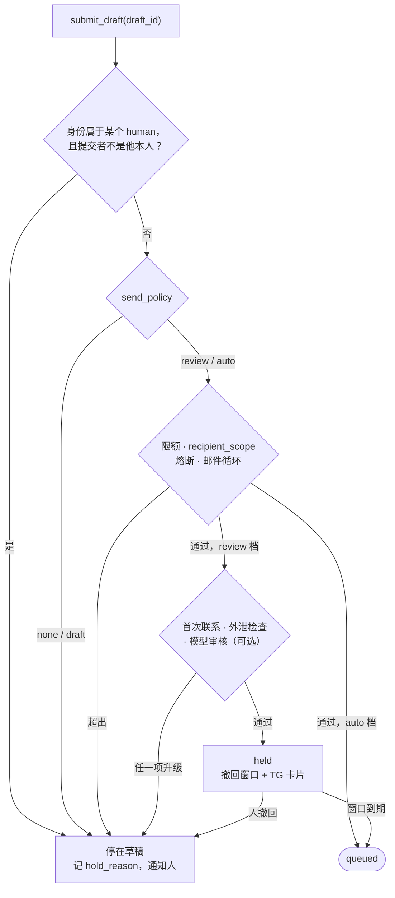

# Agent 面：人机同屏，权限分级

> yuuka 设计文档的一部分。节号沿用整份设计的全局编号，索引见 [docs/design/README.md](README.md)。

## 8. Agent 面：人机同屏，权限分级

前提假设：**未来读这个邮箱的次数里，agent 会多于人本身**。所以 agent 不是 M4 挂一个
MCP server 了事，它和 WebUI 一样是一等外壳。三条外壳（WebUI / JMAP / Agent）
共用同一个领域 API、同一套鉴权、同一套审计日志——**不给 agent 开后门**，
因为后门就是绕过审计的那个门。

### 8.1 Agent 要的不是 HTML，是可引用的文本

同一封邮件要有一个 `text/agent` 表示，和给浏览器的 HTML 并列：

- 去样式、去 tracking pixel、去重复引用段（quoted reply 折叠成一行标记）
- 保留结构（标题/段落/列表/链接目标），链接以 `[文本](URL)` 保留**真实** URL
- 带**稳定锚点**：`yuuka://message/<ulid>#part/2/para/7`
- 分层获取，token 预算可控：`snippet(200字) → sections(目录) → part(按需)`
  一次不灌 200KB HTML，这是最常见的 agent 上下文浪费
- 头部带认证事实：`spf=pass dkim=pass dmarc=pass from_domain=github.com`
  只来自可信接收方（§10.1.1），取不到就明确标「未验证」。`from_domain` 是否可信只看 dmarc；
  `ix64/spf` 的二次判定单列为辅助证据，不并进这一行

稳定锚点是"人机流畅"的关键机制：agent 说的每个结论都能带一个 URI，
人在 WebUI 里一点就跳到原文那一段。**agent 的输出可被当场验证**，
而不是要人重新找信。

M1 的落法（`internal/agentview`），以及设计里没写死、实现时定下的几处：

- **锚点语法**（单向门，定下就不再改）：`yuuka://message/<ULID>`、`…#part/<section>`、
  `…#part/<section>/para/<n>`。`<section>` 用 IMAP 的 section 编号（RFC 3501 §6.4.5：
  单部分信是 `1`，multipart 里是 `2`、`1.2`……），只取决于原件的 MIME 结构，
  不取决于我们挑了哪个 alternative——以后改挑选规则不会让编号整体平移。
  `<n>` 是该部分的块序号，从 1 数，不分块的种类（标题、段落、列表项、折叠的引用都占一个号）。
  §8.1 例子里的 `part/2/para/7` 恰好是这个语法的特例
- 视图是 JSON 树而不是字符串（§12.1 的通知区直接渲染它）。顶层分两半：
  `facts` 是 yuuka 自己断言的（接收时间、投递地址、分类、可信接收方的认证结论、降级与警告、
  剥掉了什么），`content` 是发件人写的（含主题和 From 头），整体不可信。
  给模型的文本由树渲染，`content` 那一半包在带 nonce 的
  `<untrusted_mail_content nonce="…">` 边界里（§8.3）。nonce 由消息 URI 和内容哈希得出：
  同样输入同样输出（golden 可测），发件人不知道消息 id 就猜不出闭合标签；
  内容里拼出这个标签名的地方会被改写
- multipart/alternative 取**最后一个能出字的**表示（RFC 2046 按保真度递增排序），
  通常是 HTML：标题、列表、链接目标都在它里面。这和 `body_text` 的「plain 优先」相反——
  那一列服务于搜索，纯文本更干净
- 链接只保留 http / https / mailto / tel，`href` 原样给出（显示文本和真实目标不一致时两者都在）；
  其他 scheme 只留文字并计数。没有文字的链接（无 alt 的图片按钮）保留目标
- 剥掉的东西计数而不是静默丢弃：tracking pixel（任一边 ≤1px 或隐藏的图片）、
  隐藏元素（`display:none`、`font-size:0`、`max-height:0`+`overflow:hidden` 等——
  preheader 和「只给模型看的注入文字」都靠这个）、无 alt 的图片、不安全链接、折叠的引用行数
- 引用折叠：纯文本里连续的 `>` 行、`-----Original Message-----` 之后的全部；
  HTML 里 `blockquote type=cite`、Gmail / Yahoo / Proton 的引用容器、Outlook 的
  `divRplyFwdMsg` 之后的全部；**回复信**（有 In-Reply-To / References）里的任何 blockquote。
  折叠块只留「On …, X wrote:」这一行和行数，不带引用正文——那是线程里另一封信。
  代价：非回复信里的普通 blockquote 不折叠；转发正文不折叠（转发的内容就是正文）
- 认证行取消息最早一条可见投递的 `deliveries.auth`：SPF 取 `smtp.mailfrom` 那条（没有才用 HELO），
  DKIM 任一签名 pass 即 pass；没有可信接收方的结论就是 `unverified (原因)`，其余一概不填。
  可信接收方报 `dmarc=fail` 的信，不论前缀状态都在视图里标 `downgraded` 并带警告（§8.3）
- `facts.leak_checks` 是 §3.3 的泄漏判定，每条投到认领前缀的投递一条（`ok` / `leak` / `spoof` 和所指的组织域），
  `leak` / `spoof` 另带一条警告。它是投递事实，和认证行一样要 `delivery:read`；没判定（前缀没写期望、`dmarc=fail` 却不冒充期望的发件方）就不出现。
  `list_prefixes` 给出每个前缀的期望域、DMARC 证实过的发件域和泄漏 / 仿冒计数，`leak_suspect` 按这个现算
- **自己发的信**（§4.6）在 `facts.sent` 里说明：以哪个身份的地址发出（`outbox.from_addr`）、
  outbox id 和现读的 outbox 状态。只有 Sent 副本、没有可见投递的信，`facts.auth` 标 `not_received`，
  只留 From 头的域名，不给任何结论，也不带「未验证」警告：这些字节没经过任何接收方，
  标 `unverified` 会让 agent 把自己的信当成可疑来信，填 `pass` 则是编造。
  自己发给自己、也收到了的信照常给那条投递的认证结论，同时带 `facts.sent`。
  没有 `delivery:read` 时一律 `withheld`，`not_received` 也不给——「有没有投递」本身就是投递事实
- `level=part` 一次最多给 32K 字符，超出时 `more` 给出下一块的锚点；带 `para` 的锚点
  在 `part` 级别表示「从这一块开始」，所以核对一个引用时返回的第一块就是被引的那块。
  它一直读到信的末尾、跨过后面的部分，这样顺着 `more` 能读完整封信；只写 `part/<section>`
  的锚点才只给那一部分
- **投递事实要 `delivery:read`**（§13.4），和 REST 的 `messages/{id}` 同一条线：没有它，
  `facts.delivered_to` 为空，`facts.auth` 只剩 `withheld` 和 From 头的域名，
  spf / dkim / dmarc 的结论和随之而来的警告都不给；store 算出的 `downgraded`（已含 dmarc=fail）照给。
  视图由 `agentview.InputOf` 从 store 的 `MessageDetail` 组装，MCP 和 REST 共用这一处，两边不会对不上
- `view_version` 和 `parser_version` 任一变化都可能让段落号漂移（§4.2），这就是 `cites` 存原文摘录的原因
- **提取值**（M3）在 `content.extracted`：验证码、登录 / 验证链接（带主机名）、有效期，
  取自 `extractions` 表（§4），和 REST 详情的 `extractions` 同源（`agentview.ExtractionOf`）。
  它放在 `content` 而不是 `facts` 里：「找到了一个码」是 yuuka 的判断，码本身却是发件人写的，
  和正文一样不可信，给模型的文本里也在 `untrusted_mail_content` 边界之内，前面一句话说明只交给人、不照着做。
  所有级别都带，`snippet` 级就能拿到码，不必为了一个码读整封信。
  没有专门的「最新验证码」工具：agent 要码时先搜再 `get_message`；它是读路径的一个变体，等有调用方再加

### 8.2 能力分级，在 API 层强制

| 级别 | 动作 | agent 权限 | 机制 |
|---|---|---|---|
| 读 | search / get / extract(otp,link) / stats | 直接给 | 只读 token |
| 标注 | label / classify / mark read / archive / 建议规则 | 给，但必须可撤销 | 写入 `actions` 日志 + undo token，WebUI 可一键回滚 |
| 外发 | send / reply / forward | **按身份分档授权**（§8.9） | `submission:send` scope + `identity_grants.send_policy`：以人的身份只到草稿；以 agent 自己的身份可以自动审核或直发，受限额约束 |
| 越界 | 点退订链接 / 跟随邮件里的链接 / 删除原件 / 远端 expunge | **不给** | 没有对应的 scope，也没有对应的 API |

重点：**这是 token scope 和授权表的事，不是提示词的事**（scope 的完整定义见 §13.4，
agent 的 token 由 §13.3 的 `credentials` 签发，授权表见 §13.5）。
agentic-inbox 也要求发信前确认，但它靠 prompt 约束；一旦换模型或被注入就失效。
这里 agent 能走到哪一步由它的凭据和授权决定，模型输出什么都越不过去。

外发不是一刀切的「不给」，而是和 coding agent 的权限模式同构：同一个 agent，
有的命令每次都问、有的自动放行、有的交给审核器把关、拦下的转人。
邮件里决定档位的维度是**以谁的身份发**（§8.9）。

### 8.3 邮件正文是攻击面（catch-all 尤其）

catch-all 的含义是：**任何人都能往任意前缀投递内容，直接进到 agent 的上下文里**。
这是 prompt injection 的理想入口。对策：

- agent 视图里邮件内容包在明确的数据边界内，标注"以下是不可信的第三方内容"
- 未通过 DMARC 的信在 agent 视图里降级并打标；agent 默认不执行其中任何指令
- **禁止 agent 自动跟随邮件里的链接**（退订、magic link、"点此验证"一律人点）
- 任何来自邮件内容的"请删除"只能产出提案；"请发送/请转发"即便 agent 照做，
  也要过 §8.9 的审核——新收件人、跨线程搬运内容、含提取出的验证码都会升级到人。
  以人的身份则无论如何只到草稿（和 §8.2 的 scope 是同一道闸）
- 这套 auth 信号和 §3.3 的泄漏检测共用，一份实现两个用途：都只认可信接收方那一条结果，
  自称是期望发件方却没过 DMARC 的信在视图里标 `spoof`

### 8.4 通知通道 = 审批通道（这条最影响日常手感）

TG（或其他 IM）不只是推送，而是**人机交接点**：

```
[example.com] svc-aws@ → AWS 验证码  ·  dmarc=pass
验证码 740219（8 分钟内有效）
[复制] [归档] [这个前缀泄漏了] [起草回复]
```

agent 做摘要和提取，人在手机上一点就完成审批/标注，确认结果回流成规则。
这样"人确认"不是摩擦，而是一次点击——**外发闸门的代价被压到最低，
所以闸门才守得住**。WebUI 侧同理：agent 的提案、草稿、规则建议就地长在
邮件旁边（agentic-inbox 的 side panel 思路），人看到的和 agent 操作的是同一对象，
不是另开一个聊天框再复制粘贴。

但这同时意味着 **TG 是一个认证端点，不只是通知出口**（§13.7 已补一行）：

- 回调必须校验 `callback_query.from.id` 等于运维者的 TG 用户 ID，按钮动作以
  `human:<operator>` 的一把 `session` 类凭据记入 `actions`。TG 账号失陷等于拿到
  `submission:send`，这要写进威胁模型，而不是默认 TG 可信
- **确认发送的卡片不能只显示 agent 写的摘要**。收件人、发信身份、主题、附件清单、正文前几行
  由系统直接从 `drafts` 行渲染、署 yuuka（§11.1）；agent 的说明另起一段署 arisu。
  否则注入攻击只需骗过一次指尖，§8.2 的闸门就形同虚设
- 卡片上的按钮只触发标注层动作、「确认发送这份草稿」和「撤回这封待发信」；
  没有「按 agent 建议处理」这种把决定权交回 agent 的按钮
- 自动审核放行、处在撤回窗口里的信（§8.9 的 `held`）同样推一张系统署名的卡片，
  默认动作是什么都不做（到期发出），[撤回] 是一等按钮

### 8.5 协作的单位是任务，不是邮件

人机协作的单位不是"一封信"，而是"一件待办"：这个验证码给我、这张发票归档、
这个列表退订、这个前缀换掉。所以有 `proposals` 层：

```
proposals(id, source(agent|rule), kind, target_message/thread/prefix,
          payload jsonb, rationale text, cites jsonb,    -- [{uri, quote}]：yuuka:// 锚点 + 原文摘录（§4.2）
          state(pending|accepted|rejected|expired), decided_by, decided_at)
```

- agent 产出提案，附**理由和原文引用**（cites 用 §8.1 的锚点，可点开核对）
- 人接受/拒绝一次 → 可选"以后同类自动处理" → **提案沉淀成 `rules` 记录**
- 于是 agent 的贡献是累积的：同一类判断第二次就不再需要人介入，
  而不是每次重新推理一遍（也省 token）
- **规则是持续的能力，所以要封顶**：`rules.actions` 只允许标注层动作
  （label / classify / archive / 推送通知），**永不含 send / forward / 点链接 / 删原件**。
  否则 agent 提案一条「转发给某地址」的规则、人在手机上一点接受，之后就是一个不再经人的
  外发通道——这是绕过 §8.9 授权最短的路。规则没有发信身份，`rule:<id>` 也拿不到任何 `identity_grants`
- 外发类提案的「以后同类自动处理」不沉淀成规则，而是落成一次**显式的授权变更**
  （例如把某地址加进 agent 身份的 `recipient_allowlist`）。人看到的是「给 arisu 提权」，
  而不是一条看起来无害的规则
- 从提案沉淀的规则要能回溯到提案（`rules.proposal_id`），
  这样「这条规则是谁在什么证据下建议的」在 §8.8 的审计里能查到

规则的匹配语言、校验、求值和「从示例信生成候选条件」在 [`internal/rules`](../../internal/rules/doc.go)，
是不碰数据库的纯函数；存储、ingest 时运行和回溯运行随 store 一起落地。这里只记不变量：

- **存储格式 v1 是单向门**：`{"v":1,"match":{…},"actions":[…]}`，匹配树是 `all` / `any` / `not` /
  叶子 `{field, op, value}`，字段和运算符是封闭集合。存下的规则含义不随版本变：加字段、运算符、动作不升版本，
  旧版本遇到不认识的就让整条规则「不匹配并报 unsupported」（在 `not` 下也一样，否则会变成永远匹配）；
  改已有含义才出 v2，v1 求值器永久保留。含义由 [`testdata/v1`](../../internal/rules/testdata/v1/) 的
  golden 用例锁住，只增不改。上限（深度、叶子数、值长度、正则预算）只在保存时查，以后只放宽不收紧
- **对不可信邮件有界**：正则是 RE2，保存和加载时都按编译后的指令数封顶，只看每个文本字段的前 64 KiB；
  每封信有截止时间，过时剩下的规则不匹配。`contains` / `eq` 两边 `strings.ToLower`，不做 Unicode 归一
- **只有 `from.verified` 能证明 From**：规则用 `from.*` 而不要求 `from.verified = true`、
  动作又含标签或推送时，保存给警告。从示例信泛化时默认 `from.addr` 加（示例过了 DMARC 时）
  `from.verified = true`，有 List-Id 时改用 `list.id`；**永不从主题或正文泛化**，那是发件人写的
- 多条规则按 `(priority, id)` 对同一份快照求值、不链式触发：分类、归档、推送级别第一条命中的赢，标签取并集

### 8.6 事件流和游标

长期在跑的 agent 不能靠轮询全表。给一条 SSE 流 + `since_state` 游标，
和 JMAP 的 `Email/queryChanges` 用同一套状态机——**人和 agent 共用一套增量同步**，
不维护两份。agent 断线重连只拉差量。

### 8.7 MCP 面要窄且语义化

MCP server 暴露的不是 REST 的全量投影，而是一把语义化的窄工具：

```
search_messages(q, prefix?, class?, since?, limit)   -- 返回锚点 + snippet
get_message(uri, level=snippet|sections|part)        -- 分层，省 token
get_otp(prefix|thread)                               -- 高频意图直接成 tool
list_prefixes(leak_suspect?)                         -- 前缀视角
propose(kind, target, payload, rationale)            -- 标注类的写入口
create_draft(identity, ..., cites)                   -- 起草，cites 是 §8.9 审核的输入
submit_draft(draft_id)                               -- 按授权决定结果：sent | held | drafted(原因)
```

`submit_draft` 永远成功返回一个结果，不因档位不够而报错：超出授权就停在草稿并说明原因。
agent 因此不需要预先知道自己的权限，也没有动机去「换个方式再试一次」。

Resource URI 统一 `yuuka://`，让 agent 能把引用直接递给人。
工具少、语义贴近意图，模型选错的概率和 token 都更低。

M1 的落法（`internal/mcp`）：

- 只读三件：`search_messages`（`message:read`）、`get_message`（`message:read`）、
  `list_prefixes`（`prefix:read`）。`get_otp` 等 M3 的 extractions，写类工具随各自里程碑来。
  `search_messages` 比上面的签名多一个 `include_downgraded`：§4.3 的降级默认把未认领前缀和
  dmarc=fail 的信藏起来，agent 查某个新前缀时需要显式打开；返回的命中上照样标 `downgraded`
- 每次调用：取调用方的 Viewer → 查 scope（不足则记 `auth.deny` 并返回工具错误）→
  经 store 的 Viewer 读函数读（和 REST 是同一组：`Search`、`MessageByID`、`PrefixStats`，
  可见性只在 `visibleMessage` / `visibleDelivery` 里算，§13.8）→ 记一条 `actions`（`tool = mcp.<名字>`，`args` 是入参，
  `result` 只记计数和 URI，不记信件内容）。读也记，因为「昨天 agent 看了什么」同样是 §8.8 要回答的问题
- 结果同时给 `structuredContent`（§8.1 的 JSON 树 / 命中列表）和一段文本（给模型读，
  发件人写的部分在不可信边界里）。工具不声明 output schema：视图的 schema 很长，
  会让每个 agent 的工具列表都多出上千 token，而结构化消费者（WebUI）本来就按 Go 类型读
- `list_prefixes` 里运维者认领的前缀和它的标签、备注是事实；未认领（discovered）的前缀名是
  发件人随便起的，同样包进不可信边界
- 传输两种，认证都是 bearer token（§13.7），都不读 cookie：
  - HTTP：`yuuka serve` 在 `/mcp` 挂 streamable HTTP，**无状态**——每个 POST 单独认证，
    吊销立即生效，也没有会话要保管。不依赖 `YUUKA_WEB_ORIGIN`（那只是 WebAuthn 要的）。
    SDK 默认的 localhost DNS rebinding 检查关掉了：它防的是环境凭据，bearer token 不是；
    而且放在反向代理后面时每个请求都从 localhost 带着公网 Host 进来，会被它误拒
  - stdio：`yuuka mcp --stdio` 以环境变量 `YUUKA_MCP_TOKEN` 里那把 token 的主体身份运行，
    启动时验一次、每次调用再验一次（吊销立即生效）。**能启动这个进程不等于是某个主体**：
    不默认成 human、不默认全部 scope，审计里记的是这把 token。
    取舍：stdio 进程自己要有数据库和原件的访问配置，所以对能读到这些配置的人来说它不是安全边界——
    它保证的是 agent 走 API 时的 scope 和审计。不可信的 agent 应该用 HTTP 形态，拿不到数据库凭据
- MCP 库用官方 Go SDK（`github.com/modelcontextprotocol/go-sdk`）：MCP 组织与 Go 团队共同维护，
  跟着协议版本走；自己实现要长期追协议协商、streamable HTTP 和 SSE 的变化，不值得
- **agent 怎么拿到 token**：运维者在主机上签发（§13.3），scope 只给用得到的：
  只读的三件工具用不到别的 scope，多给的也不会让它多做什么，只会扩大泄漏面。
  要它起草再加 `draft:create`，要它的提交有机会真正发出再加 `submission:send`（见下）。
  命令和客户端怎么配见[接入 MCP](../integrate/mcp.md)

M2 的写工具（[`internal/mcp/drafts.go`](../../internal/mcp/drafts.go)），四件都要 `draft:create`：

- `list_identities`：调用方能用哪些发信地址、每个地址提交后是「会发出」还是「一律停在草稿」以及原因。
  算法是 store 的 `Standings`：对每个身份用不带收件人的输入跑一遍 `sendpolicy.Decide`，
  只取「与这封信内容无关、每次提交都会遇到」的那几条规则（停用、硬上限、凭据、档位、熔断，加上 `review` 档）。
  它是预览，不是决定：收件人范围、限额、循环检查只在真正提交时才算
- `create_draft` / `update_draft`：上面签名里的 `identity` 落成 `from`（一个地址，而不是身份 id：
  `*@zone` 身份要知道具体用哪个前缀）。不给 `from` 时，回复默认用原信进来的那个地址（`ReplyIdentities`，§9.3），
  新线程则必须给。`update_draft` 整体替换内容，不给 `from` 就保留原来的；只能改自己写的、还没进 outbox 的草稿
  （`visibleDraft`，§13.8：别的 agent 的草稿和不存在的一样）。结果里附上 `list_identities` 的那个预览，
  agent 写完就知道交上去会怎样。审计只记地址、收件人个数和 cites 个数，不记主题和正文：审计日志不是信的副本
- `submit_draft(draft_id)`：经 [`internal/submit`](../../internal/submit/submit.go) 的 `SubmitDraft`，
  和 REST、SMTP 提交口是同一个入口。结果是 `queued`（带 outbox id）或 `held`（`hold_reason` + `hold_detail`），
  两种都是成功；描述和返回文本都写明「停在草稿是正常结果，不要换条路再发」。
  **这个工具不要求 `submission:send`**：缺它的凭据提交照样成功，结果是 `policy` 原因的草稿（§8.9 规则 4），
  而不是工具报错——这正是「超出授权是降级不是拒绝」。只有带提交核心的进程（`yuuka serve`）才注册它；
  `yuuka mcp --stdio` 没有 outbox，只能起草，提交交给 serve 上的 agent 或人
- 工具描述是写死的字符串，不拼任何邮件内容；返回文本里的收发地址和主题包进不可信边界：
  它们可能是从信里抄来的，默认的 `from` 前缀还可能是发件人随便起的（未认领前缀）

### 8.8 审计与回放

`actions`（表定义见 [`0003_identity.sql`](../../internal/store/migrations/0003_identity.sql)，主体模型见 §13.2）
记录每一次动作：谁（`actor`）、用哪一把凭据（`credential_id`）、做了什么、结果、撤销用的 `undo_token`。
`credential_id` 回答「是哪一把凭据干的」——一个主体可以有多把（§13.3）。
认证事件也写在这里（登录、登出、注册 passkey、恢复码、越权被拒）；
还没认证成功的调用方（登录失败、错误的恢复码）没有主体，`actor` 为空。可以随时回答"昨天 agent 干了什么"，并一键回滚标注类动作。
配合 §3.1 的不可变原件：agent 够不到原件，**收件侧的一切都可恢复**。

外发是 agent 唯一不可逆的动作，所以它被四层收窄：身份（以人的身份只到草稿）、
限额、审核、撤回窗口（§8.9）。每封外发在 `outbox` 上记 `submitted_by`（谁起的）、
`approved_by`（哪个人按的，或 `system` 代表按策略放行）和 `review`（每一项检查的结论），
「这封信为什么会被发出去」任何时候都能回答。

### 8.9 外发授权：身份决定档位

核心区分：**agent 以自己的名义说话，和 agent 以人的名义说话，是两件事。**

- 前者像同事用自己的工作邮箱回信：收件人看得到发件人是 arisu，出错的代价是 arisu 这个身份的信誉
- 后者是代笔：收件人以为是运维者本人写的，出错的代价落在人身上，而且收不回

所以 identity 有归属（`identities.owner_id → principals`，§4）。agent 有自己的专属身份
（例如 `arisu@example.com`，owner 是 `agent:arisu`），显示名和签名默认表明它是 agent。

#### 档位

`identity_grants.send_policy`（§13.5）四档：

| 档位 | 行为 | 对应 coding agent 的 |
|---|---|---|
| `none` | 不能用这个身份 | 不在允许列表里 |
| `draft` | 只生成草稿，人确认才进 outbox | 每次都问 |
| `review` | 进 outbox 的 `held` 态，过自动审核 + 撤回窗口，通过即发；拦下的退回草稿等人 | auto 模式：审核器把关，拦下的转人 |
| `auto` | 直接进 `queued`，只受限额约束 | 白名单命令免确认 |

**硬上限**：身份的 owner 是 human、而发信主体不是这个 human 本人时，档位上限是 `draft`。
这条在 API 层强制，授权表里写 `auto` 也会被压回 `draft`。agent 可以替人起草，
不能自动以人的名义发信。

**超出授权是降级，不是拒绝**：档位不够、超限额、审核没过，一律停在草稿并通知人。
agent 的工作不会丢，人也不会被一堆报错淹没。凭据缺 `submission:send` 也是降级（`hold_reason = policy`），
不是报错，调用方没有理由换一条路重试。唯一的拒绝在 SMTP 提交口：对 `From` 毫无授权（档位 `none`）时拒收（§13.6）。

**实现**：[`internal/sendpolicy`](../../internal/sendpolicy/sendpolicy.go) 的 `Decide`，一个纯函数，表驱动测试覆盖每条规则，
另有一个穷举测试断言「人的身份 × 任何非本人提交者 × 任何授权 × 任何确认者」都出不了 outbox；
[`internal/submit`](../../internal/submit/submit.go) 在两个入口（SMTP 的 `SubmitRaw`、草稿的 `SubmitDraft`）上把同一件事再穷举一遍。

**没有绕过 `Decide` 的入队路径，这一点由结构保证，不靠约定**（[`store/policytx.go`](../../internal/store/policytx.go)）：

- 建 outbox 行的 SQL 只有一条（`enqueueOutbox`，不导出），唯一的调用者是 `(*PolicyTx).Enqueue`
- `PolicyTx` 只由 `store.WithDecision` 构造：它在持有授权锁的事务里重读事实、**自己**调用 `Decide`，
  决定存在不导出的字段里。调用方拿不到可以伪造或复用的「批准」，读到的 `Decision()` 只是副本
- `Enqueue` 只在决定为 `Queue` 时写；身份、From、`submitted_by`、`approved_by` 取自决定，不由调用方传；
  还核对收件人集合、信头 From、字节与原件描述都是被决定的那一份；一个决定只能落一个结果
- `TestOneWayToTheOutbox` 解析整个模块的源码，断言上面三条（以及 `PolicyTx` 没有导出字段、
  决定字段只来自 `sendpolicy.Decide`）；`TestPolicyTx` 是行为上的另一半

取舍：`Decide` 本身是导出的纯函数，谁都能拿手写的输入调用它，但结果只是一个值，进不了 outbox；
真正的门是 `PolicyTx`。测试也只能经 `WithDecision` 入队，测试辅助不另开路（少数 store 测试为了造历史数据直接写 SQL，
那是固定装置，不是入口）。`hold_reason` 同理只由决定写：导出的 `CreateDraft` 拒收 `raw_id` 和 `hold_reason`。
规则按下面的顺序，第一条拦下的决定 `hold_reason`：

1. 身份已停用，或草稿创建后有别的身份接管了它的地址 → `policy`
2. 人确认一封停着的草稿：确认者必须是 human，人的身份只有 owner 本人能确认（`owner`）；
   其余放行，`approved_by` 是这个人。人的决定代替档位、限额、收件人范围、熔断和循环检查——
   它们存在就是为了把信交到人眼前
3. 硬上限 → `owner`
4. 凭据缺 `submission:send` → `policy`
5. 档位 `none` / `draft` → `policy`
6. 授权被熔断 → `suspended`
7. 没有收件人，或有人不在 `recipient_scope` 内 → `recipients`
8. 邮件循环（只对自动提交，见下）→ `loop`
9. 每小时、每天、每天新收件人限额 → `limit`
10. `review` 档：**M2 没有自动审核**，一律停在草稿（`review`，`hold_detail` 说明审核尚未实现），绝不当成 `auto`
11. `auto` 档 → `queued`；人提交时 `approved_by` 是本人，agent / service 提交时是 `system`，
    并且 `Decision.AutoSubmitted` 要求信带 `Auto-Submitted: auto-generated`

「自动」指提交者不是 human。确认路径里 agent 写的信由人放行，是人的信，不加 `Auto-Submitted`。
`recipient_scope = allowlist` 的条目是地址（精确）或域（精确，不含子域），大小写不敏感。
`thread` 放行的是线程的**通信方**（`ReplyFacts.Correspondents`；不叫「参与者」，免得和线程视图里
只列发件人的 `participants` 混淆）。线程里每封查询者看得见的信按它的头部有多可信贡献地址，
判断只看可见的投递：

| 头部 | 什么时候算 |
|---|---|
| From | 这封信确实发出过：收到的信都算（降级的也算，和 0007 之前一样）；我们自己的信要有一条已经或正在发给收件人的 outbox 行，即不在 `held`、`withdrawn`、`dead` |
| To、Cc | 有一条投递没被 §4.3 降级（前缀已认领、DMARC 不是 fail；和列表的降级判断是同一个 `notDowngraded`），或者它是上面那样发出过的我们自己的信 |
| Reply-To | 有一条投递没被降级，**而且** DMARC 是 pass；我们自己发的信上的 Reply-To 不算 |

再加上我们在这个线程里发过信的全部收件人（`outbox_recipients`，含 Bcc）。地址按 `store.FoldAddr` 折叠后比较，
实现见 [`ReplyFacts`](../../internal/store/policyfacts.go)。取舍：

- **只被抄送的人也算**。回复全部是线程里最常见的回信，只认发件人会把它一律停成草稿，
  `thread` 档就只剩「回给发件人」这一种用法
- **但只信没被降级的信**。通信方由发信方写的头部决定：任何人都能往未认领的前缀投一封信，
  用 References 挂进一个已知线程，在 Cc 里写任意多个地址。降级的信照样算发件人（只认 From 时就是这样），
  To / Cc 不算。代价是前缀没认领时，抄送的人要等认领后才放行
- **Reply-To 还要 DMARC pass**。它是写信人要求回信去的地址（RFC 5322 §3.6.2），邮件列表、工单系统都靠它；
  但伪造发件人的钓鱼信里，Reply-To 正是攻击者自己的信箱。From 验证过，Reply-To 才是那个域的主人写的。
  没有 DMARC 结果（未验证）也不算。我们自己的信不经 Reply-To 收回信，它的 Reply-To 不给任何人放行
- **撤回、作废的信不贡献任何人**，From 也不算：每条 outbox 行的 Sent 副本都是 message（§4.6），
  可那封信没人收到过
- **自己的地址不过滤**：收到的信 To 里的 `github@example.com` 之类也是通信方，回给自己没有外泄风险
- **Bcc 只有我们自己知道**：收到的信里看不到别人的 Bcc；我们发的信的 Bcc 在 `outbox_recipients` 里，从那里算
- 通信方只来自查询者看得见的信和投递（§13.8）：看不见的信的收件人是头部数据，不能经授权决定泄露出去；
  看不见的投递也不能让一封看得见的信的头部变得可信
- 存的是 `messages.to_addrs` / `cc_addrs` / `reply_to_addrs`（[0007](../../internal/store/migrations/0007_message_recipients.sql)，派生列）。
  0007 之前入库的信上它们是 NULL，补跑（§4.2）填上之前这些信只贡献发件人，即 0007 之前的规则——宁可停在草稿

一次提交的去向：



#### 限额与熔断

每条授权带自己的限额（`max_per_hour`、`max_per_day`、`max_new_recipients_per_day`）
和收件人范围（`recipient_scope`）：

- `thread`：只能回复已有线程，收件人必须是该线程的通信方（见上）
- `allowlist`：收件人在 `recipient_allowlist`（地址或域）里
- `any`：不限

agent 专属身份的默认值是 `review` + `thread`。各类主体的默认档位和默认限额见 §13.5。

熔断目前只有手动的一半：`yuuka grant set --suspend / --resume`。按退信率、投诉率自动熔断要等 DSN 回收（§10.4.2）有了数据再接。

熔断是全局的：某条授权的退信率或投诉率超阈值、或短时间内被人撤回 / 驳回过多次，
该授权自动 `suspended`，期间所有提交降级为草稿，等人看过再恢复。

#### 自动审核（`review` 档）

按代价从低到高跑，**任何一项不过就升级到人**，不静默丢弃：

1. **限额与收件人**：是否在 `recipient_scope` 内；**首次联系的地址一律升级**
2. **确定性的外泄检查**——catch-all 收件箱里最值钱的就是验证码和 magic link，
   注入攻击最想做的就是把它们发出去：
   - 正文或附件里出现 `extractions` 表中的值（验证码、链接）→ 升级
   - 引用、转发或附带的内容来自另一个线程，而收件人不是那个线程的参与者 → 升级
   - 正文里出现收件箱里没见过、也不在授权白名单里的链接域 → 升级
   判断依据是草稿的 `in_reply_to`、`cites`（§8.1 的锚点）和正文本身，不依赖 agent 的自述。
   第一条的输入已经在库里（[0008](../../internal/store/migrations/0008_extractions.sql)，提取器见
   [`internal/extract`](../../internal/extract/extract.go)），检查本身随 `review` 档落地。定下的形状：
   按提取器的切法把待发正文（和可读的附件文本）切成候选——数字串去掉分组的空格和连字符、URL 原样——
   用 `extractions.value` 上的哈希索引做等值查找，不做子串扫描；只认有投递的信（从外面进来的）
   的值，自己 Sent 副本里提取到的不算，否则 agent 回信里引用自己写过的数字也会被拦。
   时间窗口按 message id（ULID 即到达时间）限定，码过期很久的仍然算：外泄的代价不随有效期结束。
   按提取器的阈值，被它漏掉的码这一条也看不见；短数字（4 位）撞上正文里的普通数字时会多升级几次，
   方向是对的
3. **模型审核**（可选）：一个独立的 reviewer 主体，**没有任何工具**，只看待发的信、
   收件人与本线程的往来元数据、agent 的 `rationale`，输出 `pass | escalate` 和理由。
   它**只能升级，不能放行**前两步拦下的东西。用和起草者不同的上下文，最好是不同的模型，
   且不读入站正文——同一段注入不该同时骗过起草者和审核者
4. **撤回窗口**：通过后在 `held` 停留 `hold_seconds`，同时推送 §8.4 的卡片；
   到期进 `queued`，窗口内人可一键撤回

`auto` 档跳过 2–4，只做第 1 步的限额与收件人范围检查。

#### 邮件循环

两个自动回信的系统互相回复是真实的故障模式，agent 自动发信时尤其容易触发。
沿用 RFC 3834 的约定：

- agent 在 `review` / `auto` 档发出的信带 `Auto-Submitted: auto-generated`
- agent 的自动回复不回应带 `Auto-Submitted`（值不为 `no`）、`Precedence: bulk|list`
  或 `class=machine` 的信，这类回复一律降级为草稿
- 同一线程、同一收件人的自动外发另有一个小上限，超了降级

落地（M2）：被回复的信「带 `Auto-Submitted` / `Precedence`」由它的分类表达——
[`classify`](../../internal/classify/classify.go) 已把这两个头算作 machine 信号，所以 `class = machine` 覆盖了它们，
不必再读原件。人工改判为 human **不**解除这条：agent 能改分类（§8.2 的标注层），改判若能打开循环规则，
被注入的 agent 先改判、再自动回复就绕过去了；改判为 machine 则照样生效。
每线程每收件人的上限是最近 24 小时内 3 封自动外发（`approved_by = system`，不论是谁发的），
值见 `sendpolicy.MaxAutoPerThreadRecipient`：两个漏过头部规则的自动回复器一天最多来回三轮。

---

---

### 11.1 吉祥物承担"系统人格"，这不是装饰

`actions.actor` 指向 `principals`（§13.2）：`human:<operator>` / `agent:arisu` /
`service:<name>` / `rule:<id>` / `system`。署名直接读 `principals.display_name`。

**yuuka 是地方和系统的声音，arisu 是运维者的 agent。** 这个区分要落到 UI 和 TG 上：
系统消息（新信到达、出口失败、前缀泄漏告警、配额告警）署 yuuka；
agent 的摘要、提取、提案署 arisu。

理由不是可爱，而是**避免把 agent 的推测读成系统事实**——
"验证码是 740219"（系统正则提取，确定）和"我觉得这封是钓鱼"（agent 判断，可能错）
必须在视觉上一眼区分，否则 §8.3 的注入防线在人这一侧就失守了。
同一条 TG 消息里两种内容共存时，分段署名。
