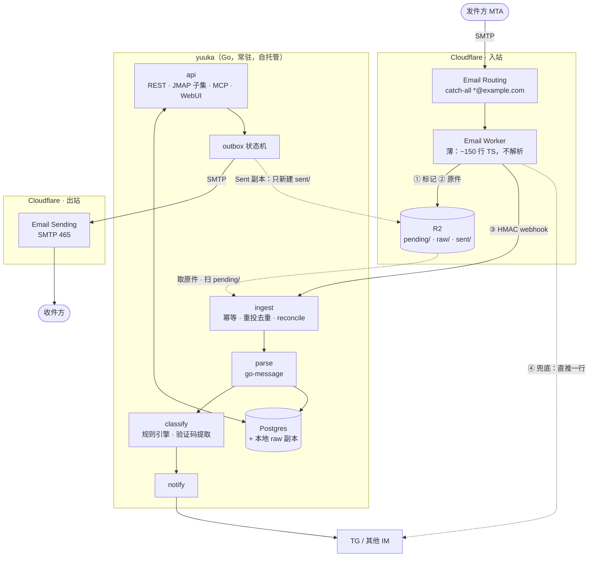
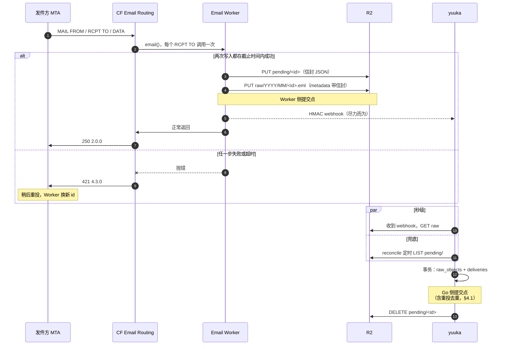

# 总体架构与设计原则

> yuuka 设计文档的一部分。节号沿用整份设计的全局编号，索引见 [docs/design/README.md](README.md)。

## 2. 总体架构



**Worker 为什么必须薄**：它是唯一不能用 Go 写的部分，所以把它压到"落盘 + 通知"
两件事，不放任何业务语义。MIME 解析只在 Go 侧有一份实现，WebUI、JMAP、
本地客户端看到的语义必然一致。

**为什么不用 Cloudflare Queues 当主通道**：R2 + `pending/` 标记已经是一个
可靠队列，且 R2 本身就是所需的归档层，少一个组件。webhook 只负责把延迟从
"下次 reconcile"降到"秒级"，丢了不影响正确性。以后量大再换 Queues 不动上层。

**不假设部署形态**：公网主机、反向代理之后、内网加隧道都应该能跑。
yuuka 对网络只有两个要求：ingest 端点能被 Worker 访问到，WebUI 能被运维者的浏览器访问到。
怎么做到（端口映射、反向代理、隧道）是部署的事；认证不靠它们，每个端点由 yuuka 自己认证（§13.7）。
唯一有意不认证的是给反向代理做健康检查的 `GET /healthz`，它只回答一位，理由和约束见 §13.7。

**进程配置只放信任根**（已定，未实现，§17）。今天出口和 Telegram 也在环境变量里；多个自有域、多个外部邮箱之后，
出口、身份的出口链、通知渠道和拉取账户的凭据要在运行时增删，它们进库，机密做信封加密：每条一把 DEK，DEK 由主机上的 KEK（以后可以是 Vault 或云 KMS）包住。留在主机的是这几样：

- 数据库连接串：连上库之前就要用
- KEK 文件（`YUUKA_KEK_FILE`），或配置了 Vault / KMS 时它的地址和访问凭据：密文的价值全在包装 DEK 的那把钥匙，和密文放在一起，加密就白做了
- R2 的两把令牌和 `YUUKA_WEBHOOK_SECRETS`：收信必须在没有 KEK、包装器连不上、机密子系统整个坏掉时照常工作（§3.5），
  所有域共用同一对 bucket，加域名不动它们；webhook 密钥的轮换本来就要和 Worker 的部署一起做
- `YUUKA_TRIAGE_*`：邮件内容会不会离开部署（§15）是主机的决定，不是一次会话的
- 提交口的 TLS 文件、WebAuthn 的 origin、可信代理、`YUUKA_MCP_TOKEN`：主机或客户端自己的事实，不是第三方凭据

划线的依据是：丢了或换了它，收信会不会受影响；它是不是决定了别的密文、别的数据能不能被读走。是，就留在主机。

### 2.1 收信提交协议

信封（`MAIL FROM` / `RCPT TO`）不在 `.eml` 里，而 catch-all 判前缀靠的正是 `RCPT TO`。
所以 Worker 落盘的不只是原件，还有信封。顺序是唯一的，不留备选：

1. **写 `pending/<id>`**：JSON，含 `id`、`envelope_from`、`envelope_to`、`received_at`、
   `raw_key`。写失败就抛错
2. **PUT `raw/YYYY/MM/<id>.eml`**：同一份信封再写进 R2 对象的 custom metadata，
   让原件自描述——即使标记丢了，只凭 raw 也能恢复投递事实。写失败就抛错
3. 发 HMAC webhook（尽力而为，失败不抛错）
4. 正常返回 = 向 Cloudflare 确认收下

**Worker 侧的提交点是第 2 步成功。** 之前任何一步失败都抛错，交给 Cloudflare 让发件方重投。
Worker 必须给自己设截止时间：R2 写入超过 60 秒就放弃并抛错。

**Go 侧的提交点**是一个事务：写 `raw_objects` + `deliveries`（信封从标记或 metadata 读）。
事务提交后才删除 `pending/<id>`。reconcile 按标记的状态处理：

| 标记 | raw | 处理 |
|---|---|---|
| 有 | 有 | 正常 ingest（幂等），提交后删标记 |
| 有 | 无，标记 < 15 分钟 | Worker 可能还在写，跳过 |
| 有 | 无，标记 ≥ 15 分钟 | Worker 在第 2 步失败并已抛错，这封由发件方重投、会换新 id。记一条 `orphan_marker` 事件后删标记；短时间内频繁出现就告警 |
| 无 | 有，库里没有 | 不应出现（标记只在入库后删）。每周一次全量扫 `raw/` 与 `raw_objects` 对账兜底，信封从 metadata 恢复 |

Email Worker 每次调用只有**一个** `RCPT TO`：同一封信发给同域两个前缀，
Worker 会被调用两次、产生两份 raw，由 §4.1 的折叠合并成一条 message、两条 delivery。

完整时序（Worker 侧失败走 421 重投，Go 侧由 webhook 或 reconcile 两条路之一触发）：



#### 2.1.1 实测：Worker 的结局如何变成 SMTP 应答

2026-10 在一个测试域上实测：直连 Cloudflare MX 投递，记录 DATA 结束时的应答。

| Worker 的结局 | 发件方收到 | 含义 |
|---|---|---|
| 正常返回 | `250 2.0.0 Ok` | 收下 |
| 同步抛错 / `await` 之后抛错 | `421 4.3.0 Upstream error` | **临时失败，发件方会重投** |
| `setReject(reason)` | `555 5.7.1 <reason>` | 永久失败，发件方退信 |
| 一直不返回 | 约 311 秒后 Worker 被取消，Cloudflare **再调用一次**；第二次也被取消后（约 622 秒）回 `421 4.3.0` | 已超过 RFC 5321 建议的 10 分钟 DATA 超时，多数发件方在此之前已自行超时、按临时失败重投 |

由此定下的规则：

- **失败就抛错，不需要 `forward()` 兜底**：抛错得到的是 421，发件方按标准会重投
- **永远不用 `setReject()`**：它让发件方退信，等于把信丢了。任何失败都应该是临时失败
- **截止时间是必需的**：不设的话，挂住的 R2 写入会让连接悬空十分钟，
  而且 Worker 可能在发件方放弃之后才写完，造成一份没人知道的重复。超时就抛错，换一个明确的 421
- **同一次投递可能跑两次 Worker**：被取消后 Cloudflare 会自行重试一次，第一次可能已经写了一半。
  Worker 的写入因此必须能承受重复——每次调用用新 id，重复由 Go 侧的重投去重收拾（§4.1）
- **一笔事务多个收件人时**，Worker 按 `RCPT TO` 各调用一次、并行执行，
  **任一调用抛错，整笔事务回 421**，发件方会对所有收件人重投——已经成功的那几路会收到第二份。
  所以重投去重不是边角情况，而是常规路径（§4.1）
- **新建的路由规则约 30–60 秒后才生效**，此前对该地址回 `550 5.1.1`（永久失败）。
  catch-all 规则建好后不再涉及；但给新域接入时，要先建规则、确认生效，再把 MX 指过来
- `wrangler email routing rules update … catch-all` 只接受 forward / drop；
  catch-all 指向 Worker 要在 wrangler 配置里声明 `addresses = ["*@<zone>"]`（Wrangler ≥ 4.113，只支持顶级域），
  或在 dashboard 设置

### 2.2 Worker ↔ Go 契约（v1）

这一节是 Worker 和 Go 之间唯一的约定，按单向门处理（AGENTS.md）：任何改动两侧在同一个提交里改，
并更新 `testdata/contract/v1/` 下的共享测试向量——两侧的测试读同一份向量，格式漂移会直接让测试失败。
`v` 字段让将来的格式可以和旧格式并存，而不是原地修改。

#### 标识与时间

- `id`：Worker 为**每次调用**生成的 ULID（26 位 Crockford base32，大写）。
  发件方重投、Cloudflare 的二次调用都会得到新 id（§2.1.1），所以 id 标识的是「一次 Worker 调用」，不是一封信
- 时间一律 UTC、RFC 3339、毫秒精度、以 `Z` 结尾，如 `2026-10-31T01:41:38.123Z`

#### 存储：两个 bucket

| bucket | key | 内容 | Worker 的权限 | Go 的权限 |
|---|---|---|---|---|
| raw | `raw/YYYY/MM/<id>.eml` | 收到的原始 MIME 字节，写一次永不改 | 写（只在不存在时写） | 读、列 |
| raw | `sent/YYYY/MM/<id>.eml` | yuuka 为外发组装或规范化的原始 MIME 字节（Sent 副本，§3.6、§4.6），写一次永不改 | 不碰 | 读、列、写（只在不存在时写） |
| raw | `pull/YYYY/MM/<id>.eml` | 从外部邮箱拉下来的原始 MIME 字节（§10.1.3），写一次永不改（M3.5） | 不碰 | 读、列、写（只在不存在时写） |
| pending | `pending/<id>` | 投递标记 | 写 | 读、列、删 |

`raw/` 的 `YYYY/MM` 取 `received_at` 的 UTC 年月。`sent/` 不属于 Worker 的契约，列在这里是因为它和 `raw/` 共用一个 bucket、
一把 Go 侧凭据：`<id>` 是 Go 生成的 ULID，`YYYY/MM` 取提交时间的 UTC 年月，key 函数是 [`r2.SentKey`](../../internal/r2/r2.go)。
Worker 不读、不写、不列 `sent/`，它的行为和 `testdata/contract/v1/` 的向量都不因 `sent/` 改变。
`sent/` 里的字节在越过发送的提交点之前就写下（§4.5），所以它收的是每一份为外发准备的字节，
包括停在草稿的 SMTP 提交和最终撤回、作废、从未发出的信：**发没发出看 outbox 的状态，不看前缀**（§4.6）。
`pull/` 同理不属于 Worker 的契约：`<id>` 也是 Go 生成的 ULID，`YYYY/MM` 取写入时刻的 UTC 年月，
不取远端报来的 `INTERNALDATE`——那是远端说的，可以是任何值，拿它分目录会让一个 key 的位置由外部输入决定。
key 函数是 [`r2.PullKey`](../../internal/r2/pull.go)。Worker、`testdata/contract/v1/` 的向量都不因它改变。

分成两个 bucket，是因为 R2 令牌的权限粒度到 bucket 为止，前缀管不住。Go 要例行删除标记，
pending 单独一个 bucket，删除就用一把碰不到原件的凭据，删错 key 也删不到原件。
key 仍保留 `raw/`、`pending/` 前缀，文档、日志里的引用不用改，将来合回一个 bucket 也不必迁移 key。

**原件不可变靠代码守住，而不是靠令牌。** Sent 副本放进 raw bucket 而不是第三个 bucket，换来的是少一个 bucket、
少一把令牌，收发两类原件在同一处归档、用同一套保管方式。代价是 Go 侧的 raw 令牌必须是 Object Read & Write，
「`raw/` 不可变」不再由权限保证，改由下面几条保证：

- 读写 raw bucket 的类型 [`r2.RawBucket`](../../internal/r2/r2.go) 没有删除方法，只有两个写方法：`PutSent` 和
  [`PutPull`](../../internal/r2/pull.go)（拉取的原件，见下文）。它们先用 `r2.CheckSentKey` / `r2.CheckPullKey`
  核对整个 key 的形状（前缀 + 四位年 + 两位月 + ULID + `.eml`），不符就在发请求之前拒绝。
  两者最后都经 bucket 唯一的一次 PutObject（`RawBucket.create`），它再核对一遍 key 是 `sent/` 或 `pull/` 的形状：
  以后再加一个写方法，忘了自己的检查也到不了 `raw/`。方法集由测试钉住
- 每次写都带 `If-None-Match: *`。R2 的 S3 API 把条件头和写入放在同一步原子判定，并发写同一 key 至多一个成功，
  其余得到 `412 PreconditionFailed`（[R2 S3 API 兼容性：Conditional operations](https://developers.cloudflare.com/r2/api/s3/api/)）。
  所以哪怕代码拼错了 key、撞上一个已存在的对象，也只会失败，覆盖不了。412 映射为 `r2.ErrExists`：
  一次重试的前一次可能已经写成，调用方读回已存对象、比对 sha256 和长度，相同即视为成功，不同就是程序错误。`PutPull` 在自己里面做这一步，连 metadata 一起比：metadata 的编码是 `r2` 包自己的，调用方没有什么可补充的
- 不先查再写：check-then-put 有竞争窗口，条件写是唯一的写法

放弃的是对**凭据泄露**的防护：拿到这把令牌的人可以无条件覆盖或删除 `raw/` 下的原件，条件头只约束守规矩的客户端。
只读令牌原本对程序错误和凭据泄露都管用，现在只剩前者。可选的加固是 R2 的 bucket lock 规则：
它按前缀阻止删除和覆盖、不阻止新建；规则属于 bucket 配置，按 Cloudflare 文档要能编辑 bucket 配置的令牌才能设，
Object 级令牌不含这项权限（[Bucket locks](https://developers.cloudflare.com/r2/buckets/bucket-locks/)，未实测）。
代价是锁住的对象在保留期内谁也删不掉，所以目前没有作为部署要求。

**什么时候回头把 `sent/`、`pull/` 挪到自己的 bucket**：Go 进程跑在不那么可信的环境里、raw 令牌需要分发给更多进程，
或者出现了任何一次 `sent/`、`pull/` 之外的写入——那就说明代码这道闸不够，应当回到「Go 对原件只读」由权限保证。
迁移只是复制对象、加一组配置：两个前缀原样保留，key 不变。

#### 拉取的原件：`pull/`（M3.5）

> 状态：key、条件写和 metadata 已实现（[`internal/r2/pull.go`](../../internal/r2/pull.go)）；拉取本身还没有调用它（§10.1.3）。

从外部邮箱拉下来的原件放进 raw bucket 的 `pull/` 前缀，由 Go 写、条件写，和 `sent/` 一样。
这放宽了原来的「Go 对 raw bucket 只写 `sent/`」，考虑过的另一种做法是给它单开一个 bucket 和一把令牌：

- **选 raw bucket**：拉取的原件和收到的原件是同一类东西——别人写的信、yuuka 的权威存储——同一处保管、同一套备份和保留规则。
  凭据泄露时能碰到的范围不变：Go 侧的 raw 令牌今天就已经能写整个 bucket，多守一个前缀只多一道代码闸
- **放弃的**：单开 bucket 能让「拉取的代码写错 key」和「`raw/` 被覆盖」在权限上隔开，代价是主机上多一把凭据、
  多一组部署配置；而条件写本来就让写错 key 只会失败、覆盖不了（上文）。回头条件见上一段

每个 `pull/` 对象带一个 custom metadata `yuuka-pull`，描述这份原件的来历（账户、`source_key`、远端定位、远端的 `INTERNALDATE`），
编码和 `yuuka-marker` 同一个办法、同一个理由（带版本的 JSON 再 base64url，纯 ASCII）。格式以 [`r2.PullMeta`](../../internal/r2/pull.go) 为准。
它连同 key 限在 2 KiB 以内，这是 S3 的上限、远低于 R2 的 8 KiB，原件因此能搬到任何 S3 存储；超了就拒绝写，**从不截断**——
截断的描述就是错的描述。拉取时编码失败算这一封的失败，按 §10.1.3 进失败表，不会写出一个说不清来历的对象。
M3.5 自己用不上它：远端仍保有原件，库丢了可以重拉。它是为 M3.6 写的——卸载之后 R2 是唯一副本，
那时库丢了，只能靠原件自描述恢复投递事实（§9.6、§4.2）。从第一封就写，免得卸载开启时还有一批说不清来历的对象。

#### 投递标记

UTF-8 编码的 JSON 对象：

| 字段 | 类型 | 说明 |
|---|---|---|
| `v` | 整数 | 固定为 `1` |
| `id` | 字符串 | 见上 |
| `received_at` | 字符串 | Worker 收到这次调用的时间 |
| `envelope_from` | 字符串 | `MAIL FROM`。值为空或 `<>` 时记空字符串；但 Cloudflare 不会给出这两种（见下方实测），退信不能靠它识别 |
| `envelope_to` | 字符串 | 这次调用对应的那一个 `RCPT TO` |
| `raw_key` | 字符串 | 原件在 raw bucket 里的 key |
| `raw_size` | 整数 | 实际写入的原件字节数（不取 `message.rawSize` 的声明值） |

- `v` 不认识就拒绝，不猜；认识的版本里出现未知字段则忽略——加字段不算破坏性变更，改字段含义才算
- 地址原样保存，不做大小写或 IDN 归一；可能含非 ASCII（SMTPUTF8）

#### 原件自带的 metadata

raw 对象带一个 custom metadata：`yuuka-marker` = 投递标记 JSON 的 **base64url（无填充）**。
整体编码一次，是因为 Go 侧经 S3 API 读 metadata：R2 会把非 ASCII 的值按 RFC 2047 编码后再交出来，
非 ASCII 的 key 则直接丢掉。编成纯 ASCII 后两条读取路径拿到的字节完全一样；
而且标记和 metadata 共用同一份 schema，不用为 metadata 另定一套字段规则。
单个对象的 metadata 上限是 8 KiB，标记最长不过几百字节。
标记丢了（§2.1 的对账表最后一行），只凭 raw 对象就能恢复全部投递事实。

#### webhook

```
POST <ingest-url>
Content-Type: application/json
Yuuka-Timestamp: <unix 秒>
Yuuka-Signature: v1=<HMAC-SHA256，小写十六进制>

<投递标记 JSON，与 pending/<id> 的内容逐字节相同>
```

- **签名输入**：`"v1:" + timestamp + ":" + body`，body 取原始字节，不重新序列化
- **密钥**：部署时生成的随机串（至少 32 字节），取其 UTF-8 字节作 HMAC key。
  Go 侧同时接受多把密钥，轮换时新旧并存一段时间
- **Go 侧校验顺序**：timestamp 与本地时钟相差不超过 300 秒 → 逐把密钥计算并做常数时间比较 →
  解析标记 → 按标记读 raw、入库
- **不维护 nonce**：窗口内重放一个合法请求，结果只是再触发一次幂等入库，没有副作用；
  为它引入一张 nonce 表不值得
- **应答**：`204` = 已入库或此前已入库；`4xx` = 请求本身有问题（签名、格式），Worker 只记日志；
  `5xx` 或超时 = 暂时失败，交给 reconcile。Worker 对任何应答都**不重试、不抛错**——
  webhook 只负责把延迟降到秒级，正确性由 reconcile 保证（§2）

#### Worker 的步骤

1. 生成 `id`，记 `received_at`；`message.from` 为空或为 `<>` 时 `envelope_from` 记空字符串
2. 把 `message.raw` 整个读进内存。R2 的 `put()` 要求流的长度已知，而入站上限是 25 MiB、
   Worker 内存是 128 MB，缓冲比 `FixedLengthStream` 简单，也不用信任 `rawSize` 的声明值
3. 写 `pending/<id>`
4. 写 raw 对象，带 `yuuka-marker`，并以 `onlyIf` 要求「key 不存在才写」；条件不满足时 `put()` 返回 `null`，
   视同失败。id 唯一，这道条件只防程序错误，不是常规路径
5. 第 3、4 步共享一个 **60 秒**截止时间（`Promise.race` 计时器——R2 的 `put()` 不能取消）；
   任一步失败或超时就抛错（§2.1.1 的 421 路径）。超时的写入之后可能仍然完成，
   留下一对完整的标记和原件：reconcile 会把它入库，发件方重投的那一份由重投去重合并（§4.1），不丢也不重复
6. 用 `ctx.waitUntil` 发 webhook，5 秒超时，结果只记日志。Cloudflare 要等 `waitUntil` 结束才回 SMTP `250`（见下方实测），
   所以这 5 秒直接加在发件方的等待上；Go 侧因此不把入库绑在请求上，Worker 放弃等待也不打断进行中的入库
7. 正常返回

Worker 运行在 Workers Paid 上（Email Sending 本来就要求它，§7）：入站处理计入 Workers 的 CPU 限额，
免费档每次 10 ms 的 CPU 不够缓冲一封大信。

**M0 实测结论**（2026-10，真实 bucket 与真实投递；文档都没写）：

| 问题 | 结论 | 影响 |
|---|---|---|
| 经 binding 的 `onlyIf`（`If-None-Match: *`）条件写是否原子 | 是。5 轮、每轮 8 个并发写同一 key，每轮恰好 1 个成功，其余 7 个返回 `null`，无报错 | 第 4 步的「不存在才写」可以依赖 |
| `MAIL FROM:<>` 时 `message.from` 是什么 | `postmaster@<HELO 域>`：Cloudflare 按 SPF 对 null sender 的约定（RFC 7208）替换了它 | Worker 拿不到 null sender，和真的 `postmaster@` 发件人无从区分。退信识别只能看内容（`multipart/report`，§10.4.2）。第 1 步的归一化无害，留给会给出空值的其他来源 |
| SMTP `250` 是否等 `waitUntil` 结束 | 等。webhook 目标睡 6 秒时，`250` 在约 6 秒后才到，Worker 日志里 webhook 在 5 秒超时 | webhook 的超时就是加给发件方的最大延迟，保持在几秒以内；Go 侧把入库从请求上下文中脱开（第 6 步） |

端到端也按设计跑通：单收件人、一笔事务两个收件人（两条投递、同一 `content_hash`）、
发件方重投（两份原件、一条投递、第二份 `duplicate_of` 第一份），webhook 不可达时全部由 reconcile 在一分钟内入库。

日志只记 `id`、`raw_size` 和步骤结果，**不记地址、主题或正文**：Worker 的日志在 Cloudflare 一侧，不归运维者管。


---

---

## 3. 八条设计原则

1. **原始 MIME 是邮件内容的唯一事实来源，不可变**
   `raw/YYYY/MM/<ulid>.eml` 写一次永不改；发出的信同理，为外发组装或规范化的那份字节就是
   `sent/YYYY/MM/<ulid>.eml`（Sent 副本，§2.2），交给出口的正是它。从内容派生的一切（解析结果、线程、附件索引、
   提取值）都能用 `reparse` 一条命令整库重放，解析器出 bug 不等于丢信息。
   但**人和系统做出的决定不是派生物**：标注、改判、前缀登记、规则、授权、
   投递事实与远端卸载状态。它们和派生数据分开存放、`reparse` 不碰、按正经数据库备份（§4.2）。

2. **`(域, 前缀)` 是维度，不是邮箱**
   不存在"创建邮箱"这个动作。每个 catch-all 域的 `*@<zone>` 全部接住，
   未见过的组合自动进 `prefixes(zone, prefix)` 表。全局单库 →
   跨域跨前缀搜索、统计、去重天然可做。

3. **前缀注册表 + 泄漏检测**（现成项目全都没有，但这是 catch-all 的真正价值）
   每个前缀登记"我把它给了谁"。当 `github@` 收到非 GitHub 发件域的信，
   或某前缀的发件域集合突然变化 → 标记"可能泄漏/被转卖"。
   这里要分清两个问题。**地址是否泄漏**不需要认证：任何意料之外的发件方都说明地址被别人知道了。
   **「自称是 X 的信到底是不是 X」**看的是收件人看到的信头 `From`，能证明它的只有
   可信接收方给出的 **DMARC** 结果（SPF 或 DKIM 通过且与 From 域对齐，§10.1.1）。
   所以「观测到的发件域」只算 DMARC 通过的 From 组织域，这样泄漏才能归因到具体一方；
   未验证的信照样计入泄漏信号，但不归因到任何域；自称是 `expected_domains` 却没过 DMARC 的，标为仿冒。
   已实现（M3），判定是 [`internal/leak`](../../internal/leak/leak.go) 里的纯函数，store 在读的时候现算：

   | 一条投递（认领前缀、`expected_domains` 非空） | 判定 | 归因 |
   |---|---|---|
   | DMARC 通过，From 组织域在 `expected_domains` 里 | `ok` | 该域 |
   | DMARC 通过，From 组织域不在里面 | `leak` | 该域 |
   | DMARC 没通过（`fail`、`none`、未验证），From 声称的组织域在里面 | `spoof` | 声称的域 |
   | DMARC 是 `none` 或未验证，From 不声称任何期望的域 | `leak` | 无 |
   | DMARC 是 `fail`，From 不声称任何期望的域 | 不判定 | — |

   - **按组织域比较**：两边都取 Public Suffix List 的可注册域（`golang.org/x/net/publicsuffix`，含私有后缀），
     和 DMARC 的宽松对齐同一个粒度：给了 `example.net`，`mail.example.net` 发来的也算。
     `expected_domains` 存的就是组织域，`yuuka prefix expect` 写入时归一化，比的就是看到的。
     代价是分不出同一组织下的子域；要按子域细分时再加精确匹配，而不是改这条默认
   - 「DMARC 通过」要求可信接收方那条结果的 `header.from` 和信头 From 是同一个组织域（没给 `header.from` 时就认 From）：
     它评判的若是另一个 From（多个 From 头、解析器取了别的那个），这个 pass 证明不了读信人看到的发件方
   - **不参与**的：未认领前缀（字典攻击，见下）、还没写 `expected_domains` 的前缀——没有期望就无从判定，
     只列观测到的发件域，供人据此写期望
   - **`dmarc=fail` 只判仿冒**：认领前缀上唯一的降级就是 `dmarc=fail`（§4.3）。它冒充期望的发件方时是最典型的仿冒，
     计入仿冒数、侧栏的标记和前缀详情，信本身照旧降级（不推送、不进聚合视图）。冒充别人的则不判定：
     接收方已经说了 From 是伪造的，它能说明的「谁知道这个地址」不比任何一封垃圾信多，算成泄漏只会让群发的伪造信
     淹没真正的泄漏；它留在「降级」里。要是哪天发现这类信确实先于泄漏出现，再把它算成不归因的泄漏
   - **不存储**，和 §4.3 的降级一样现算：改 `expected_domains` 立刻对已有的信生效，reparse 改了 `auth` 也随之变。
     观测到的发件域同理从 `deliveries.auth` 和 `messages.from_addr` 现算，二者本身都是派生的（§4.2），
     所以 `prefixes.observed_domains` 一列留空；更要紧的是可见性（§13.8）：一个主体只能经它读得到的投递「观测」到发件域，
     存在 `prefixes` 上的一份会把看不见的账户里的发件方透露给所有人。代价是每次读前缀表多一次按
     （前缀、DMARC 结果、From 域）分组的查询；个人信箱的量级可以忽略，量大时再考虑物化
   - 「某前缀的发件域集合突然变化」还没做：它要一条时间上的基线，等有了足够的观测再定
   SPF 单独证明不了 From：它验证的是信封 `MAIL FROM` 域或 HELO，转发还会让它失败。
   `ix64/spf` 的二次判定因此只是辅助信号——可信接收方没给 SPF 结果时补一个、给 agent 视图多一条证据，
   不参与 From 身份判断，也不覆盖可信接收方的结论。它的输入只从可信那一行 `Received` 里取，
   不齐时结果是 `none`；它依赖查询当时的 DNS，所以只在 ingest 时算一次、作为事实保存（§4.2）。
   前缀分两态：**claimed**（我认领过、给出去过）和 **discovered**（只是有人往这投过）。
   泄漏检测、TG 推送、聚合视图默认只看 claimed；discovered 主要是垃圾信字典攻击的产物，
   静默登记即可，认领是一个显式动作（§4.3、`prefixes.state`；M1 由 `yuuka prefix claim` 完成）。

4. **双区分流（machine / human）**
   `class` 字段 + 规则引擎，信号：`List-Unsubscribe`、`Auto-Submitted`、
   `Precedence: bulk`、`noreply` 类发件人、不是回信却带着提取器确信的验证码或登录链接、
   前缀命名约定（`svc-*` / `gh-*`）。
   `Feedback-ID` 看着像群发平台的标记，但不算信号：Cloudflare 出口给人发的信也加（§10.4），
   自托管用户的来信会被整批误判。支付平台的收据没有任何机器头，靠 `receipts@` 这类发件人认出来。
   「验证码模式」就是提取器本身（[`classify`](../../internal/classify/classify.go) 调 `extract`，置信度 ≥ 85，
   即码或链接紧挨着说明它的词）：分类和码位用同一个判断，不会出现「码位显示了码、信却在会话区」。
   只看不是回信的信——有 `In-Reply-To` / `References`、或主题带 `Re:` `Fwd:` 的信是人在说话，
   引用或转发了一个码也还是人写的；判断回信只看头部，零成本。代价：人写的第一封信里如果原样写着
   「我的验证码是 123456」，会被分进通知区；邮件里不带任何回信标记的人转码，同样。改判可以纠正
   - 通知区：按前缀/服务聚合，自动提取验证码、magic link、过期时间，
     只读、可批量清理、推送到 TG；UI 重点是"一眼看到码"而不是读信。
     提取器（[`internal/extract`](../../internal/extract/extract.go)）偏精确不偏召回：
     漏一个码，人看一眼主题就有；把订单号当成码摆出来，人就不再信这个位置。
     提取值是派生数据（`extractions`，§4），从不打开或抓取其中的链接。
     登录链接必须带只属于这位读者的 token（ID、哈希、签名串）：人人点开都一样的「Log In」按钮、
     页脚的「Sign in」是网页，不是凭据，按字面摆进码位就是误报。代价是 token 很短（字母数字混合不足 8 位、纯数字不足 6 位）的真链接会漏掉，
     读者照样能在正文里点到。
   - 会话区：完整 MUA 语义——线程、引用、草稿、附件、多身份签名、可回复。
   分流错了可以一键改判并生成规则，规则是用户数据不是代码。

5. **不丢信**
   未知前缀照收；解析失败进 `quarantine` 并保留 raw；ingest 幂等
   （折叠键 `content_hash` + 同路径 raw sha256 去重，见 §4.1；Email Worker 可能重投）;
   Worker 侧只要 raw 写成功就算收下，自建服务离线数天也只是延迟入库。
   提交顺序、信封存放和 reconcile 规则见 §2.1，只有那一套，不留备选。
   「Worker 抛错 → Cloudflare 让发件方重投」是这条原则的基石。官方文档没有写，
   已实测确认：抛错得到 `421 4.3.0`，发件方会重投；`setReject()` 得到 `555`，发件方退信（§2.1.1）

6. **出口是状态机，不是 fire-and-forget**
   `outbox(held → queued → sending → sent | partial | unknown | failed(n) → dead)`，
   结果按收件人逐个记录（`outbox_recipients`），bounce/suppression 回写到收件人这一层。
   完整的状态转换见 §4.5。
   **只在确定对方没收下时重试**：连接、认证、`RCPT` 阶段失败或 4xx 可以退避重试；
   正文（`DATA`）已经发出但没等到最终回复，就是 `unknown`——不自动重试，
   先用出口的状态查询或退信事件对账，对不上再交给人决定。盲目重试的代价是对方收到两封。
   「确定」要有落库的证据：每次尝试在越过提交点之前先写 `committed_at`，
   进程崩溃后凡是写过它的尝试都进 `unknown`，不能凭库里的 `sending` 重排（§4.5）。
   部分收件人被拒是 `partial`：只对 4xx 的那几个收件人重试，已收下的不再发。身份层支持任意 `From` 前缀（Cloudflare Email
   Sending 是域级 onboard，所以 `任意@example.com` 都能发），签名/显示名按前缀配置。

7. **入口是多实例的 driver，不是一个管道**
   `ingest driver` 的契约（§10.1）按多实例设计：Cloudflare Email Worker（各 catch-all 域）、
   IMAP 拉取（Gmail / 工作邮箱）、将来可能的自建 MX。代码里的接口**等第二个 driver（M3.5 的 IMAP）
   出现时再抽**——只有一个实现时抽出来的接口多半不对；在那之前，Cloudflare 这一条路径
   照样遵守 §10.1 的契约：driver 不解析 MIME，产出原件引用和稳定标识。出口同理：SMTP 口是通用货币，`transport.SMTP` 一个实现
   就覆盖 CF / Resend / SES / Gmail / 工作邮箱（§10）。上层不动。
   这条保证系统不被 Cloudflare 的 beta 功能和配额锁死。

8. **Agent 是一等公民，权限按身份分档**
   Agent 和人共用同一套领域 API、同一套鉴权、同一套审计，不开后门；
   能力分级由 API 层强制（见 §8），读随便读，标注可撤销，
   **外发按身份授权**：以自己的专属身份可以经自动审核或在限额内直接发出，
   以人的身份只能产生草稿（§8.9）。规则引擎没有发信身份，只做标注层动作（§8.5）。
   邮件正文永远按不可信输入对待。

---

---

## 5. Go 侧选型

| 用途 | 选择 | 备注 |
|---|---|---|
| MIME 解析 | `github.com/emersion/go-message` (+ `mail`) | 编码/多部分/inline 处理成熟；`enmime` 作为宽容兜底备选 |
| 发信 | 标准库组装（§10.2.1）+ `net/smtp` over TLS 465 | **MIME 自己组装，transport 只投递字节**；一个 smtp driver 覆盖 CF/Resend/SES/Gmail/工作邮箱，差别只是配置（§10.2）。不引第三方 SDK |
| SMTP submission 口（服务端，§13.6） | `github.com/emersion/go-smtp` 的 server 侧（带进 `github.com/emersion/go-sasl`） | 和已在用的 `go-message` 同一作者同一生态，维护多年，除 `go-sasl` 外没有依赖。自己写要处理 ESMTP 扩展、`DATA` 的点转义、`BDAT`、管线化和 SASL，全是协议细节而不是 yuuka 的逻辑。它不能关掉 `8BITMIME`、`CHUNKING` 的宣告，这对 yuuka 无害（§13.6）。只用协议部分：监听、TLS、PROXY protocol 由 `internal/mailnet` 做，认证、限速、审计在 yuuka 这边 |
| PROXY protocol 解析（§13.6） | `github.com/pires/go-proxyproto` | 只依赖 `x/net`。起初自己写，换掉是因为它带着被广泛部署才学到的边角：客户端证书 TLV 的长度余量、LOCAL 下的非法 family、修过的远程 panic。只用 `Read` 解析一个头；监听、超时、只收 TCP 来源这些策略在 `internal/mailnet` |
| Markdown 渲染（发信正文，§10.2.1） | `github.com/yuin/goldmark` | Go 生态的事实标准，CommonMark 合规，无传递依赖。用它的渲染钩子把样式内联进 HTML，不另引 CSS inliner |
| **拉取**外部邮箱（M3.5） | 自己写的只读最小 IMAP 客户端 [`internal/imap`](../../internal/imap/)；`go-imap/v2` 的 `imapserver` 只在测试里当对手 | 起初选的是 `go-imap/v2` client。换掉，因为它拿不到我们必需的那部分：`FetchOptions` 是固定字段的结构体，没有发任意 fetch 项的口子，响应里出现不认识的项整条 `FETCH` 失败，所以 Gmail 的 `X-GM-MSGID` / `X-GM-LABELS` 和 OBJECTID 的 `EMAILID` 都取不到；上游明确把 Gmail 扩展划在范围外，加 `X-GM-LABELS` 的 PR 被关掉（2026-06）。没有稳定 id，Gmail 只能用定位做 `source_key`（单向门，§10.1），UIDVALIDITY 一变就要全量重下，M3.6 卸载也做不了按 id 核对。依赖三问里第三问本来分量最重，这次的事实是成熟实现拒绝了我们要的那一块；而要的是一个只读、不解析 MIME 的子集（词法、literal、`CAPABILITY` / `ID` / `LOGIN` / `AUTHENTICATE`、`LIST` / `STATUS` / `EXAMINE`、`UID SEARCH`、任意项的 `UID FETCH`、modified UTF-7），比当初选 go-smtp 的服务端协议面窄得多。补偿手撞怪癖的办法：词法器和整个客户端做 fuzz，`imapserver`（同一作者）作测试依赖进 `go.mod`、不进二进制，脚本化的会话录音做 golden；脱敏的真实服务器（Gmail、Dovecot、Exchange）会话录音还没有，随 §10.1.5 的实测补上。`go-sasl` 没有 `XOAUTH2`，M3.5b 自己写，二十行。先轮询，IDLE 以后再加。认证：M3.5 只做密码（Gmail 个人账户开两步验证后用 app password；它是否仍对个人账户开放待实测，§10.1.5）；OAuth 同意屏在 Testing 模式下 refresh token 7 天过期、转正式又要应用审核，个人项目的 Gmail 默认走 app password，OAuth 和 M365 留给 M3.5b（§17.8）。Gmail 以后可升级到 Gmail API（`history.list` 增量 + Pub/Sub push），`source_key` 已按它对齐（§10.1） |
| 以后要真 IMAP（服务端，M5） | `github.com/emersion/go-imap/v2` 的 server 侧（候选） | **因为后端常驻，IMAP 永远是可加的一层，不依赖 CF 的私测功能**。拉取不用它的 client 侧（上一行），不影响这个选择：网关是服务端，Gmail 扩展的问题不存在 |
| JMAP | 自己实现子集 | 见下 |
| HTTP | 标准库 `net/http` 的 `ServeMux` | Go 1.22 起自带方法与路径参数匹配，不需要路由库，也不需要框架 |
| API 契约（§5.1） | OpenAPI 3.1，从 Go 类型生成；schema 推导用 `github.com/google/jsonschema-go` | MCP 的工具 schema 本来就由它从 Go struct 推出（官方 MCP SDK 的依赖，同由 Go 团队维护），REST 用同一个库、同一批类型，两边不会对不上 |
| DB | `pgx` + 手写 SQL（或 sqlc） | 邮件查询形状怪，ORM 吃亏 |
| 前端 | 任选，产物 `embed` 进二进制 | 单文件部署 |
| SPF | `ix64/spf` | 同作者的既有库，直接复用 |
| WebAuthn（passkey 登录，§13.7） | `github.com/go-webauthn/webauthn` | duo-labs/webauthn 的延续，Go 里事实上的标准实现。自己写要带上 CBOR、COSE 密钥、authenticator data、各种 attestation 格式和 origin / RP ID 校验，上千行且全是安全关键代码。只用它的校验部分：仪式状态、存储、会话都在 yuuka 自己手里，换库不动表结构（§13.3） |
| CSRF | 标准库 `http.CrossOriginProtection` | Go 1.25 起自带，不需要 token 型 CSRF 库 |
| 第三方机密的静态加密（§17.2，未实现） | 信封加密，标准库 `crypto/hkdf` + AES-256-GCM：每条机密一把 DEK，`local` 包装器用 KEK 包 DEK | 不引 `x/crypto` 的 XChaCha20-Poly1305：每把 DEK 只封一次，KEK 包装的次数十年也离 96 位随机 nonce 的上限很远。Vault Transit、云 KMS 以后作为包装器接入，它们的 SDK 到那时再按依赖三问评估。格式由 `testdata/secret/` 的向量钉住 |
| 旧字符集解码 | `golang.org/x/text` | 通知里的主题常是 GB2312/GBK 等旧编码，标准库的 `mime.WordDecoder` 只认 UTF-8 和 ISO-8859-1；pgx 本来就间接依赖它 |
| R2（S3 API） | `aws-sdk-go-v2/service/s3` | Cloudflare 自己的 Go 示例用它，依赖全在 aws/smithy 内。**`RequestChecksumCalculation` 与 `ResponseChecksumValidation` 都设为 `WhenRequired`**：SDK 自 2025 年起默认附带的校验和 R2 不完全支持。R2 的 LIST 与 PUT/DELETE 强一致，reconcile 可以直接依赖列表结果 |

**关于 JMAP 要诚实说一句**：JMAP 客户端生态非常薄（Fastmail 自家客户端、
ltt.rs 等，Thunderbird / aerc / iOS Mail 都不支持）。所以"JMAP 就行"实际等于
"我自己写客户端或用 PWA"。建议的落法：
- 内部 API 自己定（REST，贴着 UI 需求走，不受 JMAP 束缚；契约的形式见 §5.1）
- 对外暴露 **JMAP 子集**：`Core/echo`、`Mailbox/get`、`Email/query`、`Email/get`、
  `Email/set`、`EmailSubmission/set`、`Email/queryChanges`（增量同步）
- 真的想用 Thunderbird/iOS Mail 的那天，加 `go-imap` 网关（监听方式同 §13.6：只做 993 隐式 TLS、支持 PROXY protocol），一两周的活，
  后端模型已经就绪

### 5.1 API 契约：OpenAPI 3.1，从 Go 类型生成

REST 的契约是 [`internal/api/openapi.json`](../../internal/api/openapi.json)，由 Go 类型和路由表生成、提交进仓库，
二进制在 `/api/v1/openapi.json` 免认证提供。WebUI 的类型和客户端从它生成。

M1 手写的 REST 有四处会悄悄漂移，这次迁移就是为了消掉它们：

- **请求契约只存在于两边的代码里**。参数名、枚举值、上下限一份写在 Go 的 `parse*` 里，
  一份写在 TS 拼 `URLSearchParams` 的字符串里，改了一边，另一边要到运行时才收到 400
- **端点和响应类型的配对是人写的**。`getJSON<MessagePage>("/api/v1/messages")` 里的泛型参数写错了，编译器照样放行
- **同一批 Go 类型由两个工具各自推导**。tygo 推 TS 给 WebUI，`jsonschema-go` 推 JSON Schema 给 MCP，
  `omitempty`、可空性、枚举这类问题两个工具各有各的答案
- **用 bearer token 的调用方没有机器可读的接口描述**，只能读源码

store → 线上类型的映射（`summary()` 之类）和领域解析（游标、`prefix@zone`、锚点）不在其中：
这两样换成什么方案都得手写，只是换个地方写——它们现在是参数类型上的 `UnmarshalText`。

#### 选型看的是消费方

| 消费方 | 要的是什么 |
|---|---|
| WebUI | 强类型的 TS 客户端，接得上 TanStack Query |
| MCP agent | JSON Schema。这是协议规定的，没得选 |
| 用 bearer token 的 agent 和服务 | 机器可读的接口描述，`curl` 能直接调 |
| 附件、iframe 正文、SSE（§8.6） | HTTP 原生：二进制响应、`Content-Disposition`、`text/event-stream` |
| JMAP 子集（M4） | RFC 规定的 JSON，无论如何手写 |

OpenAPI 3.1 的 schema 就是 JSON Schema 2020-12，和 MCP 是同一种语言；二进制响应和各种状态码都能写进同一份文档。
它是标准格式，两边的工具可以各自替换：TS 生成器不满意就换一个，Go 侧也一样。十年尺度上，最可能还在的也是它。

#### 放弃了什么

- **ConnectRPC / protobuf**。如果消费方只有前后端这一对，它是好选择：protobuf-es 和 connect-query 好用，
  `buf breaking` 能查破坏性变更，流式是一等公民。放在上面那张表里有三处硬伤：
  - MCP 绕不开 JSON Schema，于是同一个概念（`class`、`downgraded`……）要在 proto 和 JSON Schema 里各定义一遍
  - agent 读到的 JSON 树（§8.1）要经过 protojson。按 buf lint 的规则，枚举值得带前缀，JSON 里出现的是
    `"LEVEL_PART"` 而不是 `"part"`；int64 会被编码成字符串，只能刻意避开。等于为了 proto 的规矩，牺牲给 agent 的形状
  - 附件、iframe、SSE、auth 都在契约之外，Connect 只覆盖一部分接口，协议反而多了一种
- **先写 YAML，再生成 Go**（ogen、oapi-codegen）。schema 一旦成了来源，Go 类型就是生成物。
  而 agentview 必须是 MCP SDK 能用 `encoding/json` 序列化的普通 struct，ogen 生成的类型用的却是自己的编码器；
  oapi-codegen 对 3.1 的支持不完整，生成的类型满是指针。手写 OpenAPI YAML 本身也很冗长。
  先写 spec 真正的好处是"评审的是契约"，这一点用提交生成物保住（见下文）
- **huma 这类 code-first 框架**。方向和本节一样，但它是框架：handler 签名、错误模型、中间件都按它的来，
  想删掉的代价很高，维护也基本靠一个人。它还有自己的 schema 推导，和 MCP 用的不是同一个
- **只保留 tygo，自己补一层请求类型和配对**。这能消掉前两处漂移，但两个推导器的问题还在，
  对外仍然没有接口描述
- **Go 注释进不了契约**。tygo 会把字段注释带进 TS；`jsonschema-go` 只读 `jsonschema:"…"` 标签当描述。
  响应类型的注释仍留在 Go 里，参数的说明写在标签里

#### 形状

```
Go 类型 + 路由表（internal/api，authn 的 /auth/ 表）
   │  internal/openapi：jsonschema-go，和 MCP 工具 schema 同一个库、同一组 ForOptions
   ▼
internal/api/openapi.json（go generate ./internal/api）
   │  openapi-typescript（devDependency，pnpm --dir web run gen）
   ▼
web/src/api/schema.gen.ts → openapi-fetch + openapi-react-query（web/src/api/client.ts）
```

- **路由表是唯一来源**。[`internal/api/api.go`](../../internal/api/api.go) 的 `routes` 每条记方法、路径、scope、
  参数类型和响应类型；服务请求、ACL 测试（§13.8）和生成器都遍历它。`/auth/*` 是
  [`internal/authn/handler.go`](../../internal/authn/handler.go) 的 `endpoints`，`Handler` 和 `Ops` 都从它来，
  WebAuthn 的选项和凭据只描述成对象（形状归库管）。`/mcp` 和 JMAP 不进：它们各自描述自己
- **加一个端点是一条表项加一个有类型的 handler**，形状是 `func(*API, ctx, *auth.Viewer, P) (R, error)`，
  见 [`internal/api/route.go`](../../internal/api/route.go)。`P` 的字段按 `path:` / `query:` 标签绑定，
  带 `body:"json"` 的字段是请求体；`R` 是 `struct{}` 时回 204，`withStatus` 改成功状态码。
  附件这类 HTTP 原生端点用 `rawRoute`，参数照样绑定，响应自己写，在文档里照样有描述
- **约束只声明一次**。枚举是类型上的 `Enum()` 方法，范围、正则、默认值是字段上的
  `minimum` / `maximum` / `pattern` / `default` 标签；读这些标签的只有
  [`internal/openapi/schema.go`](../../internal/openapi/schema.go) 的 `Constrain`（写进 schema）和 `Check`（运行时校验），
  文档和服务端不会各说各话。请求体解码时拒绝未知字段，再把每个值过一遍 `Check`；
  `omitempty` 字段的零值算缺省、不校验。必填只到 JSON 解码这一步——缺了必填字段得到零值，由 handler 判断
- **MCP 和 REST 共用类型，也共用推导**。`Class`、`Level`、`Kind` 等在 agentview 里各声明一次取值，
  MCP 工具的输入 schema 也走 `openapi.Schema`，于是 `class=robot` 在两边都被 schema 拒掉
- **生成物就是契约，靠评审它来守住契约**。改了接口，diff 里就能看到 `openapi.json` 和 `schema.gen.ts` 怎么变；
  `check` 在任一个过期时失败（`TestOpenAPI`、`gen --check`）。发布之后在 `check` 里加 oasdiff 拦破坏性变更，
  作用相当于 `buf breaking`
- **这份文档本身也随二进制提供**，不需要认证：仓库是公开的，契约本来就不是秘密；拿到 token 的 agent 可以直接读它
- 依赖：Go 侧没有新模块，`jsonschema-go` 从间接依赖变成直接依赖，`tygo` 已移除；
  Node 侧是 `openapi-typescript`、`openapi-fetch`、`openapi-react-query`

几处是用了才知道的：

- **`jsonschema-go` 一律内联，不出 `$ref`**。生成器把每个具名 struct 和枚举登记成组件，
  推导时用 `TypeSchemas` 换成引用；被嵌入的 struct（`Message` 嵌 `MessageSummary`）只能展开，不能引用。
  两个类型同名（agentview 的 `Auth` 和投递的认证结果）是生成错误，于是后者改名 `DeliveryAuth`
- **它把切片和指针都推成可空**。线上从不发 `null`（下一节），生成器就把 `null` 从所有 schema 里去掉；
  这句承诺由 ACL 测试兑现：每个端点的成功响应里出现任何 `null` 都算失败
- **openapi-typescript 要 TypeScript 5 的编译器 API**，仓库用的 TypeScript 7 不再导出它。
  [`.pnpmfile.cjs`](../../.pnpmfile.cjs) 给它单独装一份 TypeScript 5，别处看不到；它支持 7 之后删掉

#### 趁还没发布一并定下的约定

以下几点发布之后再改就是破坏性变更，所以已经定下：

- **错误用 RFC 9457 的 `application/problem+json`**（[`internal/openapi/problem.go`](../../internal/openapi/problem.go)），
  `/api/` 和 `/auth/` 都是。扩展成员 `code` 是稳定的机器可读码，取值在 schema 里列全；`detail` 给人读，
  客户端只按 `code` 分支。`type` 一律缺省（`about:blank`），所以 `title` 就是状态码的文字。
  §8.9 的"超出授权降级为草稿"不算错误：照常返回成功，结果里说明原因。
  store 和提交核心的哨兵错误只在 [`api.go`](../../internal/api/api.go) 的 `fail` 一处映射成 code，handler 不各自翻译：
  对象已不在可改的状态（草稿已进 outbox、outbox 行不是 `unknown`、提案已决定）是 `409 conflict`，
  `from` 没有身份覆盖是 `422 no_identity`，提交核心直接拒收是 `403 submission_rejected`。
  规则或提案校验不过是 `400 invalid_rule`，扩展成员 `path` 指向请求体里出错的位置（§8.5）；
  只有人能做的事被别的主体调用是 `403 forbidden`；一个提议者待决的提案满了是 `429 rate_limited`
- **写端点**：创建回 `201` 和新对象，删除回 `204`。修改是 `PUT` 整体替换，不做 `PATCH`：
  只有一种写法，就不必在 JSON 里区分「缺省」和「清空」（`omitempty` 的零值本来就算缺省）。
  例外只有一个且写在字段说明里：草稿缺省 `from` 表示保留原值，因为草稿总有一个发件地址
- **分页**：新行会从列表头部插入的（消息、搜索、草稿、outbox，以后的事件），一律用不透明游标，因为 offset 在新信到达时会重复或跳行；
  搜索的 `total` 照常单独返回，且不受游标影响。变化很慢、只给人翻的表（未认领前缀，§12.9）用 `limit` / `offset`。
  草稿按最后修改时间排，被编辑的草稿会跳到头部、越过已经发出的游标，和新信到达是同一回事
- **多值参数**一律逗号分隔（OpenAPI 里的 `style: form, explode: false`），如 `class=human,unknown`
- **哪个端点接受哪些值，就用哪个类型**。搜索不接受 `downgraded=only`，所以它的参数类型是
  `SearchDowngraded`，不在 handler 里另拒一次
- JSON 字段名用 snake_case，时间用 RFC 3339 UTC，列表永远是数组，响应里没有 `null`

#### 什么时候该回头

- 自己写的这层（绑定、校验、表转文档：`internal/openapi` 的 schema 与 document，加 `internal/api/route.go`）
  落地时约 580 行代码（不计注释与空行），比预估的 300～400 多。多出来的主要是请求体的绑定和校验（M2 的写端点要用）
  和为凑出 `$ref`、去掉 `null` 而补的推导胶水，越过了当初定的 500 行警戒线。超出的两块都是一次性的，
  不随端点数增长，所以警戒线顺延到约 800 行：加端点只该加路由表条目和 handler，不该让这层变大。
  越过 800 行，或者开始实现 OpenAPI 的边角功能（多种媒体类型协商、`oneOf` 判别、回调……），
  说明在重造 huma，该直接用现成的
- 出现需要双向流或高吞吐二进制的接口：只给那一部分单独考虑 Connect 或 WebSocket，不必把整套契约都迁过去

---
