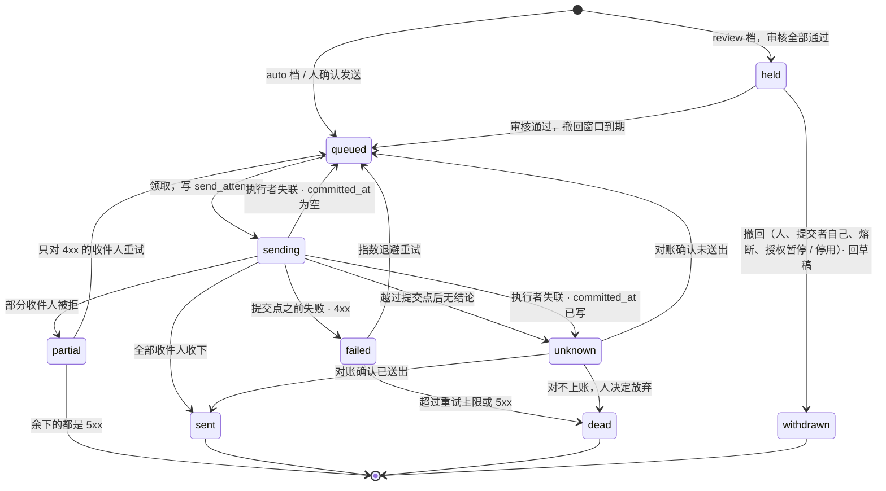

# 数据模型

> yuuka 设计文档的一部分。节号沿用整份设计的全局编号，索引见 [docs/design/README.md](README.md)。

## 4. 数据模型（Postgres）

一封信在模型里拆成**内容**和**投递**两层——因为同一封信可能同时落到
`a@example.com`、`b@另一个域` 和 Gmail（CC 或多地址投递），内容只该存一份。

已经建好的表，列、约束和索引以迁移为准：[`internal/store/migrations/`](../../internal/store/migrations/)。
这里只说每张表做什么、属于 §4.2 的哪一类：

| 表 | 类别（§4.2） | 做什么 | 迁移 |
|---|---|---|---|
| `raw_objects` | 投递事实 | 原件存储里的每个对象一行，带 `sha256` 和 `content_hash`（§4.1）；发件方重投的那份照样落盘，用 `duplicate_of` 指向第一份，不再生成 delivery。yuuka 为外发组装或规范化的字节（Sent 副本，`sent/` 前缀）也是这里的行，发没发出看 outbox（§4.6） | [0001](../../internal/store/migrations/0001_ingest.sql)、[0006](../../internal/store/migrations/0006_sent_copies.sql) |
| `accounts` | 配置与授权 | 账户（§9.2）。M2 只有 `cf_catchall` 一种，就是 `YUUKA_ACCOUNT` 命名的那个 | [0005](../../internal/store/migrations/0005_sending.sql) |
| `deliveries` | 投递事实；只有 `message_id`、`auth` 两列是派生 | 每次投递一行：账户、信封、`(zone, prefix)`、这一路自己的原件（Received / ARC / DKIM 每一路都不同）和认证结果。投递是 ingest 记下的事实，不是从 MIME 派生的：信封、远端定位、卸载状态都不在原件里。`(account_id, source_key)` 是幂等键（§10.1） | [0001](../../internal/store/migrations/0001_ingest.sql)、[0005](../../internal/store/migrations/0005_sending.sql) |
| `messages` | 派生（id 除外，id 跨 reparse 稳定） | 内容，按 `content_hash` 折叠；`list_id` 是 List-Id 的标识部分，供规则的 `list.id` 匹配（未经验证的头）；隔离状态 `parse_error` 也在这一层（§4.2）。To / Cc / Reply-To 只存折叠后的地址，供线程通信方（§8.9）匹配；阅读区要的显示名在取信时从原件现解析（`mimeparse.ParseRecipients`），不为显示再加一列。`extract_version` 记下哪一版提取器处理过它（§4.2） | [0002](../../internal/store/migrations/0002_content.sql)、[0007](../../internal/store/migrations/0007_message_recipients.sql)、[0008](../../internal/store/migrations/0008_extractions.sql)、[0010](../../internal/store/migrations/0010_message_list_id.sql) |
| `extractions` | 派生 | 提取器（[`internal/extract`](../../internal/extract/extract.go)）从一封信里找到的验证码、登录 / 验证链接、有效期（§3 原则 4）：通知区一眼看到码（§12.9），`review` 档的外泄检查拿它比对外发正文（§8.9）。值是发件人写的，只当数据；链接从不被打开或抓取。「码用过了」「收起」这类人的决定不放这里 | [0008](../../internal/store/migrations/0008_extractions.sql) |
| `threads` | 派生 | 消息图的连通分量（§4.1）。reparse 整体重建，旧 id 能沿用就沿用，但不像 message id 那样承诺稳定 | [0002](../../internal/store/migrations/0002_content.sql) |
| `message_state` | 决定 | 一封信的标注：标签、归档、改判（`class_override`），由人、agent 和规则写，来历在 `annotation_log`；已读等 `flags`；钉住（§9.6 卸载跳过）。本地标注层，远端永不覆盖（§9.2） | [0002](../../internal/store/migrations/0002_content.sql)、[0009](../../internal/store/migrations/0009_rules.sql) |
| `message_aliases` | 决定 | 折叠算法换版本后被合并掉的旧 id 指向存活的 id，`yuuka://` 锚点和外键引用因此不失效 | [0002](../../internal/store/migrations/0002_content.sql) |
| `prefixes` | 决定；`first_seen` / `last_seen` 是观测值 | `(zone, prefix)` 注册表：我把它给了谁（`expected_domains`，存组织域）、claimed / discovered 两态（§3.3、§4.3）。实际谁在发、有没有泄漏或仿冒不存，读时从投递现算（§3.3） | [0002](../../internal/store/migrations/0002_content.sql)、[0004](../../internal/store/migrations/0004_prefix_claim.sql) |
| `changes` | 日志 | 全局变更日志：§8.6 的 `since_state`、JMAP `queryChanges`、前端 SSE 共用。M1 建表就开始写 | [0002](../../internal/store/migrations/0002_content.sql) |
| `principals` `credentials` `passkeys` `enrollment_tokens` `recovery_codes` | 配置与授权 | 主体、凭据、WebUI 登录（§13.2、§13.3、§13.7） | [0003](../../internal/store/migrations/0003_identity.sql) |
| `identity_grants` `account_access` | 配置与授权 | 谁能以哪个身份发信、发到哪一步（§13.5）；谁能读哪个账户（§13.8）。M1 建表，M2 补外键 | [0003](../../internal/store/migrations/0003_identity.sql)、[0005](../../internal/store/migrations/0005_sending.sql) |
| `actions` | 决定 | 审计日志（§8.8） | [0003](../../internal/store/migrations/0003_identity.sql) |
| `rules` | 决定 | 规则（§8.5）：匹配树和动作存规范化的 JSON，`revision` 每次改动加一，软删除。每条规则有自己的 `rule:<id>` 主体 | [0009](../../internal/store/migrations/0009_rules.sql) |
| `proposals` | 决定 | agent 的提案和人的决定（§8.5）；`expired` 读时现算 | [0009](../../internal/store/migrations/0009_rules.sql) |
| `notes` | 决定 | 主体在一封信或一个线程上的笔记，每个作者每个目标一条、覆盖写；是作者的判读、不是事实，不驱动任何东西（§8.10） | [0012](../../internal/store/migrations/0012_notes.sql) |
| `annotation_log` | 决定 | 对 class / archived / 每个标签的每次改动：谁、什么等级、前后值。来源追溯、撤销和优先级都靠它（§8.5） | [0009](../../internal/store/migrations/0009_rules.sql) |
| `triage_scores` | 观测事实 | 决策模型对一封信的评分，一次评分一行，只追加（§15.2）。只显示、不驱动任何东西（§15.4） | [0013](../../internal/store/migrations/0013_triage.sql) |
| `identities` | 配置与授权 | 能用来发信的地址（精确地址或 `*@zone`）、所属账户、出口名、归属主体（§9.3、§8.9） | [0005](../../internal/store/migrations/0005_sending.sql) |
| `drafts` | 决定 | 写好了、没发出的信；提交超出授权时停在这里，`hold_reason` 说明原因（§8.9）。收件人的显示名和地址列并排存，只用于显示（§8.9） | [0005](../../internal/store/migrations/0005_sending.sql)、[0014](../../internal/store/migrations/0014_draft_recipient_names.sql) |
| `outbox` | 决定 | 决定要发的每封信，和它在 §4.5 状态机里的位置；`raw_id` 指向 Sent 副本 | [0005](../../internal/store/migrations/0005_sending.sql) |
| `send_attempts` `outbox_recipients` | 发送事实 | 每次发送尝试的执行归属、提交点和结果；逐收件人的结果、退信与投诉（§4.5） | [0005](../../internal/store/migrations/0005_sending.sql)、[0006](../../internal/store/migrations/0006_sent_copies.sql) |

`deliveries.auth` 的结构由 [`internal/authres`](../../internal/authres/authres.go) 的 `Auth` 定义，只来自可信接收方（§10.1.1）。
迁移里与本节设计不同的地方都以 `M0:` / `M1:` / `M2:` 注明，主要是这几类：

- 有几列已建、暂不写：`messages.spam_score`（§4.3 的降级现算）、`messages.body_html_key`、
  `deliveries.spf_recheck`（二次 SPF 判定还没接）、`prefixes.observed_domains` 和 `prefixes.leak_suspect`
  （泄漏检测按可见性现算，§3.3；存一份会绕过 §13.8。两列不删：删列要迁移，留着不读没有代价）
- M2 的 `outbox.state` 已经容纳 `held` 和 `withdrawn`、`outbox.review` / `hold_until` 已建；
  `review` 档（M3）只追加了 `drafts.review`、`outbox.withdrawn_by` 和描述 `held` / `withdrawn` 形状的约束
  （[0011](../../internal/store/migrations/0011_review.sql)）
- **出口（transport）不是表**。出口按名字定义在进程配置里（主机、端口、caps、凭据文件路径），
  `identities.transport` 只存名字。出口带着一份密钥和一个进程必须连得上的主机，这两样都是部署事实，
  和 R2、数据库的配置同类；放进表里只是配置的镜像，还可能和配置不一致。代价是改出口要改配置、重启，
  而不是一条 CLI；回头的条件是出现了需要在运行时增删出口的场景
- **没有 `zones` 表**。它的列（所属账户、是否 catch-all、是否已开通发信）在 M2 没有读者：
  identity 自带 zone 和账户，「这个域开没开通发信」是出口配置的属性。等有东西需要单独问一个域的时候再建
- `accounts` 只有 M2 读的列，kind 只有 `cf_catchall`：M2 的所有 identity 都属于这个 Cloudflare 账户。
  只发不收的账户（`smtp_only`）、IMAP 等拉取账户，连同 `sync_policy`、`writeback_policy`、`offload_policy`、`auth_ref`
  这些列，随 M3.5 一起加

**`YUUKA_ACCOUNT` 与 `accounts`**：0005 把 M0 / M1 的 `deliveries.account_key` 换成了 `account_id`，
每个出现过的 key（以及 `account_access` 里只出现过的 key）变成一个 `cf_catchall` 账户，`name` 就是原来的 key。
`YUUKA_ACCOUNT` 现在是这个账户的 `name`：ingest 第一次提交时按名字取它的行，没有就建
（[`store.EnsureCloudflareAccount`](../../internal/store/accounts.go)）——Cloudflare 账户由进程配置声明，
不另设命令。`yuuka identity add` 在库里恰好只有一个账户时默认用它，否则要显式指定。所以升级后照旧用同一个名字，重投去重接着认升级前的投递；改名字等于开一个新账户
（幂等键按账户算），而不是给旧账户改名。

**数据库角色**：部署时 yuuka 用两个非超级用户角色连库（建法见 [`deploy/postgres-roles.sh`](../../deploy/postgres-roles.sh)，
接线见 [`cmd/yuuka/db.go`](../../cmd/yuuka/db.go)）：owner 拥有库和 schema、只用来跑迁移；
app 只有表上的增删改查和序列的 `USAGE`（经 `ALTER DEFAULT PRIVILEGES`，以后迁移建的表自动覆盖），
没有任何 DDL。运行时的一切查询都以 app 身份执行，所以一条被请求影响的 SQL 最多改行，
改不了表结构、删不了表、也碰不到别的库。`pg_trgm` 是 trusted 扩展，库的 owner 就能装，不需要超级用户。

迁移是单独的一次性步骤 `yuuka migrate`，部署里只有它拿到 owner 的连接串，跑几秒就退出；
常驻的 `serve` 和其余命令只有 app 的连接串，启动时只读地核对 `schema_migrations` 的版本：
相等才启动，落后就拒绝并提示先跑 `yuuka migrate`，超前（被新版本迁移过）也拒绝。
这样拿到 `serve` 进程环境的人拿不到 owner。代价是部署多一个步骤（Compose 里是一个先于 `serve`
跑完的一次性服务，见 [`deploy/compose.yaml`](../../deploy/compose.yaml)），忘了它时 `serve` 起不来，而不是带着旧表结构跑。

要不要迁移只看配置，不探测角色权限：只给一个连接串的命令从不跑 DDL，哪怕这个角色其实能跑。
否则同一份配置的行为取决于连上的是谁，部署忘了迁移步骤时也可能「碰巧」能用。
放弃的是单角色开发库的自动迁移：拉到新迁移后要手动 `yuuka migrate` 一次（`devseed` 自己会迁移）。
保留的便利是：给命令同时设了 owner 连接串时，它启动时先以 owner 迁移，和以前一样，开发和测试可以这么跑；
部署模板不这样用。

两个小缺口：`schema_migrations` 是 owner 建的表，app 能改它的行，后果是版本核对不过、`serve` 拒绝启动，
不会丢数据；版本号只说明迁移记录到了哪一步，不核对表结构本身。
测试夹具按部署的形状给每个测试建 schema（[`storetest`](../../internal/store/storetest/storetest.go)），
所以整个测试集都在 app 角色下跑过一遍。

尚未实现的表和列（设计）：

```sql
-- accounts 上还没加的列：拉取账户（M3.5）和归档卸载（§9.6）用
accounts(auth_ref, sync_policy, writeback_policy, offload_policy, active)
  -- kind 增加 imap | gmail_api | smtp_only
  -- sync_policy: full(存原件) | metadata(只索引,正文按需) | notify(只通知)
  -- offload_policy: off | after(...)，归档卸载（§9.6），仅 sync_policy=full 可开

-- deliveries 上还没加的列：拉取与卸载的事实（§9.6、§10.1）
deliveries(
  delivered_to text[],
  remote_labels text[], remote_flags bitmask,
  remote_state smallint,             -- present | offloaded（远端已按 §9.6 删除，本地是唯一副本）
  offloaded_at timestamptz
)
  -- message_id 可空的另一个原因：notify 策略只留幂等桩，不建 message（§4.4、§10.1）

-- drafts 上还没加的列
drafts(attachments jsonb,            -- 要先有上传存储
       proposal_id)                  -- 提案（M3）

attachments(id ulid pk, message_id, filename, mime, size, sha256, content_id, disposition, blob_key)
notifications(id, message_id, channel, state, sent_at)
```

全文检索：Postgres 原生 FTS 对中文很弱。先用 `pg_trgm` 够个人用量，
中文体验不行再换 Postgres 里的做法（Go 侧切词写 `tsvector`、pg_bigm、PGroonga），这是可替换的一层，不影响模型。
M1 做的是子串匹配：一个 trigram GIN 表达式索引（迁移 0002 的 `messages_search`），
查询按空白切词、每个词都要命中（[`internal/store/search.go`](../../internal/store/search.go)）。
子串匹配不需要分词，中文天然可用；少于三个字符的词用不上 trigram 索引，退化为顺序扫描，
结果仍然正确，个人量级可以接受。`body_text` 有长度上限：它只服务检索和摘要，原件才是正文的来源。
查询怎么表示、条件有哪些、和 JMAP 怎么对齐，见 [§16](search.md)。

检索留在 Postgres 里，不用外置引擎（Meilisearch、bleve 一类）。外置索引要把可见性再算一遍：
命中、`total`、分面都只能在 Viewer 可见的信上算（§13.8），搬到引擎里就成了第二份 ACL；
标签、归档、`class_override`、降级这些随时会变的过滤条件也要一路同步过去，
同步出错，搜索就和列表对不上。它还是第二个有状态服务，`reparse` 得能重建它。

向量检索（pgvector 加 bge-m3 一类 embedding）暂不做。对中文语料的检索实测里，
向量的增益集中在「换说法」的查询上，专名、原话、错别字和字面检索持平甚至更差；
搜邮件多是字面查询（发件人、订单号、主题里的词），而 agent 搜不到会自己换词重试。代价却不小：
- 经第三方接口做向量，等于把全部正文（验证码、密码重置、账单）交出去；本地推理要一个 sidecar，
  或者引入 cgo，打破单个静态二进制
- catch-all 谁都能投，写一封语义上贴近「发票」「密码重置」的信挤进 agent 的搜索结果，
  比骗过字面匹配容易，放大了 §8.3 的不可信输入面
- 要求 Postgres 带 `vector` 扩展，共享实例上的部署者未必装得了

向量本身是内容派生的数据，能放进可 `reparse` 重建的表（每个向量记下生成它的模型），模型上没有障碍。
重新考虑的条件：有一份按真实查询写的邮件检索评测集证明增益；embedding 能在本地生成，或按账户显式开启；
只为已认领前缀里的非垃圾信生成。到那时它是和字面检索融合排序的一路，不替换字面检索。
在那之前更值得补的是字段限定（发件人、主题、有无附件）和按相关度排序。

### 4.1 折叠键：内容哈希，不是 Message-ID

catch-all 意味着**任何人都能往任意前缀投递**，所以 Message-ID 不能做折叠键：
攻击者投一封 Message-ID 与已有邮件相同的信，就会被折叠进旧 message，新内容在索引层消失
（raw 还在，但 UI 看不到）；另外大量垃圾信没有 Message-ID 或反复重用同一个。因此：

- 折叠键是 `content_hash`：对去掉传输头（每一跳、每次投递都会加或改写的字段，
  v1 的剔除列表见 [`internal/contenthash`](../../internal/contenthash/contenthash.go)）后的原件字节取 SHA-256。
  它只保证一个方向：**内容不同，哈希必然不同**，所以不会误合并。
  反方向只是「通常相同」：转发和邮件列表会改 Subject 或追加页脚，中继可能把 8bit 重编码成
  quoted-printable，这些都会让同一封信算出不同的哈希。**哈希不同就不合并**——
  代价是同一封信显示两次（它们仍按 Message-ID 进同一条线程），比误合并吞掉内容便宜得多。
  不改成对解码后内容取哈希：那会让折叠键依赖解析器版本，解析器一升级折叠结果就变
- **Message-ID 不进折叠键**。`Message-ID` 头不在剥离之列，`content_hash` 相同就意味着
  Message-ID 相同，再加一列是冗余；缺失时也不必合成一个。Message-ID 只用于线程
- **`content_hash` 是原件的字节属性**，和 `sha256` 并列存在 `raw_objects` 上，ingest 时算一次。
  算法只按 RFC 5322 的字段边界（含折行）切分头部、按字段名剔除，不解析 MIME，不依赖解析器版本。
  所以 M0 没有解析也能用它去重，reparse 也不会改变折叠结果。
  算法定为 v1，用 golden 测试锁住；将来要改剔除列表就是 v2，只对新入库的原件生效，旧行不重算——
  最坏的结果是同一封信显示两次
- **raw 的 sha256 不唯一**：原件存储里的每个对象都有自己的一行，哪怕另一次 Worker 调用存下了
  一模一样的字节。同一个对象被 webhook 和 reconcile 各处理一次，撞的是 `id`；
  是不是一次新的投递，由下面 `deliveries.source_key` 的唯一约束决定。
  若 sha256 唯一，两个收件人恰好拿到字节相同的原件时，第二个收件人的投递会被静默丢掉。
  sha256 也认不出发件方重投：Cloudflare 每次接收都加一行带新事务 id 和时间戳的
  `Received`，重投的原件 sha256 必然不同（§2.1.1 实测）。跨路径折叠同理也不能靠它
- **重投去重由唯一约束保证，不是先查后插**。push 来源（Cloudflare Worker 等）的
  `deliveries.source_key` 由 `content_hash` 和 `envelope_to` 拼成（`store.PushSourceKey`），同一账户内唯一（§10.1）。
  重投的第二份在插入 delivery 时撞键：原件照样落盘（不可变、可审计），
  `raw_objects.duplicate_of` 指向第一份，不生成新的 delivery——和第一份的写入在同一个事务里，
  webhook 与 reconcile 并发处理同一封信的两份也不会各建一条。
  多收件人事务里一路失败就会让其余各路重投（§2.1.1），所以这是常规路径。
  代价是同一封信被有意投递两次到同一地址时也会被合并，可以接受。
  pull 来源不这样做：远端的两份是两个对象（比如同一封信在两个文件夹里），
  各自要有自己的定位才能回写和卸载，所以各是一条 delivery，只在 `messages` 层折叠
- §1 沿用的 `subject + sender` 兜底线程匹配**只对 `class=human` 启用**：
  机器邮件里同一发件人的所有「Your verification code」会被它归成一条巨型线程。
  M1 只在新信是 human、自己没有 `In-Reply-To` / `References` 时才找，而且限一个时间窗口，
  具体规则见 [`internal/store/threads.go`](../../internal/store/threads.go)。
  「sender」目前只是发件人本人。发出的信已经进了 `messages`（§4.6），但兜底规则还没放宽成
  「线程的通信对方」：§10.4.1 拿不到平台 id 时断开的第一封，要等这条放宽才接得上
- 线程是消息图的连通分量：In-Reply-To / References 指到对方的某个 id、或者两封有相同 id
  （内容没折叠的同一封信）就连一条边，加上面的兜底边。一封信的 id 是它的 `Message-ID`；
  我们发出的信还有每次尝试记下的 `send_attempts.message_id` 和 `provider_id`（§10.4.1）——
  平台自定 Message-ID 时 Sent 副本里没有这个头，回信只能对上平台给的 id。
  `provider_id` 只是「极可能就是」投递出去的 Message-ID，没验证过，也一样算：
  认错的代价是两条无关的线程被连起来，而它的形状是我们自己域下的 msg-id，别人的信不会碰巧引用它。
  这些是发送事实，所以读它们不破坏 reparse 的确定性。
  ingest 逐封并入（一封信连通两条线程时合并成较早的那条），reparse 整体重算，两者规则相同
  （[`threads.go`](../../internal/store/threads.go)），所以内容不变时 reparse 不移动任何线程。
  一个缺口：平台 id 在尝试结束时才写进库，在那之前（毫秒级）到达的回信会落进新线程，下一次 reparse 才并回去

### 4.2 重建边界：reparse 重建什么、不碰什么

§3 原则 1 说的「可重建」只覆盖从邮件内容派生的东西。边界按表划清；
唯一的混合表是 `deliveries`，它的派生列只有 `message_id` 和 `auth` 两列，reparse 只写这两列
（拆成单独一张表会让最常用的「信 → 投递」查询多一次 join，不值得）：

| | 表 | reparse |
|---|---|---|
| **派生** | `messages`（除 id 外的列）、`threads`、`attachments`、`extractions`、`deliveries.message_id`、`deliveries.auth` | 从 `deliveries.raw_id → raw_objects`、`outbox.raw_id → raw_objects`（Sent 副本，§4.6）、`send_attempts` 记下的 id（线程）和账户配置重算 |
| **投递事实** | `raw_objects`（含 `content_hash`、`duplicate_of`）；`deliveries` 的其余列（`source_key`、信封、远端定位、`remote_state`、`offloaded_at`、`spf_recheck`） | 不碰。它们来自 ingest 当时的 `InboundRef` 和当时的外部状态 |
| **发送事实** | `send_attempts`、`outbox_recipients`：远端当时怎么回答、什么时候；Sent 副本本身是 `raw_objects` 里的投递事实 | 不碰 |
| **观测事实** | `triage_scores`：某个评分器在某个时刻对一封信的回答（§15.2）。和 `spf_recheck` 同理不是派生：换个模型、过一阵重评，答案就变；也不是谁的决定 | 不碰；只追加，重评写新行 |
| **决定** | `message_state`、`message_aliases`、`prefixes`（label / note / expected_domains / state）、`rules`、`proposals`、`annotation_log`、`actions`、`drafts`、`notes`、`outbox`、`notifications` | 不碰；也不重跑规则，规则的效果是到达时做的决定（§8.5） |
| **配置与授权** | `principals` / `credentials` / `identity_grants` / `account_access`（§13）、`accounts` / `identities` | 不碰 |

派生以外的各类都**无法从原件重建**，备份要按正经数据库来（§7）。CF 来源的投递事实能从 R2 对象的
metadata 恢复（§2.1），但外部账户的远端定位和卸载状态只在库里，同样要靠备份。

判断一列是派生还是事实，标准是**同样的输入、任何时候重算都得到同样的结果**。
只读原件和本地配置的计算是派生；查了外部状态的不是——二次 SPF 查的是当时的 DNS，
过半年重算回答的是另一个问题，所以 `spf_recheck` 是事实。`content_hash` 虽然可以从原件重算，
但它是 ingest 当时做重投去重决定的依据，算法版本冻结在行上，和 `sha256` 一样归入事实。

`reparse` 的几条规则：

- **message id 跨 reparse 稳定**。重算按现有 id 原地更新。折叠键不随解析器变化（§4.1），
  所以 reparse 本身不会合并或拆分 message；只有换算法版本后显式对旧原件重算 `content_hash` 才会，
  那时保留较早的 id，被合并的写进 `message_aliases`。
  否则 `message_state`、`proposals.cites`、`actions` 和人手里的 `yuuka://` 链接全部失效
- 段落锚点 `#part/2/para/7` 依赖解析器的分段方式，可能随 `parser_version` 漂移。
  所以 `cites` 同时存锚点和一小段原文摘录，锚点对不上时按摘录重新定位
- 生效的分类是 `coalesce(message_state.class_override, messages.class)`：
  人的改判永远压过重算结果，规则重跑也不会把它改回去
- `yuuka reparse [--since T]` 先补跑没有 message 的投递（M0 入库的、或解析步骤失败的）和 Sent 副本，
  再按 id 原地重写 `received_at ≥ T` 的消息和它们每条投递的 `auth`，最后全库重建线程——
  改了 Message-ID 或 References 的信可能挪到任何一条线程里，只重建局部会留下错的连通分量。
  它不写 `message_state`、`message_aliases`、前缀的认领与标注；`prefixes` 只会补上缺的行、放宽观测区间。
  隔离状态（`parse_error`）是派生的：换了更好的解析器，reparse 会把它清掉。
  所以它放在 `messages` 上，而不是 `raw_objects.ingest_state`——`raw_objects` 是 reparse 不碰的事实
- **给派生表加列，迁移里填不了**：值要解析原件才有。0007 加 `to_addrs` / `cc_addrs` / `reply_to_addrs` 时，
  旧行留 NULL 表示「还没读过」，补跑（`ProcessBacklog`，`serve` 启动时和每个对账周期都跑）按原件逐条重建这些信，
  运维只需 `yuuka migrate`，不必手动 reparse。没填上之前读者把 NULL 当作「没有」，结果偏向保守（§8.9）。
  代价在升级后的第一个周期：补跑在 `serve` 的对账循环里同步执行，逐条读原件、重建，每条信写一行 `changes`
  （SSE 和增量同步的消费方会收到一波 `message` 事件）；信多时这一轮要跑很久，跑完之前下一次对账不会开始
  （webhook 的实时收信不走这个循环，不受影响）。
  个人信箱的量级可以接受；要是哪天不行，给这一遍限速或者让它不写 `changes`
  另一种做法是每次升 `mimeparse.Version` 都自动重建 `parser_version` 落后的行；那等于把 reparse 变成升级的默认动作，
  而 reparse 要全库重建线程，没有这么做。下一次再给 `messages` 加派生列，照 0007 的写法：可空、部分索引找空行、补跑填（0010 的 `list_id` 就是这样加的）
- **提取值换版本自动重算，解析器不**：`extractions`（0008）的写法和 0007 一样由补跑填，
  但标记是 `messages.extract_version`（旧行为 0），补跑找的是「低于当前 `extract.Version`」而不只是「没填过」。
  所以升级提取器的版本号，下一个对账周期就把全库的信重新提取一遍，不必 reparse。
  和上一条不同的理由：提取器是启发式的，要按误判样本反复调；它只写 `extractions` 和这一列，
  不碰别的内容列、不动线程，代价只是逐封读一次原件、解析一次。提取结果没变的信不写 `changes`，
  所以一次只调置信度的升级不会让订阅方收到整库的事件。
  `extract_version` 放在 `messages` 上而不是每条提取值上：什么都没提取到的信没有行可以记版本。
  提取值的读者是它所属的那封信：列表和详情里随信一起出现，可见性就是那封信的可见性（§13.8），
  受限主体看不到一封信时也看不到它的码
- **分类读提取值**（`classify.Of` 调提取器，§3 原则 4），所以这一遍补跑也重算 `messages.class`
  和它所在线程存的 `threads.class`：`extract_version` 同时标记「这封信的分类按哪一版提取器算过」，
  M2 存下的信升级后在第一个周期里重新分类，不必 reparse，reparse 也会算出同样的结果。
  只重算分类、不重建线程是安全的：提取器只在不是回信的信里起作用，只会让信在 unknown 和 machine
  之间移动，而按主题和发件人并线程只对 human 的信生效（§4.1）。人的改判（`class_override`）照旧压过它

### 4.3 垃圾判定要有来源

一个 catch-all 域每天会收到成百上千随机前缀的字典攻击。没有垃圾判定，
§3.5「未知前缀照收并自动登记」会让 `prefixes` 被淹没、TG 每封都响、泄漏检测的基线全是噪声。
Cloudflare Email Routing 基本不做内容过滤，`spam_score` 字段必须有人填：

- M1 最低实现：`dmarc=fail`、或 `prefixes.state=discovered`（§3.3）→ 直接降级，
  不推送、不进聚合视图、不参与泄漏基线，只静默入库。
  降级按投递判断，一封信只要有一条投递不降级（前缀已认领、可信接收方没报 `dmarc=fail`）就不降级。
  它**不存储**，查询时由 `deliveries.auth` 和 `prefixes.state` 现算：认领一个前缀立刻生效，
  不必 reparse；`spam_score` 因此在 M1 恒为空。未验证（取不到可信认证头）不算 `dmarc=fail`，不降级。
  推送只在 ingest 当场判断：这条投递不降级、且同一封信没有更早的不降级投递时推一次；
  解析步骤失败、或由补跑（backlog）处理的投递一律不推——前者判断不了降级，后者已经不是新信
- 认领与取消认领（`yuuka prefix claim` / `unclaim`，§11；M3 起 WebUI 经同一个 store 函数，§13.10）只改 `prefixes.state`，
  记一条 `actions`、一条 `changes`（kind `prefix`），并和 ingest 的内容步骤持同一把锁，
  所以一次投递看到的要么是认领前、要么是认领后的状态。地址的大小写按 ingest 的规则折叠。
  因为降级现算，已有的信立刻不再降级；推送只对认领之后到达的信生效，不补推旧信——
  补推会让一次认领在 TG 上炸出一串历史邮件。
  地址往往在给出去时就认领，那时还没收到过信：这样的前缀照样建行，`first_seen` / `last_seen` 为空，
  第一封信到达时由 ingest 填上（`least` / `greatest` 跳过 NULL），而不是把认领时刻冒充成观测值。
  对还没收到过信的前缀取消认领会删掉这一行：一个从未被投递、也没人认领的前缀不描述任何事实
  （连同写过的 `expected_domains`；已收过信的前缀取消认领时期望保留，再认领即恢复）
- `yuuka prefix expect` 只改 `expected_domains`，记账方式同上；只接受已认领的前缀，
  未认领的不参与泄漏检测（§3.3），给它写期望只会是一条看不到效果的决定。降级和泄漏判定各管各的：
  `dmarc=fail` 冒充期望发件方的信判为仿冒，同时照旧降级；冒充别人的只降级、不判定（理由见 §3.3）
- Cloudflare 入站会加 `X-CF-SpamH-Score: <n>`（§10.1.1 实测）。刻度没有文档，
  先原样记进 `deliveries.auth`、作为一个信号，积累样本后再决定阈值
- 内容层面的判定（垃圾、钓鱼）交给决策模型，判定是 ingest 之后的观测事实（§15）。
  原先计划的旁路 rspamd 不再是下一步，理由见 §15.7

### 4.4 只有头部的信

`sync_policy=metadata` 的账户只落头部（§9.2、§10.1）。这带来三个存储层的问题：

**建消息**：`raw_objects.completeness = header_only`，照常建 `messages` 行，
但 `content_hash` 为空、`body_text` 为空、`has_attach` 按 `Content-Type` 推断。
`content_hash` 为空的行**不参与跨账户折叠**：只凭头部无法证明两份是同一内容，
而 §4.1 的方向是宁可重复、不可误合并。它们仍按 Message-ID / References 进同一条线程，
UI 上就是线程里并列的两条，其中一条标「正文未同步」。

**按需取正文**：`FetchBody` 的结果是流，只存在于这一次响应里：

- 不写 RawStore、不写 `messages.body_text`、不进全文索引
- HTTP 响应带 `Cache-Control: no-store`；前端不写入 IndexedDB（§12.4）
- `actions` 记下「谁、在什么时候、取了哪条投递的正文」，`result` 只记大小和 sha256，**不记内容**
- agent 取正文要有该账户的 `account_access`，并按 §9.4 计为一次外部请求

**补全**：账户从 `metadata` 改成 `full` 时，后台任务按投递重新拉取完整原件，
写一份新的 `raw_objects`（`completeness=full`），把 `deliveries.raw_id` 指过去，
再对这条投递跑 reparse——新原件 ingest 时算出了 `content_hash`，这条投递可以正常折叠。
旧的 header_only 原件保留（原件不可变），只是不再被引用。

`notify` 策略的账户不走这里：它不建 `messages`，只有 `deliveries` 的幂等桩和 `notifications`。

### 4.5 outbox 状态机

`outbox.state` 的全部转换（规则见 §3 原则 6，`held` 的来历见 §8.9）。
退信和投诉不改变这里的状态，它们落在 `outbox_recipients` 上，逐个收件人记录：



`withdrawn` 是离开 outbox、回到草稿的那条路的终点。它要有一个状态而不是删掉这一行：
`review` 的结论、谁提交的、Sent 副本都还挂在这一行上，删了就回答不了「这封为什么没发出去」。

outbox 行只有一个来处：[`store.WithDecision`](../../internal/store/policytx.go) 交出的 `PolicyTx`，
它带着在授权锁下做出的 `sendpolicy.Decide` 决定，只有 `Queue` 才能落成行：`queued`，或审核通过时的 `held`（§8.9）。
**审核升级不经过 outbox**：被升级的信直接停在草稿（`hold_reason = review`，结论在 `drafts.review`），
不建行、不占限额，也不会有一份没人收到的 Sent 副本挂进线程。所以 `withdrawn` 只来自 `held`。

outbox 这一侧只有地址：`outbox_recipients` 是信封收件人，按 `addr_fold` 去重、计数、记结果。
收件人的显示名是作者写的，To / Cc 的名字在 Sent 副本的头里，Bcc 的名字留在行所来自的草稿上
（`drafts.*_names`，[0014](../../internal/store/migrations/0014_draft_recipient_names.sql)）。
所以加名字不用改 outbox，状态机和崩溃恢复也碰不到名字。

`held → queued` 只有一条语句（[`store.PromoteHeld`](../../internal/store/held.go)），由执行器在领取前调用；
`held → withdrawn` 是撤回（`store.WithdrawOutbox`）或放行时发现授权已暂停。两边都先拿内容锁再拿行，必然串行。
0011 的约束要求 `held` 行带审核结论和草稿、没有 `approved_by`，`withdrawn` 行带 `withdrawn_by` 和草稿；
`hold_until` 和 `review` 写一次，没有语句会改它们（`TestOneWayToTheOutbox`）。

表上能写成约束的不变量都写成了约束（[0005](../../internal/store/migrations/0005_sending.sql)），
不靠执行器的代码自觉：`next_retry_at` 只在等待发送的状态（`queued`、`failed`、还有收件人要重试的 `partial`）
上非空，领取时必须清掉；同一封信同时最多一条未结束的 `send_attempts`（部分唯一索引），
两个执行者即使领取逻辑写错也不会同时发同一封；`accepted` / `partial` / `unknown` 的尝试必须有 `committed_at`，
`abandoned` 的必须没有——崩溃恢复依赖的正是这一点。

#### 提交点、执行归属与崩溃恢复

「只在确定对方没收下时重试」要靠落库的证据，而不是靠进程还活着。`sending` 本身不是证据：
进程可能在对方回 `250` 之后、写下结果之前退出，库里只剩 `sending`。
直接重排会让对方收到两封，不处理又会永远卡住。所以每次发送都先在 `send_attempts` 里记一笔：

1. **领取**：`queued → sending` 和插入一条 `send_attempts`（`owner`、`lease_until`）在同一个事务里。
   执行期间定期续租
2. **提交点**：transport 在越过不可回头点之前回调 `commit`（§10.2），
   调用方在回调里写 `committed_at` 并**提交事务**，回调返回后 transport 才继续。
   不可回头点由出口定义：SMTP 是发出正文结束符 `<CRLF>.<CRLF>`（在此之前断开，服务器会丢弃这封）；
   API 出口是发出请求。回调失败（比如库连不上）时 transport 放弃、什么都不发出
3. **结果**：写 `finished_at`、`outcome` 和逐收件人结果，同时推进 `outbox.state`

恢复任务在启动时和之后定期运行，处理租约已过期、`finished_at` 仍为空的尝试：

- `committed_at` 为空：可以证明对方没收到正文。尝试记为 `abandoned`，收件人保持 `pending`，
  outbox 回 `queued` 按正常退避重试
- `committed_at` 已写：**不能证明没送出，一律进 `unknown`**，这次尝试的收件人也记为 `unknown`。
  不自动重排，和运行中 `Send()` 返回 `Unknown` 走同一条对账路径

这条规则只依赖「写 `committed_at` 先于越过提交点」这一个顺序，所以它也覆盖执行者没死、
只是卡住超过租约的情况。卡住的执行者之后带着结论回来时，结果只写进它自己那条尝试（按尝试 id 定位），
作为对账证据把 `unknown` 推到 `sent` / `partial` / `failed`；它不能再领取别的尝试。
误判的方向只有一个：在 `commit` 之后、真正发出之前崩溃，会把一封没发出的信记成 `unknown`——
多问人一次，不会多发一封。

`unknown` 的对账按出口能力取证：有 `provider_id` 且 `StatusQuery=true` 就查状态；
有 VERP 的出口等 DSN（§10.4.2）；能自定 Message-ID 的出口可以按自己的 id 在出口日志里找。
崩溃造成的 `unknown` 往往连 `provider_id` 都没拿到，这时交给人：UI 标「可能已发出」，
人选择「确认已送出」「接受可能重复，重发」或「放弃」，选择记入 `actions`。

#### 执行器（已实现）

入队和执行器在 [`internal/outbox`](../../internal/outbox/)，状态转换的 SQL 在
[`internal/store/outbox.go`](../../internal/store/outbox.go)，随 `yuuka serve` 运行。
上面的步骤原样落地，下面只记实现时定下的规则和取舍：

- **提交点的守卫在库里**：写 `committed_at` 的那条 `UPDATE` 要求尝试仍未结束、属于这个执行者、
  租约未过期，恢复要求租约已过期，两者对同一行加锁，至多一个成功。所以卡住的执行者回来后
  连提交点都过不去，更发不出去。比较时间一律用数据库的 `now()`，多台机器上的执行者对「谁的租约过期了」看法一致。
  租约默认 2 分钟、每 40 秒续一次，恢复每分钟跑一次
- **晚到的结论**：被恢复记成 `unknown` 的尝试，执行者带着结论回来时写进这条尝试；
  只有当 outbox 仍是 `unknown`、且这就是它最近的一次尝试时，才同时改收件人、推进状态。
  人已经 resolve 过、或已开始新尝试时，只留在尝试行上作证据。被记成 `abandoned` 的尝试没有越过提交点，
  它的结论没有新信息，直接忽略
- **`abandoned` 不只来自崩溃**：凡是在提交点之前因为和这封信无关的原因结束的尝试都记 `abandoned`——
  执行者失联、进程停止、出口不可用（见下条）、提交点没能落库、Sent 副本读不出或 sha256 对不上。
  它们**不计入重试上限**，收件人保持原状，outbox 回 `queued`。
  代价是一封真正有毒的信（比如每次都让进程崩溃）会无限重排而不是变 `dead`；Go 的执行器不会因为一封信崩溃，
  这种情况出现时再给 `abandoned` 计数
- **重试上限与退避**：`failed` 和 `partial` 的尝试才计数，第 n 次之后等 `5m·3^(n-1)`、封顶 6 小时
  （5m、15m、45m、2h15m，之后每 6 小时），第 10 次之后放弃：没人收下就是 `dead`，有人收下就停在 `partial`，
  `next_retry_at` 清空，没送到的收件人保持 `deferred`。从第一次到放弃大约一天半。
  出口是会自己重试投递的 submission 服务器，它回的 4xx 是它自己的麻烦（限速、队列满），
  不是远端信箱的；一天半能等过一晚上的故障，人第二天就能看到 `dead`，而不是一周后。
  `partial` 之后只给仍是 `pending` / `deferred` 的收件人发，已收下的不再发
- **出口失败暂停整个出口，不烧信**：连不上（拒绝、超时、证书校验失败）、问候 / `EHLO` / `AUTH`
  被拒（`535` 凭据失效、`454`、没有 `AUTH PLAIN`）都发生在 `MAIL` 之前，服务器还没听到这封信的任何事，
  由 [`transport.ExitFailure`](../../internal/transport/transport.go) 判断。按回复码 `535` 会把每个收件人记成 rejected，
  照常处理就会把队列里的信逐封判死；所以执行器把这次尝试记 `abandoned`，**暂停这个出口**：
  暂停期间不领取它的任何信，信都留在 `queued`，暂停 1 分钟起、连续失败时翻倍、封顶 30 分钟，
  出口一旦走到 `MAIL` 就复位，日志里每次暂停都报错。暂停状态只在进程内存里，重启即清零，最坏是多试一次。
  代价是凭据坏掉时信不会失败、只会等着，靠日志和 `yuuka outbox ls` 里的错误被人发现；
  这比一次换密钥就把整个队列判死好
- **出口不在配置里**：identity 指名的出口在进程配置里找不到，是配置错误而不是这封信的结论。
  到期的行不被领取、不建尝试、不计数，每 10 分钟顺延一次，`outbox.error` 写明原因，日志报错。
  入队时就找不到出口则直接拒绝入队（剥哪些头取决于出口的 caps，字节没法准备）
- **停机**：`serve` 收到停止信号后不再领取。还没到提交点的尝试立即取消，`commit` 回调拒绝，
  记 `abandoned` 并立刻到期，下一个进程马上重发；已过提交点的等最终回复（最长一次发送的超时），
  所以正常停机本身不会制造 `unknown`。容器的停止宽限期要够等一次最终回复
- **人工 resolve**：`yuuka outbox resolve <id> --sent | --resend | --abandon`，只对 `unknown`：
  `--sent` 把 `unknown` 的收件人记为收下、按收件人推进（还有 `deferred` 的照常重试）；
  `--resend` 把它们改回 `pending`、立刻排队；`--abandon` 记 `dead`。动作记进 `actions`，
  `yuuka outbox ls` 列出状态、收件人、尝试次数和最后的错误
- **每次状态变化都写一条 `changes`**（kind `outbox`，目标是 outbox id）。写 `changes` 的事务和内容层一样
  先拿同一把咨询锁，`changes.seq` 因此仍按提交顺序；`commit` 和续租不改状态，不拿锁也不写 `changes`

### 4.6 发出的信：Sent 副本、消息与可见性

发出的信和收到的信走同一条内容管线：我们交给出口的字节（Sent 副本，§10.2）
在建 outbox 行之前写进原件存储的 `sent/YYYY/MM/<id>.eml`（R2 和本地副本各一份，
`ErrExists` 时读回比对；实现见 [`outbox.Enqueue`](../../internal/outbox/outbox.go) 和 `StoreSent`），同样写一次永不改，
在 `raw_objects` 里有自己的一行，`outbox.raw_id` 指向它；然后像收信一样解析进 `messages`，
所以自己的回复出现在线程、搜索里，`reparse` 也能重建它。字节在建 outbox 行时组装（submission 口收进来的是规范化）一次，
之后每次尝试都提交这同一份：审核（M3）看到的就是发出去的。

**`sent/` 的含义是「yuuka 为外发组装或规范化的每一份字节」，不是「已经发出的字节」。**
停在草稿的 SMTP 提交（`drafts.raw_id`，确认后原样发出，outbox 行直接指向这份原件；
按新决定规范化后字节变了才另存一份，见 §13.6）、最终撤回、作废或从未发出的信都在这里。
发没发出、发给了谁，看 outbox 的状态和 `outbox_recipients`，不看前缀，也不看原件在不在。
另一种做法是只在真正发出之后才写 `sent/`，但字节必须在越过提交点之前就落下（§4.5），
那时还不知道结局；为了让前缀「名副其实」再分出一个前缀或事后搬对象，换来的只是一条不可靠的信号。
写了原件、建 outbox 行（或草稿行）的事务却失败时，原件成了没有行指向的孤儿：
调用方收到的是错误，什么都没发出，它不是丢信。对账（§2.1）只扫 `raw/`，不会把它当成漏掉的投递。

**每一份 outbox 原件都解析进 `messages`**，不论状态：`queued`、`dead`、`withdrawn` 的也是，
UI 在消息旁边显示 outbox 的状态（「排队中」「发送失败」「已撤回」）。按状态决定建不建 message，
会让 `reparse` 的结果取决于 `outbox.state` 这个会变的决定，状态每变一次派生数据就得跟着改；
现在 `reparse` 只读 `outbox.raw_id` 这一个写一次不变的事实。停在草稿、还没有 outbox 行的原件不建 message：
它还只是草稿，草稿在草稿视图里看。

**消息和 outbox 之间不存 id，靠折叠键连接**：一封信的 Sent 副本对应的 message，
就是 `content_hash` 等于这份原件 `content_hash` 的那一条（§4.1）。
另一种做法是在 `outbox` 上加一列 `message_id`，但那是派生值，放进一张 `reparse` 不碰的决定表，
就成了「只能由 ingest 写、`reparse` 修不了」的东西；折叠键是原件上的事实，`reparse` 不会改变折叠结果，
这条连接因此和折叠一样稳定，不需要任何派生状态。反过来，从 message 找它是不是我们发的，
要从 `raw_objects.content_hash` 找回原件，列表的每一行都要找一次，所以
[0006](../../internal/store/migrations/0006_sent_copies.sql) 给它加了索引。
这要求写 Sent 副本的一方照收信的规矩填 `raw_objects`：`content_hash` 必须有（`contenthash.V1`），
没有就既找不到 message、也建不了：`FoldSent` 拒绝它，补跑每一轮都把它报出来。

**收件人地址原样保存，按折叠后的地址去重**：`outbox_recipients.addr` 是写进 `RCPT TO` 的原文——
RFC 5321 规定本地部分区分大小写，yuuka 不替发件人改写；`addr_fold` 是它的小写形式
（[`store.FoldAddr`](../../internal/store/outbox.go)，和 ingest 折叠前缀是同一种小写），一封信内按它去重、首次联系和新收件人限额按它查。
`A@example.net` 和 `a@example.net` 实际几乎总是同一个信箱，所以同一封信只发一份，用先给出的那种写法。
`addr_fold` 由写入方算，不用 `lower()` 生成列：`lower()` 对非 ASCII 的结果取决于数据库的 locale，
恢复到另一种 locale 的库里会变。

Sent 副本**不是投递**：`deliveries` 记的是「一封信到了某个账户的某个地址」，
它的列（信封收件人、`(zone, prefix)`、认证结果）和读它的地方（前缀注册表、降级判断、推送）都是按收信设计的；
把发出的信塞进去，每个读者都要多一个方向判断。拉取账户的「已发送」文件夹（M3.5）里那份才是投递，
和我们自己的 Sent 副本按 `content_hash` 折叠成同一条 message——前提是出口没有加上或改写会进内容哈希的头（比如 `Message-ID`）；
否则同一封信显示两次，这是 §4.1 选定的方向。

**可见性**（§13.8）：一封 message 对某个主体可见，当且仅当
它有一条可见的投递，**或者**它是某条 outbox 的 Sent 副本、而这条 outbox 的 identity 所属账户对该主体可读。
发出的信没有投递，账户只能从 identity 来；identity 必须属于一个账户（`identities.account_id` 非空）就是为了这条。
规则只在 [`read.go`](../../internal/store/read.go) 的 `visibleMessage` 一处算。M2 不按 `account_access` 过滤（随 M3.5），
所有主体都看得见全部；但测试已经打开过滤、用受限主体跑每条读路径（§13.8）。
两件事随 M3.5 一起定、现在不定（§13.8）：草稿和 outbox 的变更事件按什么规则对谁可见；
agent 没有某账户的 `account_access` 时，能不能看到它自己经该账户的身份发出的信。

**建 message 的入口**是 [`ingest.IndexSent`](../../internal/ingest/content.go)：outbox 的入队方在建 outbox 行的事务提交之后调用它，
解析 Sent 副本、按 `content_hash` 折叠、放进线程，和收信同一把锁、同一套写法，只是没有投递、前缀和认证结果——
字节是我们自己的，认证头只会是我们写的，不取。这一步失败或进程在提交和调用之间退出，信不会丢：
`ProcessBacklog`（启动时和 `reparse` 都会跑）把有 outbox 行、却还没有 message 的 Sent 副本补上。

「每封信至少有一条投递」是 M1 的隐含假设，M2 拆掉了它，几处规则因此定下来：

- **canonical 原件和 `received_at`** 在投递和 Sent 副本里取最早的一份；Sent 副本的时间是
  `raw_objects.received_at`，即写下字节、建 outbox 行之前的提交时刻。只有 Sent 副本的信，列表按提交时刻排序。
  同一时刻投递优先：收到的那份带着认证结果，渲染时和它对得上
- **不降级**：§4.3 的降级判断的是一封信怎么到达的，Sent 副本不是到达。有一份可见的 Sent 副本就不降级，
  哪怕同一内容也投递到了一个未认领的前缀（比如抄送给自己的 catch-all）
- **读模型**：列表、线程、搜索的每一行带 `Outgoing`（outbox id、状态和发信地址 `from_addr`，取可见的最新一条 outbox 行），
  状态现读、不存，所以发送进度不需要任何派生数据跟着改。详情的 `Raw` 是渲染用的原件：
  有可见投递时是最早那条的，否则是 Sent 副本；读者不能再假设 `Deliveries` 非空。
  Sent 副本没有认证结论，agent 视图把它标成自己发的信而不是「未验证」（§8.1）
- **前缀视图不算发出的信**：它统计的是投递，Sent 副本不进任何前缀
- **分类**照常按内容算（[`classify`](../../internal/classify/classify.go)），没有专门的「我发的」类别：
  自己写的第一封通常是 unknown，回信是 human，服务经 submission 口发的告警可能是 machine

---

---

### 9.1 内容 / 投递两层模型（§4 已改）

同一封信同时落到 `x@example.com` 和 Gmail（CC、多地址、转发链）是常态。所以：

- `messages` 存**内容**，按 `content_hash` 跨账户折叠成一条（§4.1）
- `deliveries` 存**每次投递**：哪个账户、哪个域、哪个前缀、IMAP UID、
  那边的 folder/label、那边的已读状态，以及**这一路自己的原件和认证结果**
  （`raw_id` / `auth`——两条投递的 Received、ARC、DKIM 验签各不相同，不能只留一份）

好处：
- 收件箱里一封信就是一封信，不是三条重复
- 但"它是通过哪个前缀/账户来的"完整保留 → 前缀泄漏检测（§3.3）照样成立
- 幂等键是 `(account_id, source_key)`（§10.1），重复拉取、重投都不产生重复投递

跨账户线程归并：按 `Message-ID / In-Reply-To / References` 构图，
**线程不属于任何账户**。一条线程里前半在 Gmail、后半在自有域的情况能正确拼起来。
